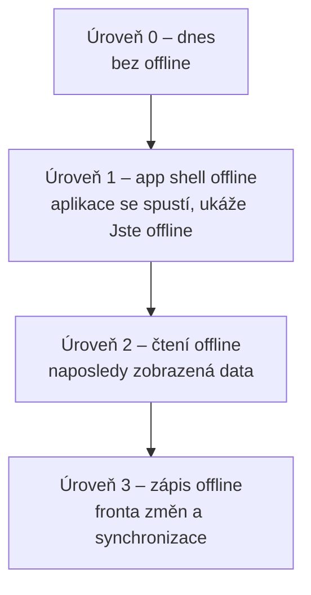

# PWA – jak později přidat offline režim

Návod pro vývojáře, který bude offline režim implementovat. Popisuje výchozí stav, otázky, které je nutné zodpovědět **před** implementací, doporučený postup a známé pasti.

## Výchozí stav

Po změně `fix-pwa-service-worker-updates` (viz `openspec/changes/fix-pwa-service-worker-updates/design.md`) platí:

- Service worker `frontend/src/sw.ts` (strategie `injectManifest`) **nemá precache ani fetch handler**. Všechny požadavky jdou do sítě a čerstvost řídí jen HTTP cache.
- `index.html` a `silent-renew.html` se posílají s `Cache-Control: no-cache`, hashované `/assets/**` jako `immutable` na 1 rok, `sw.js` a manifest jako `no-cache`.
- SW volá `skipWaiting()` + `clients.claim()`. To je bezpečné jen proto, že nic necachuje.
- Spring profil `pwa` už neexistuje. Manifest a `sw.js` se servírují vždy.
- Dev režim (`devOptions.enabled: true`) servíruje SW na Vite dev serveru (`localhost:3000`) z `/dev-sw.js?dev-sw`.
- Případný SW pro web push (`add-web-push-notifications`) obsahuje handlery `push` a `notificationclick`.

Offline režim tento model zásadně mění: jakmile SW začne servírovat aplikaci z cache, **řídí aktualizace SW, ne HTTP hlavičky**.



Každá úroveň výrazně zvyšuje složitost. Doporučení: nejít dál, než vyžadují konkrétní use-casy.

## Otázky k zodpovězení před implementací

### Byznys a rozsah

1. **Jaké konkrétní situace má offline režim řešit?** Například na závodě v lese bez signálu: startovka, seznam přihlášených, kontakty na trenéry či rodiče? Bez konkrétních scénářů nelze zvolit úroveň.
2. **Stačí úroveň 1** (aplikace se spustí a srozumitelně oznámí, že je offline), nebo je potřeba číst data (úroveň 2)?
3. **Které obrazovky a data musí být offline dostupné?** Vyjmenovat je (např. detail akce, přihlášky na akci, mé přihlášky). Vše ostatní zůstane online-only.
4. **Jak stará data jsou přijatelná?** Musí UI ukazovat „data k <čas>“?
5. **Je potřeba offline zápis** (úroveň 3)? Pokud ano, které akce, a jak řešit konflikty (např. uzávěrka přihlášek mezitím proběhla, kapacita se naplnila)?
6. **Jak má vypadat aktualizace na novou verzi?** Automaticky („o jedno spuštění pozadu“), nebo s výzvou „Je k dispozici nová verze“?

### Bezpečnost, GDPR, přihlášení

7. **Smí se osobní údaje ukládat na zařízení?** Týká se to kontaktů, rodných čísel, zůstatků účtů a dat nezletilých. Cache Storage ani IndexedDB nejsou šifrované. Co sdílená zařízení (klubový notebook)?
8. **Co se má smazat při odhlášení a při přepnutí uživatele?** Doporučení: všechna data, která patří uživateli.
9. **Jak se řeší přihlášení offline?** Tokeny `oidc-client-ts` jsou v `sessionStorage` (`klabisUserManager.ts`). Po zavření nainstalované PWA zmizí, takže **offline spuštění znamená nepřihlášeného uživatele**. Možnosti:
   - jen veřejný shell bez dat,
   - perzistovat tokeny (bezpečnostní kompromis, nutné posouzení),
   - offline data dostupná bez platného tokenu (data už jsou na zařízení, ale kdo je smí vidět?).
10. **HAL+FORMS affordance:** šablony a odkazy v uložených odpovědích odráží oprávnění v době stažení. Mají se offline akce skrývat (doporučeno), nebo zobrazovat neaktivní?

### Technické

11. **Cílové platformy:**
    - iOS Safari smaže úložiště PWA, která se 7 dní nespustí, a nepodporuje Background Sync.
    - Firefox nepodporuje Background Sync.
    - Platí to pro všechny uživatele?
12. **Objem dat a kvóty úložiště:** kolik akcí a členů se má držet offline?
13. **Code splitting:** zavádí se lazy-loaded chunky? To mění riziko při aktualizaci (viz Pasti).
14. **Kde mají offline data žít?** V SW runtime cache, nebo v perzistované cache TanStack Query (IndexedDB)? Viz krok 5.

Odpovědi patří do OpenSpec proposalu. Offline chování je uživatelsky pozorovatelné, takže jde o **spec-driven** změnu (nová capability, např. `offline-mode`, plus NFR pro ukládání dat na zařízení).

## Doporučený postup

### 1. Nejdřív aktualizace, pak cache

Než SW začne cokoli cachovat, musí existovat spolehlivý update flow. Jinak se zopakují problémy, které vedly ke změně `fix-pwa-service-worker-updates`.

- **Odstranit** bezpodmínečné `skipWaiting()` z `install`. Nový SW má čekat (`waiting`).
- Ve frontendu sledovat `registration.waiting` / `updatefound` a podle odpovědi na otázku 6 buď zobrazit výzvu, nebo nový SW aktivovat automaticky v bezpečném okamžiku (např. při navigaci). Postup:
  1. pošlat `postMessage({type: 'SKIP_WAITING'})`,
  2. v SW na zprávu zavolat `self.skipWaiting()`,
  3. po události `controllerchange` provést `location.reload()`.
- Kontrolovat aktualizace i u dlouho otevřené aplikace: `registration.update()` v intervalu (např. 15 min) a při `visibilitychange` → `visible` a `online`.
- Sladit s existujícím `staleBundleReload.ts`. Při precache je `index.html` z cache, takže porovnávat build se sítí nemá smysl a nahradí ho update flow SW.

Pozor: s `vite-plugin-pwa` **nepoužívat** `injectRegister: false` v kombinaci s `registerType: 'autoUpdate'`. Plugin pak `skipWaiting` / `clientsClaim` nenastaví (přesně tohle se stalo v commitu `74d736e1`).

### 2. Úroveň 1 – precache app shellu

V `src/sw.ts`:

```ts
import {precacheAndRoute, cleanupOutdatedCaches, createHandlerBoundToURL} from 'workbox-precaching';
import {NavigationRoute, registerRoute} from 'workbox-routing';

cleanupOutdatedCaches();
precacheAndRoute(self.__WB_MANIFEST);
registerRoute(new NavigationRoute(createHandlerBoundToURL('/index.html'), {
    denylist: [/^\/api\//, /^\/oauth2\//, /^\/login/, /^\/logout/, /^\/\.well-known\//,
               /^\/silent-renew\.html$/, /^\/swagger-ui/, /^\/v3\/api-docs/, /^\/docs\//,
               /^\/actuator\//, /^\/h2-console\//, /^\/error/, /^\/ical\//],
}));
```

- Ve `vite.config.ts` odstranit `injectManifest.injectionPoint: undefined` a nastavit `globPatterns` (js, css, html, ikony, fonty).
- **Dev režim:** v dev režimu plugin precachuje jen `index.html` (`devOptions.navigateFallback`). `NavigationRoute` proto v DEV potřebuje `allowlist: [/^\/$/]`, jinak SW zachytí navigace a rozbije HMR. Alternativou je `devOptions.enabled: false` po dobu vývoje offline režimu.
- **Denylist musí odpovídat `SpaFallbackFilter.EXCLUDED_PREFIXES` / `EXCLUDED_EXACT`** na backendu. Doporučení: test, který oba seznamy porovná, nebo jejich generování z jednoho zdroje. Jinak SW servíruje SPA tam, kde má odpovědět backend (Swagger, iCal feed, manuál).
- `/auth/callback` je SPA routa. Shell z cache je v pořádku, ale výměna kódu za token vyžaduje síť.
- Přidat UI stav „Jste offline“: `navigator.onLine` + události `online` / `offline` a chybové stavy dotazů. Mutace (HAL šablony) offline zakázat.

### 3. Backend při precache

- HTTP hlavičky nechat beze změny. `index.html` je dál `no-cache`, aby uživatelé bez SW a samotná instalace SW stahovali aktuální verzi. Precache stahuje podle revize v manifestu.
- **Staré hashované assety po deployi:** CI dnes `assets/` maže (`.github/workflows/backend_publish.yml`). S precache to vadí jen při lazy chuncích: stará otevřená stránka si dotáhne chunk, který na serveru už není. Pokud se zavede code splitting, ponechávat assety předchozího releasu (např. 2 releasy zpět), nebo chybu načtení chunku ošetřit reloadem.

### 4. Úroveň 2 – čtení dat offline

Doporučený přístup je **perzistovat cache TanStack Query** (`@tanstack/query-persist-client` + IndexedDB, např. `idb-keyval`), ne cachovat `/api` v SW. Důvody:

- data lze klíčovat a mazat per uživatel (odhlášení, přepnutí uživatele),
- přesně se volí, které query se perzistují (`dehydrateOptions.shouldDehydrateQuery`), takže citlivé endpointy zůstanou mimo,
- UI zná stáří dat (`dataUpdatedAt`) a může zobrazit „data k …“,
- SW zůstává jednoduchý.

Pokud se přesto zvolí SW runtime caching `/api`:

- strategie `NetworkFirst` s `networkTimeoutSeconds`, nikdy `CacheFirst`,
- cache musí být oddělená per uživatel. Odpověď závisí na `Authorization` (field security, affordance), takže sdílený klíč URL by ukázal data jiného uživatele,
- při odhlášení poslat SW zprávu ke smazání cache,
- explicitní allowlist endpointů a `ExpirationPlugin` (stáří i počet).

### 5. Úroveň 3 – zápis offline (jen pokud je opravdu nutný)

- Outbox v IndexedDB. Odeslání při `online` / spuštění aplikace. Background Sync jen jako bonus (chybí v Safari a Firefoxu).
- Backend musí podporovat **idempotentní** požadavky (idempotency key) a vracet srozumitelné konflikty: uzávěrka, kapacita, optimistic locking.
- UI musí ukazovat čekající a neodeslané změny a umožnit je zahodit.
- Vyžaduje samostatný návrh a ADR v `docs/design-decisions.md`.

### 6. Testování

- **Unit:** handlery SW s mockovaným `ServiceWorkerGlobalScope`, logika update flow ve frontendu.
- **E2E (Playwright):** `context.setOffline(true)`, spuštění aplikace offline, offline banner, zakázané akce.
- **Ruční, Chrome DevTools → Application:**
  - **Migrace z předchozí verze:** nainstalovat SW bez precache (stav po `fix-pwa-service-worker-updates`), nasadit verzi s precache, ověřit aktivaci a obsah cache.
  - **Aktualizace:** nasadit dvě po sobě jdoucí verze a ověřit, že se nová projeví podle zvolené strategie (výzva / automaticky) bez zavírání oken.
  - **Odhlášení:** ověřit, že po odhlášení na zařízení nezůstala data uživatele (Cache Storage, IndexedDB).
  - Reálné zařízení Android a iOS (nainstalovaná PWA), včetně spuštění po několika dnech.
- Lighthouse PWA audit.

### 7. Rollback

- Nouzový kill-switch: build s `vite-plugin-pwa` `selfDestroying: true` vygeneruje `sw.js`, který se odregistruje a smaže cache. Nikdy k tomu nepoužívat 404 na `/sw.js`.
- Návrat na verzi bez precache funguje automaticky: nový `sw.js` při aktivaci smaže `workbox-precache-*` cache a jednorázově obnoví okna (logika z `fix-pwa-service-worker-updates`, D3). Při úpravách SW ji nemazat, dokud může existovat klient se starou verzí.

## Známé pasti (poučení z historie)

| Past | Důsledek | Jak se vyhnout |
|---|---|---|
| `registerType: 'autoUpdate'` + `injectRegister: false` | plugin nenastaví `skipWaiting` / `clientsClaim`, nový SW věčně čeká | vlastní registrace a explicitní update flow |
| SW nikdo neregistruje (smazaný `useRegisterSW`) | noví uživatelé SW nemají, staří nemají kontrolu aktualizací | registrace na jednom místě (`registerServiceWorker.ts`) s testem |
| `/sw.js` vrací 404 | prohlížeč registraci **ponechá** a starý SW dál servíruje starou verzi | kill-switch SW (`selfDestroying: true`), nikdy 404 |
| precache v dev režimu bez `allowlist` | SW zachytává navigace na `localhost:3000`, rozbije HMR | `NavigationRoute` `allowlist: [/^\/$/]` v DEV |
| Reload stránky | **neaktivuje** čekající SW, ten se aktivuje až po zavření všech oken | `SKIP_WAITING` + `controllerchange` → reload |
| `index.html` s `max-age` | starý shell odkazuje na smazané assety, výsledkem je bílá stránka | `no-cache` na HTML |
| `skipWaiting` + precache + lazy chunky | stará stránka a nový SW, chybějící chunky | čekající SW + řízený reload, ponechat staré assety |
| Sdílená API cache napříč uživateli | únik dat jiného uživatele | cache per uživatel, mazání při odhlášení |
