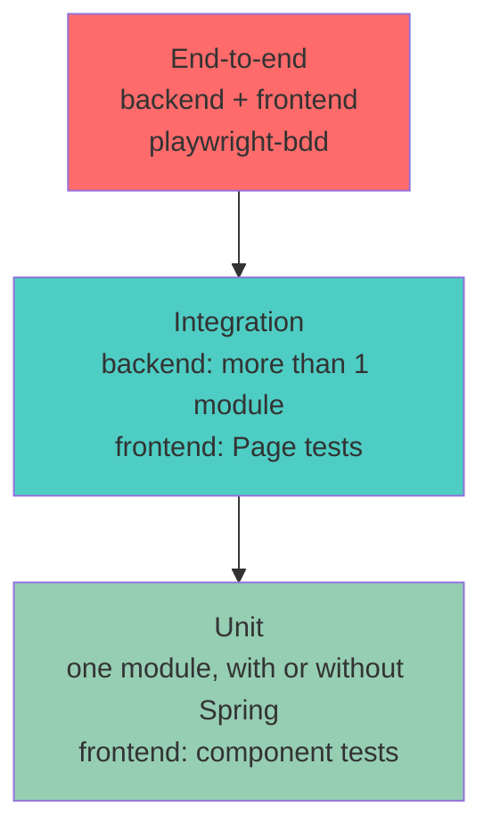
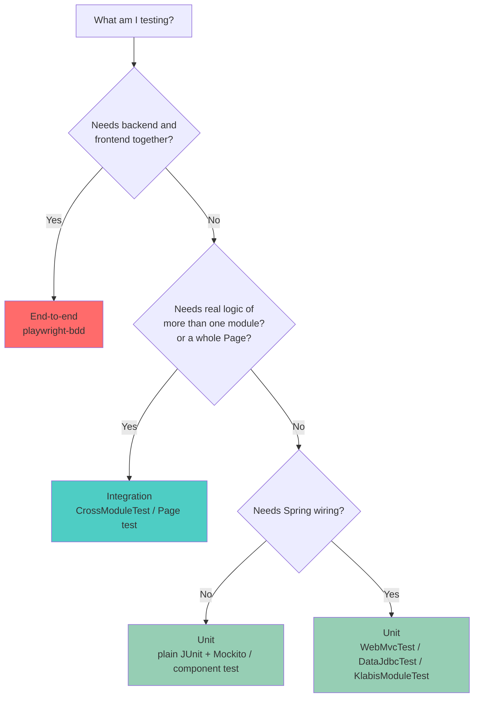

# Testing Pyramid

How Klabis tests are split into levels so that each behaviour is tested **once, at the lowest level that can verify it**. Concrete backend patterns (annotations, slices, mocks) live in the `backend-patterns` skill (`references/testing-guide.md`), frontend conventions in `frontend/CLAUDE.md`, E2E rules in `frontend/e2e/README.md`.

## Levels

| Level | Scope | Backend | Frontend |
|-------|-------|---------|----------|
| Unit | Confined to one module | domain/service tests (no Spring), `@DataJdbcTest`, converter tests, `@<Module>WebMvcTest`, single-module `@KlabisModuleTest` | component, hook and util tests |
| Integration | Backend: real application/domain logic of more than one module. Frontend: Page tests | `@CrossModuleTest`, `@KlabisModuleTest` with business modules in `extraIncludes` / `ALL_DEPENDENCIES` | Page tests (`src/pages/**`) |
| End-to-end | Backend and frontend together | — | playwright-bdd scenarios (`frontend/e2e`) |

A Spring Boot test is still a unit test when it loads a single module. A module counts as covered only when its application/domain logic runs for real — a module loaded just for its web beans with mocked primary ports (`extraIncludes` in `@<Module>WebMvcTest`) does not count.

## Rules

### Most tests are unit tests

Business rules, invariants, validation, edge cases, error branches, security (401/403), response shape, HAL links/affordances, rendering states and form behaviour are verified at unit level.

### Mock only boundaries

A unit test may mock only:

- **layer boundaries** inside the module — secondary ports (repositories, `@Port`) in application tests, primary ports in REST adapter tests; the mocked implementation (e.g. the repository adapter) gets its own unit test,
- **module boundaries** — other modules' primary ports,
- **app boundaries** — external systems (ORIS, e-mail); on the frontend the data/API layer and auth.

Never mock other classes of the module under test (domain objects, domain services, mappers, converters, child components, helpers) — use the real ones.

### Higher levels don't repeat lower levels

- **Integration** verifies only the cooperation between modules (an event is delivered and handled, a call crosses the module boundary, a page wires its components and navigation) — happy path only.
- **End-to-end** verifies only that a user journey works through UI and API — no validation messages, authorization matrix or field-by-field checks.

Before writing a higher-level test, name what it verifies that no lower-level test can. If there is nothing, don't write it.

## Decision Tree

Whenever a branch leads to a higher level, check the rule above — the behaviour may already be covered lower.

## Example: Event Registration

| Level | What it verifies |
|-------|------------------|
| Unit — domain | Registration deadline, duplicate registration, category rules |
| Unit — service | Repository and member lookup (other module's primary port) mocked; correct aggregate method called and saved |
| Unit — `@EventsWebMvcTest` | Request mapping, 401/403, response shape, `register`/`unregister` affordances |
| Unit — `@DataJdbcTest` | Registration persisted and loaded, memento round-trip |
| Integration — `@CrossModuleTest` | Registering a member resolves member data from `members` through the real `Members` port |
| Unit — frontend component | Registration form fields, validation, disabled states |
| Integration — frontend Page | Event detail page shows the registration button and opens the form |
| End-to-end | A member registers for an event and sees the registration in the list |

## Maintainability Practices

- **Test data builders** — build domain objects via `<Aggregate>TestDataBuilder`; never construct them inline or mock them.
- **Custom assertions** — `<Aggregate>Assert extends AbstractAssert` for domain objects.
- **Parameterized tests** — `@ParameterizedTest` instead of copy-pasted variations.
- **Naming** — `should<ExpectedBehavior>When<Condition>`, group with `@Nested` + `@DisplayName`.
- **Independence** — no shared mutable state between tests; clean committed data (`@CleanupTestData`).
- **Given / When / Then** — keep the three phases visible.
- **Minimal setup** — each test sets up only what it needs; avoid giant `@BeforeEach`.
- **Async events** — make async handlers synchronous (`SyncTaskExecutor`) or use the Modulith `Scenario` API; never assume immediate processing.
- **One concern per test** — a failing test should point to one behaviour.

## Further Reading

- `backend-patterns` skill → `references/testing-guide.md` — backend test patterns
- `frontend/CLAUDE.md` → Testing — frontend test levels
- `frontend/e2e/README.md` — E2E commands, rules and step vocabulary
- `gherkin-bdd` skill — writing E2E scenarios
