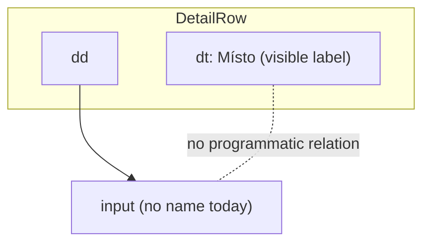
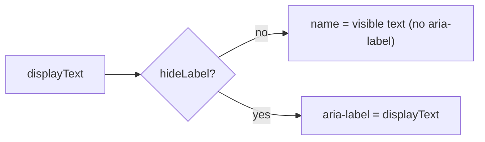

# Design

## Context

See proposal.md (Why) for motivation and `specs/non-functional-requirements/spec.md` for the requirements.

HAL-FORMS field components have two render modes:

- `field` — the component renders its own `<label for>` through `FieldWrapper`; the control is correctly named.
- `input` — the component renders the bare control; the caller places it in a `DetailRow` (`<dt>` label + `<dd>` control) or another layout. Every field component then passes `label={undefined}` and the control has **no accessible name**.

`input` mode is used by inline editing (`EventDetailPage` via `helpers.renderInput`, `HalFormsForm` custom layouts), composite fields in `KlabisFieldsFactory` (each sub-field wrapped in its own `DetailRow`), `HalFormsCollectionField` rows, and `LegalGuardianInputField` (no `DetailRow` at all).

Current state per component (verified 2026-10-19):

| Component | Primitive | `input` mode name today |
|---|---|---|
| HalFormsInput | TextField (forwards rest props) | none |
| HalFormsTextArea | TextField multiline (forwards rest props) | none |
| HalFormsDateTime | TextField | none (`field` mode label also uses raw `prop.name`, not `getFieldLabel`) |
| HalFormsSelect | SelectField (forwards rest props) | none (`field` mode uses raw `prop.name`) |
| HalFormsMemberId | TextField search (named "Hledat…") + SelectField | select has none |
| HalFormsCheckbox | CheckboxField single (forwards rest props) | none |
| HalFormsRadio | RadioGroup (no rest props; group uses `aria-labelledby` only when `label` set) | group has none (`field` mode uses raw `prop.name`) |
| HalFormsCheckboxGroup | CheckboxField group mode (same as RadioGroup) | group has none |
| HalFormsMultiSelect | own `<input>` | **already correct** — `aria-label` from `prop.prompt \|\| getFieldLabel(prop.name)` |

`HalFormTemplateButton` always sets `aria-label="Select <text> form"`, which overrides the visible Czech text for every HAL-FORMS action button. Icon-only buttons (`hideLabel`) are used through `HalFormButton`.

## Goals / Non-Goals

**Goals:**
- Every control rendered in `input` mode has an accessible name equal to the visible label in the normal case.
- Radio/checkbox groups in `input` mode have a group name.
- Action buttons are named by their visible text; icon-only buttons by the same Czech text.
- Remove the E2E workarounds that exist only because of these defects.

**Non-Goals:**
- A full WCAG audit (contrast, focus order, other English `aria-label`s such as "Close modal" / "Close alert" in `Modal` and `Alert`). These can be follow-ups.
- Changing the visual layout of `DetailRow`.
- Automated accessibility scanning (axe) in CI.

## Decisions

### D1: Name `input`-mode controls with `aria-label` from the field label (recommended) — not `aria-labelledby` via `DetailRow`

Each field component in `input` mode sets `aria-label` to the same text it would render as a visible label in `field` mode: `prop.prompt || getFieldLabel(prop.name)`. A small shared helper (e.g. `fieldLabel(prop)` next to the field components) is used by all components so `field` and `input` mode can never diverge; this also fixes the three components that currently fall back to the raw `prop.name` instead of the localized label.

**Alternatives considered:**

| Option | Pros | Cons |
|---|---|---|
| **A. `aria-label` from prompt / `getFieldLabel` (chosen)** | Copies the existing in-repo pattern (HalFormsMultiSelect); self-contained per component and unit-testable in isolation; works for controls rendered without a `DetailRow` (LegalGuardianInputField, collection rows); labels come from `src/localization` as frontend/CLAUDE.md requires | The name is a second copy of the label text; if a caller puts a different text in the `DetailRow` than the field's prompt, the names diverge (WCAG 2.5.3 risk) |
| B. `DetailRow` generates an id (`useId`) for its `<dt>` and exposes it via React context; field components set `aria-labelledby` | Name is the visible text by construction — cannot diverge | Requires a new context and plumbing in 13 `DetailRow` consumers' rendering paths; does not help controls outside `DetailRow`, so option A is needed as a fallback anyway; `DetailRow` is also used for read-only values where the context is unused |

Option B is strictly A + more machinery, and the divergence risk of A is small: all current `DetailRow` callers already use the same source for both texts (`EventDetailPage` uses `labels.fields.<name>`, which is what `getFieldLabel(<name>)` returns; `KlabisFieldsFactory` passes the same literal as `DetailRow` label and sub-field `prompt`). The risk is covered by page-level tests (see Risks). This keeps the change KISS per the project design principles.

### D2: Group components receive an explicit group name

`RadioGroup` and the group mode of `CheckboxField` currently only name the group via `aria-labelledby` pointing at their own rendered label. They get an optional `aria-label`-style prop (e.g. `ariaLabel`) applied to the `role="group"` container when no visible label is rendered. `HalFormsRadio` and `HalFormsCheckboxGroup` pass the field label in `input` mode. The individual options keep their own names.

### D3: Action button name = visible text; `aria-label` only when icon-only

`HalFormTemplateButton` sets `aria-label={hideLabel ? displayText : undefined}`. With a visible label the button's text content is its accessible name (WCAG 2.5.3 satisfied by construction). `displayText` is already Czech (`label` → `getTemplateLabel` → `template.title` → `templateName`). The `title` tooltip stays.

### D4: Tests assert by accessible name

TDD per component: the failing test is written with `getByLabelText('<label>')` / `getByRole('textbox' | 'combobox' | 'checkbox' | 'group' | 'button', {name: '<label>'})`, which is how assistive technology and the E2E suite locate controls. `HalFormButton.test.tsx` ("should have proper aria-label") is rewritten to assert `getByRole('button', {name: 'Create Member'})` and that no `aria-label` is present; a new case covers `hideLabel`.

### D5: E2E workarounds removed last

`frontend/e2e/steps/form.steps.ts` keeps its `<dt>`/`<dd>` XPath fallback in `field()` and the `Select <label> form` alternative in `I click` until both app fixes are in. The final task removes them and runs the E2E suite against a running instance; any failure there points at a control the unit tests missed.

## Risks / Trade-offs

- [A caller shows a `DetailRow` label different from the field's prompt → name diverges from visible text] → Page-level tests for the main inline-edit page (`EventDetailPage`) and `KlabisFieldsFactory` composites query by the visible `DetailRow` label; the E2E suite (which, after D5, only finds fields by label) catches the rest. Document in `field` component docs that callers wrapping an `input`-mode field must pass the same label.
- [Existing unit tests rely on the English "Select … form" name] → Only `HalFormButton.test.tsx:237` does (grep verified); other tests use `data-testid`, which is unchanged.
- [Controls get a name in `field` mode twice (label + aria-label)] → `aria-label` is set only in `input` mode, exactly like HalFormsMultiSelect.
- [`HalFormsMemberId` contains two controls (search box + select)] → The search box keeps its "Hledat…" name; only the select gets the field label, so `getByLabelText('<label>')` stays unambiguous.

## Migration Plan

Frontend-only, no data or API migration. Ships with the next frontend build; rollback is a revert of the commits.

## Glossary

| Term | Meaning |
|---|---|
| Accessible name | The text assistive technology announces for a control (button, field, group); computed from label, text content or explicit naming attributes |
| `input` render mode | HAL-FORMS field rendering without its own visible label, used when the surrounding layout (e.g. a detail row) shows the label |
| Icon-only button | Action button that displays only an icon (`hideLabel`), its text is available as tooltip and accessible name |
