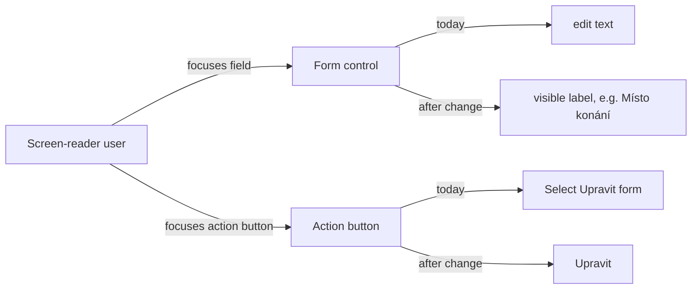

# Proposal

## Why

Users relying on assistive technology (screen readers, voice control) cannot reliably operate Klabis forms. Inline-edit form fields (e.g. on the event detail page) are announced only as "edit text" because the visible label is not associated with the control, and HAL-FORMS action buttons are announced with an English phrase ("Select … form") instead of the visible Czech text. Both defects were found during the E2E test review, where the test steps had to work around them; they violate WCAG 2.1 success criteria 1.3.1 (Info and Relationships), 2.5.3 (Label in Name) and 4.1.2 (Name, Role, Value).

## What Changes

- Every HAL-FORMS form control rendered without its own visible label (inline "input" render mode next to a detail-row label) gets an accessible name equal to the field's visible label.
- Radio and checkbox groups rendered in the same mode get a group name equal to the visible label.
- HAL-FORMS action buttons are announced by their visible (Czech) text; only icon-only buttons carry a separate descriptive name (the same Czech text).
- Unit tests asserting the old English "Select … form" name are updated.
- E2E step definitions drop the workarounds (`<dt>`/`<dd>` XPath fallback for fields, "Select <label> form" pattern for buttons) once the app is fixed.
- The project gains its first accessibility requirement in the non-functional requirements spec.

## Capabilities

### New Capabilities

_None._

### Modified Capabilities

- `non-functional-requirements`: adds a requirement that form controls and action buttons expose accessible names matching their visible (Czech) labels.

## Impact

- **Frontend only** — no backend or API change.
- `frontend/src/components/HalNavigator2/halforms/fields/` — HalFormsInput, HalFormsSelect, HalFormsTextArea, HalFormsDateTime, HalFormsCheckbox, HalFormsRadio, HalFormsMemberId, HalFormsCheckboxGroup (HalFormsMultiSelect already does it).
- `frontend/src/components/UI/forms/` — RadioGroup and CheckboxField group mode need a way to receive a group name when no visible label is rendered.
- `frontend/src/components/HalNavigator2/HalFormTemplateButton.tsx` and `HalFormButton.test.tsx`.
- `frontend/e2e/steps/form.steps.ts` — removal of workarounds.
- Test queries by data-testid are unaffected; queries by accessible name become possible (`getByLabelText`, `getByRole(..., {name})`).
