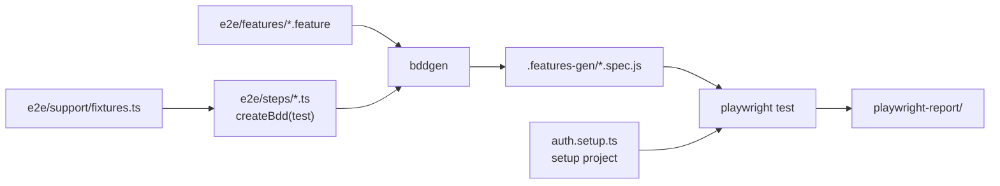
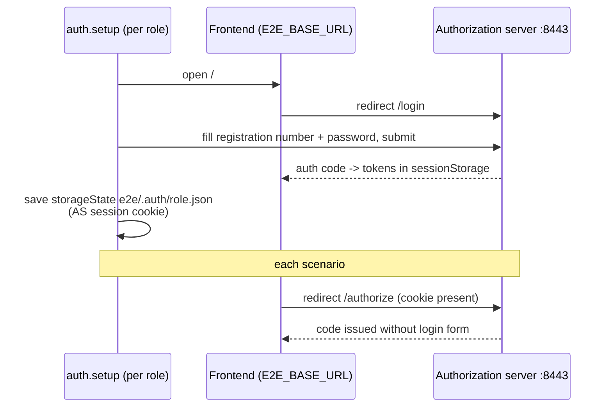

## Context

The frontend has only Vitest unit tests (`src/**/*.{test,spec}.{ts,tsx}`, jsdom, mocked API). Checks against a running instance are done by hand through Playwright MCP. A running instance is available in two shapes:

- **A: local**. `runLocalEnvironment.sh` starts the Vite dev server on `http://localhost:3000` (proxying `/api` and `/.well-known` to the backend) and the backend on `https://localhost:8443`. It uses profiles `h2,ssl,debug,metrics,local-dev,example-data`. The frontend uses the confidential `klabis-web-local` OIDC client.
- **B: CI**. The `ghcr.io/zabiny/klabis-be:<tag>` image is published by `backend_publish.yml` and already contains the built frontend. It serves on `https://localhost:8443` with the public `klabis-web` client. Default OAuth2 redirect URIs already cover `localhost:3000` and `localhost:8443`.

Both instances use in-memory H2, so data resets on restart. Seeded users `ZBM9000` (admin) and `ZBM9500` (member), both with password `password`, exist only with the `example-data` profile. The frontend keeps the OIDC user, including the access token, in `sessionStorage` under the key `oidc.user:<authority>:<clientId>`.

## Goals / Non-Goals

**Goals:**
- Provide an opt-in E2E suite that runs against any running instance selected by `E2E_BASE_URL`.
- Write scenarios in English Gherkin that trace back to OpenSpec scenarios.
- Keep tests independent of each other and of manual data edits.
- Provide a manually triggered CI workflow that tests the exact published image.
- Deliver a PoC: infrastructure, both role logins, one read-only scenario and two mutating event scenarios.

**Non-Goals:**
- Running E2E on PRs, on push or automatically after deploy.
- Testing deployed Coolify instances (production or staging), which have no seeded users and hold real data.
- Mobile viewport projects, cross-browser runs and visual regression. The PoC runs on Chromium desktop only.
- Generating `.feature` files automatically from `spec.md`, or a spec-coverage report. A coverage report can follow later.
- Cleaning up test data. Both targets reset on restart.

## Decisions

### D1: Playwright Test + `playwright-bdd`

`playwright-bdd` compiles `.feature` files and step definitions into ordinary Playwright test files (`bddgen`). Those then run through the Playwright Test runner.

- **Alternative: `@cucumber/cucumber` with Playwright as a library.** Rejected. It loses Playwright fixtures, setup projects, trace viewer, retries and the HTML report, which would all have to be rebuilt.
- **Alternative: plain Playwright `test()` files.** Rejected because the user wants Gherkin, whose syntax mirrors the OpenSpec scenarios.

### D2: Opt-in by isolation, not by flags

- Tests live in `frontend/e2e/`, outside Vitest's `src/**` include, so `npm test` never sees them.
- `npm run test:e2e` runs `bddgen && playwright test`. npm `pre*` hooks bind to the exact script name, so the `pretest`/`openapi` hook does not run. E2E code must not import the generated OpenAPI types.
- `frontend-tests.yml`, `publish-frontend-resources` and `backend_publish.yml` stay unchanged.

### D3: Configurable target

`playwright.config.ts` reads `E2E_BASE_URL`, defaulting to `http://localhost:3000`. It sets `use.baseURL` and `ignoreHTTPSErrors: true`, because the committed keystore is self-signed. All navigation and API calls are relative, so the same suite works on A (Vite proxy) and B (same-origin backend).

### D4: Authentication through a setup project and AS session reuse

- A setup project runs once per role (`admin` = `ZBM9000`, `member` = `ZBM9500`) and stores `storageState` in `e2e/.auth/<role>.json` (gitignored). Login credentials come from env (`E2E_ADMIN_USER`, `E2E_ADMIN_PASSWORD`, `E2E_MEMBER_USER`, `E2E_MEMBER_PASSWORD`) and default to the seeded values.
- `storageState` keeps cookies but not `sessionStorage`. Each test re-enters through the authorization server, whose session cookie logs it in silently. Cookies are scoped by host, not port, so the `localhost` cookie works for both targets.
- A `loginAs(role)` step (`Given I am logged in as "admin"`) selects the role's state through a fixture. Tests wait for the main navigation before continuing.
- **Fallback** if silent re-entry proves unreliable: the setup project also serialises the `oidc.user:*` entry, and a fixture restores it via `page.addInitScript` before the app loads.

### D5: `Given` data setup through the REST API

- An `api` fixture reads the access token from the page's `sessionStorage`. It scans for the `oidc.user:` prefix, because the client id differs between A and B.
- The fixture calls `/api/...` relative to `E2E_BASE_URL` with `Authorization: Bearer` and `Accept: application/prs.hal-forms+json`.
- `Given` steps create their data through the API. `When` and `Then` steps act only through the UI, which is the subject under test.
- **Alternative: `Given` through the UI.** Rejected as the default because it is slower and makes setup fail for reasons unrelated to the scenario. It remains acceptable where no API exists.

### D6: Data independence through a run prefix

- Only seeded users are assumed. Every other entity a scenario needs is created with a name prefixed `E2E-<runId>-`. The `runId` is generated once per run, plus the worker index.
- Read-only scenarios may rely on stable seed facts (roles, menu entries) but never on seeded events or groups.
- No cleanup. Prefixed data makes leftovers on a long-running local instance recognisable and harmless.

### D7: Traceability to OpenSpec

- One `.feature` per capability area, tagged `@spec:<capability>` (for example `@spec:events`). Each `Scenario:` title is the spec scenario title verbatim, so a spec scenario is found by grep.
- Gherkin tags cannot contain spaces, so the scenario title, not a tag, carries the link.
- Claude writes the feature files from spec scenarios and keeps reusable steps such as `I open the main menu`, `I fill "<label>" with "<value>"` and `I see "<text>"`. A developer reviews them. Spec prose that is not concretely testable (time travel, "e.g. an icon or badge") is narrowed to concrete assertions in the feature, or the scenario is skipped.

### D8: Manual CI workflow on the published image

New `.github/workflows/e2e-tests.yml`:

- Triggered only by `workflow_dispatch`, with input `image_tag` (default `latest`).
- Permissions: `contents: read`, `packages: read`. Logs in to GHCR with `GITHUB_TOKEN`.
- Runs `docker run -d -p 8443:8443` with `SPRING_PROFILES_ACTIVE=h2,ssl,example-data` (no `oris`, `local-dev` or `debug`). It passes the same non-secret test values that `runLocalEnvironment.sh` sets: `KLABIS_ADMIN_USERNAME`, `KLABIS_ADMIN_PASSWORD`, `KLABIS_OAUTH2_CLIENT_SECRET`, `KLABIS_ENCRYPTION_PASSWORD`, `KLABIS_ENCRYPTION_SALT`, `KLABIS_VAPID_PUBLIC_KEY`, `KLABIS_VAPID_PRIVATE_KEY` and `KLABIS_VAPID_SUBJECT`. Only `KLABIS_ENCRYPTION_PASSWORD` and `KLABIS_ENCRYPTION_SALT` have no default in `application.yml`. The rest are passed so CI matches the local environment.
- Waits for `https://localhost:8443/actuator/health` (curl `-k`, with timeout). Fails with the container log on timeout.
- Sets up Node from `frontend/.nvmrc`, runs `npm ci` and `npx playwright install --with-deps chromium`, then runs `npm run test:e2e` with `E2E_BASE_URL=https://localhost:8443`.
- Always uploads `playwright-report/` and the container log as artifacts.

### D9: Tooling integration

- `tsconfig.e2e.json` covers `e2e/` and `playwright.config.ts` and is added to `tsconfig.json` references, so `npm run build` type-checks E2E code.
- ESLint already lints `**/*.{ts,tsx}`. `.features-gen/`, `playwright-report/`, `test-results/` and `e2e/.auth/` are ignored by ESLint and git.
- Dependencies: `@playwright/test` and `playwright-bdd` as devDependencies, pinned to current versions verified at implementation time.

## Risks / Trade-offs

- **Silent re-login via AS session cookie may be flaky.** This can happen because of session timeout, `SameSite` or the cookie path. Mitigation: verify it first (task 1). The D4 fallback injects `sessionStorage`.
- **Spec scenario titles may change.** Then the link from a feature breaks silently. Mitigation: the `@spec:` tag still narrows the search. A later coverage script can report mismatches.
- **Gherkin step sprawl.** One-off prose steps would multiply. Mitigation: a documented reusable step vocabulary, with review rejecting one-off steps where a generic one fits.
- **The published image may lag behind the code.** The CI workflow tests an image, not the branch. This is intended (it tests the deployable artefact), but E2E for an unmerged branch is local-only (target A).
- **Running a `latest` image triggers no deploy.** The workflow only pulls the image. It never calls the Coolify webhook.
- **Self-signed TLS.** Accepted via `ignoreHTTPSErrors` and `curl -k`. Testing only, never against real hosts.

## Glossary

| Term | Meaning |
|---|---|
| Target instance | The running Klabis instance the suite tests, selected by `E2E_BASE_URL` |
| Role session | Stored browser state of a logged-in test role (`admin`, `member`), produced by the setup project |
| Run prefix | `E2E-<runId>-` prefix on every entity a scenario creates, to keep runs independent |
| Feature file | English Gherkin file under `frontend/e2e/features/`, traced to an OpenSpec capability by `@spec:` tag and scenario title |
| Step vocabulary | Shared, reusable `Given`/`When`/`Then` step definitions under `frontend/e2e/steps/` |

## Resolved Questions

- `ZBM9000` holds all permissions, including `EVENTS:MANAGE`, so event scenarios use the `admin` role.
- The image's required env values are taken from `runLocalEnvironment.sh` (see D8).
