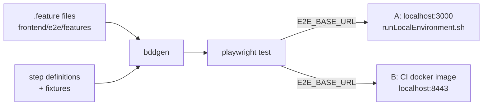

## Why

Browser verification of a running Klabis instance is done today by Claude driving Playwright MCP by hand. The checks are not repeatable, leave no regression suite behind and cannot be run from CI. Automated end-to-end tests that can be pointed at any running instance turn those manual checks into a reusable suite, without slowing down the regular development test run.

## What Changes

- Add a Playwright + `playwright-bdd` E2E test project under `frontend/e2e/`: Gherkin `.feature` files (English), step definitions, its own `playwright.config.ts` and TypeScript config.
- The target instance is set through the `E2E_BASE_URL` environment variable. Supported targets are the local dev server (`http://localhost:3000`) and the backend-served frontend (`https://localhost:8443`).
- Add a new explicit npm script `test:e2e`. The E2E suite is NOT part of `npm test`, `npm run lint` coverage of the unit test run, `publish-frontend-resources`, or the PR workflow `frontend-tests.yml`.
- Authentication fixtures: a setup project logs in each test role (`ZBM9000` admin, `ZBM9500` member) once through the UI and stores the session. Tests reuse it, and an API fixture reads the OIDC access token for `Given`-step data setup through the REST API.
- Test data convention: only seeded users are assumed. Every other entity is created per scenario with a unique run prefix, so tests stay independent of the seed and of manual edits on a local instance.
- Feature files link back to OpenSpec scenarios: a `@spec:<capability>` tag on the feature, and a Gherkin `Scenario:` title that matches the spec scenario title verbatim. Gherkin tags cannot contain spaces. Claude generates the feature files and a developer reviews them.
- Add a manual GitHub Actions workflow (`workflow_dispatch`, optional image tag input, default `latest`). It starts the published `ghcr.io/zabiny/klabis-be:<tag>` image with profiles `h2,ssl,example-data` (no `oris`), runs the suite against `https://localhost:8443` and uploads the Playwright report.
- Proof-of-concept scenarios: role-based main menu (read-only), event creation through the UI, and event update with API-prepared data.
- Document how to write and run E2E tests in `frontend/CLAUDE.md` and root `CLAUDE.md`.

## No Behavior Change Justification

**Specs reviewed:**
- `openspec/specs/application-navigation/spec.md` is unaffected. The PoC only exercises the existing "Main Menu is Driven by Authorization-Gated Links" scenarios.
- `openspec/specs/events/spec.md` is unaffected. The PoC only exercises the existing "Create Event" and "Update Event" scenarios.
- `openspec/specs/users-authentication/spec.md` is unaffected. Tests use the existing login flow and seeded users.
- `openspec/specs/non-functional-requirements/spec.md` is unaffected. "Test Environment SSL Support" already covers CI tests against `https://localhost:8443` with the committed test keystore.

**Why no spec update is needed:**
The change adds test code, test tooling and a manually triggered CI workflow only. No production frontend or backend code, API contract, authorization rule or user-visible behavior changes.

## Impact

- `frontend/`: new `e2e/` directory, `playwright.config.ts`, new devDependencies (`@playwright/test`, `playwright-bdd`), new `test:e2e` script, `.gitignore` entries for generated tests and reports. ESLint and TypeScript configs must include the e2e code.
- `.github/workflows/`: new manual `e2e-tests.yml` workflow.
- Developer workflow: a new opt-in command for verifying a running instance. The scenario-writing convention is documented in the CLAUDE.md files.
- Backend: no code changes. The CI run relies on the existing `example-data` profile, default OAuth2 redirect URIs for `localhost:8443` and the committed SSL keystore.
