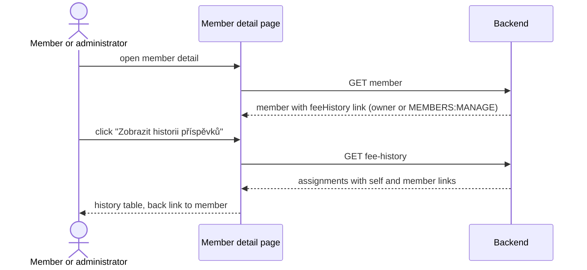

# Design

## Context

See `proposal.md` (Why). This is the current state the design builds on:

- **Endpoint.** `GET /api/members/{memberId}/fee-history` (`getFeeHistory`, tag `MemberFeeSummary`) is served by `MemberFeeSummaryController.getFeeHistory`. It returns `MemberFeeHistoryResponse { assignments: FeeAssignmentResponse[] }`, newest year first. Each assignment has `year`, `groupId`, `groupName`, `joinedAt` and `source` (`MEMBER_CHOICE` or `ADMIN_ASSIGNMENT`). The data comes from `MemberFeeHistoryService.getLevelHistory`, which reads the member's memberships in `MembershipFeeGroup`s. The response has only a `self` link.
- **Authorization today.** The operation declares `x-klabis-owner-visible: true` with no `x-klabis-authority`. A lone owner-visible narrows access to the owner, so only the member themselves may call the endpoint. A user holding `MEMBERS:MANAGE` gets 403 for anyone else. The fee summary and fee choice endpoints work the same way. The module header comment in `membershipfees.yaml` and the `klabis-api-spec` skill describe all five as owner-only.
- **No link is emitted.** Nothing links to `getFeeHistory`. `MemberFeeSummaryLinkProcessor` adds `feeSummary` to the member detail, and only on the caller's own profile.
- **Frontend.** `MemberDetailPage` renders `MemberFeeSection` only when the member resource has a `feeSummary` link and the member is active. So a membership administrator looking at another member never sees the fee section. `MemberFeeSection` checks `summary._links.feeHistory`, but that link is never sent, and it builds `/members/{id}/fee-history` by hand. No route exists for that path. Unknown paths fall through to `GenericHalPage`.
- **Yearly fee.** `MembershipFeeGroup` already holds a yearly fee snapshot for its year (`yearlyFeeSnapshot`, also used by the fee summary). The history data does not include it.

## Goals / Non-Goals

**Goals:**

- The history page can be reached through a HAL link, both by the member and by a membership administrator.
- The endpoint's authorization matches the link: the owner OR `MEMBERS:MANAGE`.
- The page follows the project's HAL page patterns: `useHalPageData` with the generated `GetFeeHistoryResource` type, links taken from the resource, and no URLs built by hand.

**Non-Goals:**

- Showing a membership administrator the rest of another member's fee section, such as the current level summary or the choice controls. `getFeeSummary` and the fee choice operations stay owner-only.
- Linking each history row to its fee group detail.
- Showing years in which the member had no level (missed choice, sanction). See Open Questions.
- Editing past assignments from this page.

## Decisions

### D1: `feeHistory` link lives on the member resource, not on the fee summary

A new `RepresentationModelProcessor<EntityModel<MemberDetailsResponse>>` in the membershipfees module, `MemberFeeHistoryLinkProcessor`, adds `feeHistory` to the member detail. It follows the cross-module pattern of `AccountMemberDetailLinkProcessor` and `MemberFeeSummaryLinkProcessor`. The link is built with `klabisLinkTo(methodOn(MemberFeeSummaryApi.class).getFeeHistory(memberId, null))`. `klabisLinkTo` evaluates the operation's authorization against the target member through `AuthorizationEvaluator.canInvoke`, so the link appears exactly when the caller may follow it. That is the member themselves, or a holder of `MEMBERS:MANAGE`. No hand-written "is own profile" check is needed.

*Alternative: put the link on the fee summary.* Rejected. The summary is owner-only and is never fetched for another member, so an administrator could not reach the page. Having the link on both resources would mean two sources of truth for the same link.

*Alternative: extend `MemberFeeSummaryLinkProcessor`.* Rejected. That processor exists for `feeSummary` and has an imperative own-profile gate. Keeping the history link in its own processor keeps both simple.

### D2: Authorization becomes owner OR `MEMBERS:MANAGE`

`getFeeHistory` gets `x-klabis-authority: MEMBERS_MANAGE` next to the existing `x-klabis-owner-visible: true`. The `x-klabis-target-id: MEMBER` on `FeeSummaryMemberIdParam` is already in place. This is the standard OR form (compare `finance.yaml` `getAccount`). The rest stays as it is:

- Ordinary members still get "forbidden" for anyone else's history.
- `getFeeSummary`, `getChoice`, `chooseTier` and `removeChoice` stay owner-only.

The module header comment changes from "5 operations" to "4 operations, plus `getFeeHistory`, which also admits `MEMBERS:MANAGE`". The `klabis-api-spec` skill reference (`field-security.md`) cites the 5-operation count and is updated the same way.

"Membership administrator" maps to `MEMBERS:MANAGE`, the authority every fee administration operation in this module already requires.

### D3: Yearly fee is added to each history entry

`FeeAssignmentResponse` gains `yearlyFee: number`, the same wire type as `CurrentGroupResponse.yearlyFee`. `MemberFeeHistoryPort.LevelAssignment` gains the group's yearly fee snapshot, and `MembershipFeesResponseMapper` maps it. The value is the snapshot of the fee group for that year, which is what the member was charged. It is not the current catalog value. No domain change is needed.

### D4: History response links back to the member

The history response gets a `member` link to `getMember` (members module), next to `self`. The page's back link reads this link instead of building `/members/{id}` itself. `MemberFeeHistoryDetailsPostprocessor` adds it. Its domain is already the member UUID.

### D5: Frontend page and route

- New route `/members/:memberId/fee-history` → `MemberFeeHistoryPage` in `frontend/src/pages/membership-fees/`, registered in `App.tsx` next to the `fee-choice` routes. `HalRouteContext` maps the SPA path to `/api/members/{id}/fee-history`, so the page uses `useHalPageData<GetFeeHistoryResource>()`.
- The page shows a title ("Historie členských příspěvků"), a back link taken from `_links.member`, and a table. `assignments` is a plain array, not `_embedded`, so `HalEmbeddedTable` does not apply. The table is a `KlabisTable` fed the array through its `data` prop, with no paging and `emptyMessage` for the empty state. `FinancesPage` is a precedent. Columns:
  - Rok;
  - Tier;
  - Roční poplatek (`{yearlyFee} Kč`);
  - Způsob přiřazení. It reuses the existing `MEMBER_CHOICE` / `ADMIN_ASSIGNMENT` labels ("Vlastní volba" / "Přiřazeno adminem").

  When there are no rows, an empty-state message is shown.
- **Entry point.** `MemberDetailPage` reads `_links.feeHistory` from the member resource and passes its path to `MemberFeeSection`. The section then renders when either `feeSummary` or `feeHistory` is present:
  - the summary block only when `feeSummaryHref` is set;
  - the "Zobrazit historii příspěvků" link only when the history link is set, with the path from `extractNavigationPath(feeHistory.href)`.

  For an administrator on another member, this gives a fee section that contains only the history link.
- The fee section stays hidden for inactive members (`member.active === false`), as today. For an administrator this also hides the history link of a former member. See Open Questions.
- `FeeSummaryLinks.feeHistory` is removed from `memberFeeTypes.ts`, along with the dormant `summary._links.feeHistory` branch and its test.



### D6: No domain model change

The history is read from the existing `MembershipFeeGroup` memberships and the group's yearly fee snapshot. No aggregate, value object or persistence changes are needed. Only the application-layer read model (`LevelAssignment`) gains a field.

## REST API changes

| Operation | Change |
|---|---|
| `GET /api/members/{id}` (`getMember`) | New HAL link `feeHistory` → `getFeeHistory`. Present when the caller is the member or holds `MEMBERS:MANAGE`. Documented in `members.yaml` `x-hal-links`. |
| `GET /api/members/{memberId}/fee-history` (`getFeeHistory`) | Authorization: owner OR `MEMBERS:MANAGE` (was owner only). New HAL link `member` → `getMember`. Response field `assignments[].yearlyFee` added. No templates. |

Response of `getFeeHistory` (HAL+FORMS):

```json
{
  "assignments": [
    {
      "year": 2026,
      "groupId": "uuid",
      "groupName": "Základní",
      "yearlyFee": 500,
      "joinedAt": "2025-11-02",
      "source": "MEMBER_CHOICE"
    }
  ],
  "_links": {
    "self":   { "href": "/api/members/{memberId}/fee-history" },
    "member": { "href": "/api/members/{memberId}" }
  }
}
```

No new parameters or request bodies, and no HAL+FORMS affordances.

## Glossary

| Term | Meaning |
|---|---|
| Fee level history | The list of a member's fee level assignments by year: level, yearly fee and assignment source. |
| Assignment source | How a member got a level for a year: *member choice* or *administrator assignment*. |

## Risks / Trade-offs

- [The yearly fee snapshot can be edited until the first surcharge] → The history shows the current snapshot of that year's group. After the first surcharge the snapshot is frozen, so for past years the value is stable.
- [A wider read authorization exposes the history to `MEMBERS:MANAGE` holders] → This is intended. Administrators already see the same data through the fee group member lists. A WebMvc test pins that ordinary members are still refused.
- [The fee section now renders for administrators on other members] → It shows only the history link. A `MemberDetailPage` test covers the "admin on another member" case, which the existing "does NOT show MemberFeeSection when feeSummary link is absent" test describes. That test has to be rewritten.

## Migration Plan

No data migration. Deploy backend and frontend together, as usual. Rollback is a plain revert. The added field and links are additive for API clients.

## Open Questions

Product questions. Each has a default that the specs and tasks assume:

1. **Years without an assignment.** Should the history show years in which the member had no level, for example a missed choice that was sanctioned? Default: no, only years with an assignment.
2. **Former (inactive) members.** Should a membership administrator see the history link on an inactive member's detail, for accounting? Default: no, the fee section stays hidden for inactive members, as today.
3. **Who else may see it.** Should a legal guardian (the guardian group) or a holder of `MEMBERS:READ` / `FINANCE:MANAGE` see a member's fee history? Default: no, only the member and `MEMBERS:MANAGE`.
4. **Link from a history row to the fee group.** Should a history row link to its fee group detail? Default: no (Non-Goal).
