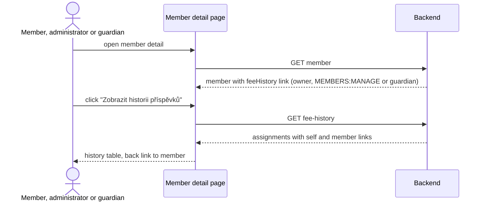

# Design

## Context

See `proposal.md` (Why). This is the current state the design builds on:

- **Endpoint.** `GET /api/members/{memberId}/fee-history` (`getFeeHistory`, tag `MemberFeeSummary`) is served by `MemberFeeSummaryController.getFeeHistory`. It returns `MemberFeeHistoryResponse { assignments: FeeAssignmentResponse[] }`, newest year first. Each assignment has `year`, `groupId`, `groupName`, `joinedAt` and `source` (`MEMBER_CHOICE` or `ADMIN_ASSIGNMENT`). The data comes from `MemberFeeHistoryService.getLevelHistory`, which reads the member's memberships in `MembershipFeeGroup`s. The response has only a `self` link.
- **Authorization today.** The operation declares `x-klabis-owner-visible: true` with no `x-klabis-authority`. A lone owner-visible narrows access to the owner, so only the member themselves may call the endpoint. A user holding `MEMBERS:MANAGE` gets 403 for anyone else. The fee summary and fee choice endpoints work the same way. The module header comment in `membershipfees.yaml` and the `klabis-api-spec` skill describe all five as owner-only.
- **No link is emitted.** Nothing links to `getFeeHistory`. `MemberFeeSummaryLinkProcessor` adds `feeSummary` to the member detail, and only on the caller's own profile.
- **Frontend.** `MemberDetailPage` renders `MemberFeeSection` only when the member resource has a `feeSummary` link and the member is active. So a membership administrator looking at another member never sees the fee section. `MemberFeeSection` checks `summary._links.feeHistory`, but that link is never sent, and it builds `/members/{id}/fee-history` by hand. No route exists for that path. Unknown paths fall through to `GenericHalPage`.
- **Guardian access.** A legal guardian group delegates `MEMBERS:EDIT_PROFILE` (`LegalGuardianGroup.delegatedAuthorities`). `LegalGuardianGroupRelationshipSource` then grants each guardian `MEMBERS:EDIT_PROFILE` targeted at each minor of their group, for both member and non-member guardians. The grant ends when the minor turns 18 and leaves the group. Endpoints guardians may use declare `x-klabis-authority: [MEMBERS_MANAGE, MEMBERS_EDIT_PROFILE]` with an `x-klabis-target-id: MEMBER` path parameter: the member update in `members.yaml`, and the guardian-visible fields of `MemberDetailsResponse`. Every member also holds `MEMBERS:EDIT_PROFILE` over themselves (`SelfProfileRelationshipSource`). A non-member guardian holds `MEMBERS:READ` (spec: "A non-member guardian has the permission to view club members"), so they can open a minor's member detail.
- **Acting member argument.** `getFeeHistory` declares `x-spring-provide-args: @ActingMember MemberId actingMember`. That argument fails with `MemberProfileRequiredException` for a user without a member profile, such as a non-member guardian. The controller does not use it.
- **Yearly fee.** `MembershipFeeGroup` already holds a yearly fee snapshot for its year (`yearlyFeeSnapshot`, also used by the fee summary). The history data does not include it.

## Goals / Non-Goals

**Goals:**

- The history page can be reached through a HAL link, both by the member and by a membership administrator.
- The endpoint's authorization matches the link: the owner, OR `MEMBERS:MANAGE`, OR a legal guardian of the member.
- The page follows the project's HAL page patterns: `useHalPageData` with the generated `GetFeeHistoryResource` type, links taken from the resource, and no URLs built by hand.

**Non-Goals:**

- Showing a membership administrator the rest of another member's fee section, such as the current level summary or the choice controls. `getFeeSummary` and the fee choice operations stay owner-only.
- Linking each history row to its fee group detail. Product decision: no.
- Showing years in which the member had no level (missed choice, sanction). Product decision: not shown.
- Showing the history link to an administrator on an inactive member's detail. Product decision: no.
- Editing past assignments from this page.

## Decisions

### D1: `feeHistory` link lives on the member resource, not on the fee summary

A new `RepresentationModelProcessor<EntityModel<MemberDetailsResponse>>` in the membershipfees module, `MemberFeeHistoryLinkProcessor`, adds `feeHistory` to the member detail. It follows the cross-module pattern of `AccountMemberDetailLinkProcessor` and `MemberFeeSummaryLinkProcessor`. The link is built with `klabisLinkTo(methodOn(MemberFeeSummaryApi.class).getFeeHistory(memberId, null))`. `klabisLinkTo` evaluates the operation's authorization against the target member through `AuthorizationEvaluator.canInvoke`, so the link appears exactly when the caller may follow it. That is the member themselves, a holder of `MEMBERS:MANAGE`, or a legal guardian of the member. No hand-written "is own profile" or "is guardian" check is needed.

*Alternative: put the link on the fee summary.* Rejected. The summary is owner-only and is never fetched for another member, so an administrator could not reach the page. Having the link on both resources would mean two sources of truth for the same link.

*Alternative: extend `MemberFeeSummaryLinkProcessor`.* Rejected. That processor exists for `feeSummary` and has an imperative own-profile gate. Keeping the history link in its own processor keeps both simple.

### D2: Authorization becomes owner OR `MEMBERS:MANAGE` OR legal guardian

`getFeeHistory` gets `x-klabis-authority: [MEMBERS_MANAGE, MEMBERS_EDIT_PROFILE]` next to the existing `x-klabis-owner-visible: true`. The `x-klabis-target-id: MEMBER` on `FeeSummaryMemberIdParam` is already in place, so `MEMBERS:EDIT_PROFILE` is evaluated against the specific member. Access then works like this:

| Caller | Access | Why |
|---|---|---|
| The member themselves | yes | owner-visible (also self-held `MEMBERS:EDIT_PROFILE`) |
| Membership administrator | any member | `MEMBERS:MANAGE`, held over all members |
| Legal guardian (member or non-member) | own minors only | `MEMBERS:EDIT_PROFILE` targeted at each minor, delegated by the legal guardian group |
| `MEMBERS:READ` / `FINANCE:MANAGE` holder, other members | no | neither authority is listed |

"Membership administrator" maps to `MEMBERS:MANAGE`, the authority every fee administration operation in this module already requires.

*Alternative: a guardian-specific check*, either imperative like `GuardianListAccess` or a new guardian-only authority. Rejected. `MEMBERS:EDIT_PROFILE` is how the project already models "a guardian may see and edit the data of their minor". It is evaluated declaratively by `AuthorizationEvaluator`, so both the endpoint and the `klabisLinkTo` link follow it with no extra code. A new authority would need a new relationship source and new grant plumbing for a single read endpoint.

*Consequence:* a free group can also delegate "Úprava údajů člena" (`MEMBERS:EDIT_PROFILE`), and such a group's owners would also see the history of its members. Those owners can already see and edit the member's full profile, which is more sensitive than fee levels, so this is accepted. Confirming it is the only remaining open question.

The rest stays as it is:

- `getFeeSummary`, `getChoice`, `chooseTier` and `removeChoice` stay owner-only. A guardian sees only the ward's history, not their current summary or choice controls.
- The module header comment changes from "5 operations" to "4 operations, plus `getFeeHistory`, which also admits `MEMBERS:MANAGE` and `MEMBERS:EDIT_PROFILE`". The `klabis-api-spec` skill reference (`field-security.md`) cites the 5-operation count and is updated the same way.

### D2a: `getFeeHistory` no longer requires the caller to be a member

The `x-spring-provide-args` `@ActingMember MemberId actingMember` entry is removed from `getFeeHistory`. Without that, a non-member guardian (`EXT…` login) would be rejected with `MemberProfileRequiredException` before authorization even matters. The argument is unused in the method body. Link-building calls become `getFeeHistory(memberId)`. The other four operations keep it, because they are owner-only, and the owner is always a member.

### D3: Yearly fee is added to each history entry

`FeeAssignmentResponse` gains `yearlyFee: number`, the same wire type as `CurrentGroupResponse.yearlyFee`. `MemberFeeHistoryPort.LevelAssignment` gains the group's yearly fee snapshot, and `MembershipFeesResponseMapper` maps it. The value is the snapshot of the fee group for that year, which is what the member was charged. It is not the current catalog value. No domain change is needed.

### D4: History response links back to the member

The history response gets a `member` link to `getMember` (members module), next to `self`. The page's back link reads this link instead of building `/members/{id}` itself. `MemberFeeHistoryDetailsPostprocessor` adds it. Its domain is already the member UUID.

### D5: Frontend page and route

- New route `/members/:memberId/fee-history` → `MemberFeeHistoryPage` in `frontend/src/pages/membership-fees/`, registered in `App.tsx` next to the `fee-choice` routes. `HalRouteContext` maps the SPA path to `/api/members/{id}/fee-history`, so the page uses `useHalPageData<GetFeeHistoryResource>()`.
- The page shows a title ("Historie členských příspěvků"), a back link taken from `_links.member`, and a table. `assignments` is a plain array, not `_embedded`, so `HalEmbeddedTable` does not apply. The table is a `KlabisTable` fed the array through its `data` prop, with no paging and `emptyMessage` for the empty state. `FinancesPage` is a precedent. Columns:
  - Rok;
  - Tier;
  - Roční poplatek (`{yearlyFee} Kč`);
  - Způsob přiřazení. It reuses the existing `MEMBER_CHOICE` / `ADMIN_ASSIGNMENT` labels ("Vlastní volba" / "Přiřazeno adminem").

  When there are no rows, an empty-state message is shown.
- **Entry point.** `MemberDetailPage` reads `_links.feeHistory` from the member resource and passes its path to `MemberFeeSection`. The section then renders when either `feeSummary` or `feeHistory` is present:
  - the summary block only when `feeSummaryHref` is set;
  - the "Zobrazit historii příspěvků" link only when the history link is set, with the path from `extractNavigationPath(feeHistory.href)`.

  For an administrator on another member, this gives a fee section that contains only the history link.
- The fee section stays hidden for inactive members (`member.active === false`), as today. For an administrator this also hides the history link of a former member, which is the product decision.
- A guardian on a minor's detail gets only `feeHistory` (no `feeSummary`), so the section shows only the history link, the same as for an administrator.
- `FeeSummaryLinks.feeHistory` is removed from `memberFeeTypes.ts`, along with the dormant `summary._links.feeHistory` branch and its test.



### D6: No domain model change

The history is read from the existing `MembershipFeeGroup` memberships and the group's yearly fee snapshot. No aggregate, value object or persistence changes are needed. Only the application-layer read model (`LevelAssignment`) gains a field.

## REST API changes

| Operation | Change |
|---|---|
| `GET /api/members/{id}` (`getMember`) | New HAL link `feeHistory` → `getFeeHistory`. Present when the caller is the member, holds `MEMBERS:MANAGE`, or is a legal guardian of the member. Documented in `members.yaml` `x-hal-links`. |
| `GET /api/members/{memberId}/fee-history` (`getFeeHistory`) | Authorization: owner OR `MEMBERS:MANAGE` OR `MEMBERS:EDIT_PROFILE` over the member (was owner only). No member profile required for the caller. New HAL link `member` → `getMember`. Response field `assignments[].yearlyFee` added. No templates. |

Response of `getFeeHistory` (HAL+FORMS):

```json
{
  "assignments": [
    {
      "year": 2026,
      "groupId": "uuid",
      "groupName": "Základní",
      "yearlyFee": 500,
      "joinedAt": "2025-11-02",
      "source": "MEMBER_CHOICE"
    }
  ],
  "_links": {
    "self":   { "href": "/api/members/{memberId}/fee-history" },
    "member": { "href": "/api/members/{memberId}" }
  }
}
```

No new parameters or request bodies, and no HAL+FORMS affordances.

## Glossary

| Term | Meaning |
|---|---|
| Fee level history | The list of a member's fee level assignments by year: level, yearly fee and assignment source. |
| Assignment source | How a member got a level for a year: *member choice* or *administrator assignment*. |
| Ward | A minor whose legal guardian group includes the guardian. The guardian may see the ward's fee level history. |

## Risks / Trade-offs

- [The yearly fee snapshot can be edited until the first surcharge] → The history shows the current snapshot of that year's group. After the first surcharge the snapshot is frozen, so for past years the value is stable.
- [A wider read authorization exposes the history to `MEMBERS:MANAGE` holders and guardians] → This is intended. Administrators already see the same data through the fee group member lists. WebMvc tests pin that ordinary members, `MEMBERS:READ` holders and a guardian of a different minor are still refused.
- [Free-group owners with delegated "Úprava údajů člena" also gain access] → An accepted consequence of D2. See the open question.
- [A guardian loses access when the minor turns 18] → This is intended. It follows the existing guardian grant lifecycle.
- [The fee section now renders for administrators on other members] → It shows only the history link. A `MemberDetailPage` test covers the "admin on another member" case, which the existing "does NOT show MemberFeeSection when feeSummary link is absent" test describes. That test has to be rewritten.

## Migration Plan

No data migration. Deploy backend and frontend together, as usual. Rollback is a plain revert. The added field and links are additive for API clients.

## Resolved Product Decisions

| Question | Decision |
|---|---|
| Show years without an assignment? | No. |
| Show the history link to an administrator on an inactive member? | No. |
| Who else may see it? | Legal guardians, for their own minors. Not `MEMBERS:READ` or `FINANCE:MANAGE` holders. |
| Link a history row to its fee group detail? | No. |

## Open Questions

1. **Free-group owners with delegated "Úprava údajů člena".** Through D2 they also see the fee history of their group's members. The design accepts this, but it needs product confirmation. If it is rejected, the alternative is a guardian-only check that reads `LegalGuardianGroup` membership. That would replace `MEMBERS_EDIT_PROFILE` in `x-klabis-authority`, and the link processor would need a matching explicit check.
