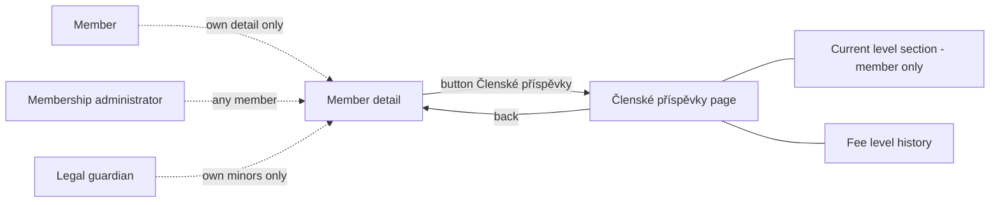

# Proposal

## Why

The spec says a member's past fee level assignments remain available ("Audit Trail of Level Assignments"), but no page shows them. A membership administrator who wants to know a member's level in a past year has to find the closed campaign, open the right fee group and look for the member there. That is also how the E2E test checks the scenario today. A member cannot see their own past levels at all.

The backend already has a fee history endpoint, but nothing links to it, no page renders it, and only the member themselves may read it. This change makes it usable and, at the same time, gives membership fees one place of their own instead of a section squeezed into the member detail.

## What Changes

- **New page "Členské příspěvky" of a member.** It has two parts:
  - the current fee section moved from the member detail (current level, prompt to choose, locked choice, "choose / change level" links), shown only to the member themselves;
  - the **fee level history**: one row per year in which the member had an assigned fee level, with the year, the level name and how the level was assigned (the member's own choice, or assigned by an administrator). The newest year is first.
- **Entry point.** The member detail shows a "Členské příspěvky" button instead of the fee section. The button is shown only when the user may open the page, and only for an active member.
- **Who may open the page:**
  - the member themselves, on their own detail;
  - a membership administrator, for any member;
  - a legal guardian, for the minors they are guardian of.

  Nobody else may. Holders of `MEMBERS:READ` or `FINANCE:MANAGE` do not get access through those permissions. The administrator and the guardian see only the history part; the current-level section stays owner-only.

  Today the history endpoint is owner-only: it declares `x-klabis-owner-visible` with no `x-klabis-authority`, so even a membership administrator gets "forbidden" for another member. The change keeps owner access and adds two alternatives: the `MEMBERS:MANAGE` authority, and the `MEMBERS:EDIT_PROFILE` permission that a legal guardian holds over each of their minors. That permission comes from the project's relationship sources (`LegalGuardianGroupRelationshipSource`) and is evaluated declaratively by `AuthorizationEvaluator`, the same way the project already handles guardian access to a minor's data.
- **`feeSummary` link moves.** It is removed from the member resource, where only the moved section used it, and is emitted on the fee history response instead, still owner-only. `MemberFeeSummaryLinkProcessor` is replaced by the history postprocessor.
- **Dormant frontend code is replaced.** The `feeHistory` link on the fee summary is removed: the backend never sends it, and the frontend checks it only in a branch that never runs. The page link comes from the member resource instead (see design).
- **E2E.** The scenario "Past assignments remain available" opens the new page instead of the closed campaign's fee group. Existing scenarios that check the current level on the profile move to the new page.

Not shown, by product decision: years without an assignment, the page for inactive members (for an administrator), the yearly fee in the history, and links from a history row to its fee group.

## Capabilities

### New Capabilities

None.

### Modified Capabilities

- `membership-fees`:
  - "Audit Trail of Level Assignments" gets user-facing scenarios for the page and its history, covering access by the member, by a membership administrator and by a legal guardian. Its existing scenario "Past assignments remain available" is reworded to use the page.
  - "Member Sees Their Current Fee Level" is modified: the current level is shown on the "Členské příspěvky" page, not as a widget on the profile. The profile only offers the button.

## Impact

- **API spec**: `docs/openapi/spec/membershipfees.yaml`:
  - `getFeeHistory` gets `x-klabis-authority: [MEMBERS_MANAGE, MEMBERS_EDIT_PROFILE]`, and its `@ActingMember` argument is dropped, so that a non-member guardian can call it;
  - its response gets `member` and `feeSummary` links;
  - `members.yaml` documents the new `feeHistory` link and drops `feeSummary` on the member resource;
  - the bundle and the frontend types are regenerated.
- **Backend (membershipfees module)**:
  - a new link processor adds `feeHistory` to the member detail;
  - `MemberFeeSummaryLinkProcessor` and its tests are removed;
  - `MemberFeeHistoryDetailsPostprocessor` adds the `member` and (owner only) `feeSummary` links;
  - `MemberFeeSummaryControllerTest` needs its authorization expectations updated.
- **Frontend**:
  - new `MemberFeeHistoryPage` (title "Členské příspěvky") and route `/members/:memberId/fee-history`; it reuses the moved `MemberFeeSection`;
  - `MemberDetailPage` replaces the fee section with the button;
  - the `feeHistory` field is removed from `memberFeeTypes.ts`;
  - new labels.
- **E2E**: `frontend/e2e/features/membership-fees.feature`, `frontend/e2e/steps/*`, and the step vocabulary in `frontend/e2e/README.md`. The guardian scenario uses the `member` role (`ZBM9500`, Eva Svobodová), who in the example data is the guardian of Sofie Svobodová.
- No database, domain model or response field changes: the history already carries year, level name and source.
