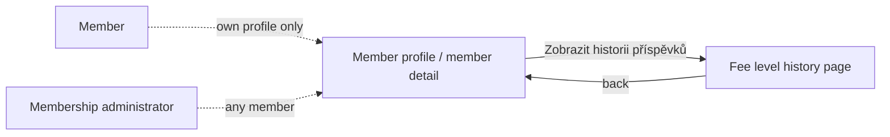

# Proposal

## Why

The spec says a member's past fee level assignments remain available ("Audit Trail of Level Assignments"), but no page shows them. A membership administrator who wants to know a member's level in a past year has to find the closed campaign, open the right fee group and look for the member there. That is also how the E2E test checks the scenario today. A member cannot see their own past levels at all.

The backend already has a fee history endpoint, but nothing links to it, no page renders it, and only the member themselves may read it. This change makes it usable.

## What Changes

- **New page: fee level history of a member.** It lists one row per year in which the member had an assigned fee level. Each row shows the year, the level name, the yearly fee and how the level was assigned (the member's own choice, or assigned by an administrator). The newest year is first.
- **Entry point.** A "Zobrazit historii příspěvků" link appears in the fee section of the member's profile or member detail. The link is shown only when the user may open the history.
- **Who may see it:**
  - the member themselves, on their own profile;
  - a membership administrator, for any member, on that member's detail page.

  Today the history endpoint is owner-only: it declares `x-klabis-owner-visible` with no `x-klabis-authority`, so even a membership administrator gets "forbidden" for another member. The change keeps owner access and adds the `MEMBERS:MANAGE` authority as an alternative.
- **Yearly fee in the history.** The history data does not contain the yearly fee today. It is added.
- **Dormant frontend code is replaced.** The `feeHistory` link on the fee summary is removed: the backend never sends it, and the frontend checks it only in a branch that never runs. The history link comes from the member resource instead (see design).
- **E2E.** The scenario "Past assignments remain available" opens the new page instead of the closed campaign's fee group.

## Capabilities

### New Capabilities

None.

### Modified Capabilities

- `membership-fees`: the requirement "Audit Trail of Level Assignments" gets user-facing scenarios for the history page, covering access by the member and by a membership administrator. Its existing scenario "Past assignments remain available" is reworded to use the page.

The requirement "Member Sees Their Current Fee Level" is not changed here. The active change `align-membership-fees-spec` already modifies it, and keeping the two changes apart avoids a merge conflict.

## Impact

- **API spec**: `docs/openapi/spec/membershipfees.yaml`:
  - `getFeeHistory` gets `x-klabis-authority: MEMBERS_MANAGE`;
  - its response gets a `member` link;
  - `FeeAssignmentResponse` gets a `yearlyFee` field;
  - `members.yaml` documents the new `feeHistory` link on the member resource;
  - the bundle and the frontend types are regenerated.
- **Backend (membershipfees module)**:
  - `MemberFeeHistoryPort.LevelAssignment` and `MemberFeeHistoryService` gain the yearly fee;
  - a new link processor adds `feeHistory` to the member detail;
  - `MemberFeeHistoryDetailsPostprocessor` adds the `member` link;
  - `MemberFeeSummaryControllerTest` needs its authorization expectations updated.
- **Frontend**:
  - new `MemberFeeHistoryPage` and route `/members/:memberId/fee-history`;
  - `MemberDetailPage` and `MemberFeeSection` render the history link from the member resource;
  - the `feeHistory` field is removed from `memberFeeTypes.ts`;
  - new labels.
- **E2E**: `frontend/e2e/features/membership-fees.feature`, `frontend/e2e/steps/*`, and the step vocabulary in `frontend/e2e/README.md`.
- No database or domain model changes.
