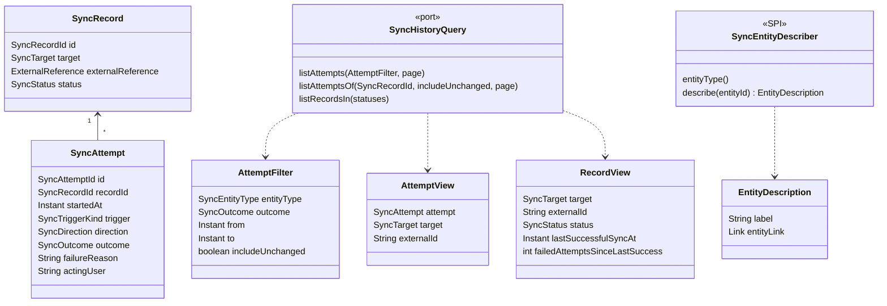

# Design

## Context

See proposal.md — Why. Relevant current state:

- The `sync` module owns `SyncRecord` (one per pairing, carries `status`, `target` = entity kind + entity id, `externalReference`) and the append-only `SyncAttempt` history (`startedAt`, `trigger`, `direction`, `outcome`, `failureReason`, `actingUser` = user UUID). History is pruned by `SyncHistoryRetentionJob` (default 30 days). No REST resource exposes attempts today; `SyncAttemptRepository` only offers per-record lookup for the derived failure count.
- Per-entity REST surface is `/api/{entityType}/{id}/sync…` (`SynchronizationController`, spec `docs/openapi/spec/sync.yaml`); affordances `synchronizeNow`, `acknowledgeSyncConflict`, `resolveSyncConflict`, `resetSyncRecord` are gated by `SyncStatePostprocessor` on current status.
- Frontend `SyncStatusIndicator` loads a sync state from a HAL link and opens `SyncStatusOverlay`, which renders the state and the affordance buttons.
- Every scheduled pass appends an attempt for every active record even when nothing is written (`NOTHING_TO_DO` → `SUCCESS`, no direction). The history is therefore dominated by no-op rows.
- `sync` knows nothing about members or events; `members` and `events` depend on `sync` (they implement `SynchronizationAdapter`), never the other way round.

## Goals / Non-Goals

**Goals:**
- Read-only queries over existing attempt and record data; no change to the engine's write path, decisions or retention.
- Reuse the existing per-entity state view and its affordances for every action.

**Non-Goals:**
- Recording what kind of manual action an attempt was (acknowledge vs. synchronise now) — the history does not distinguish them today and this change does not add it.
- Persisting a display name for entities or users.
- Performance tuning (indexes, caching, batch lookups) — sized for the expected load.

## Decisions

### D1: Attempts are read through a query port in `sync`, not through the aggregate

A new application-level query port (`SyncHistoryQuery`) serves three reads: a filtered, paged list of attempts across all records; a paged list of one record's attempts; and the records in given statuses. It returns read models joined from `sync_attempt` and `sync_record` (entity kind, entity id, external id, current status) — the attempt alone does not know which entity it belongs to.

*Alternative:* load `SyncRecord`s and their attempts through the existing repositories. Rejected: needs N queries per page and the entity-kind filter cannot be pushed into SQL.

### D2: "Changed nothing" is derived, not stored

An attempt "changed nothing" when its outcome is `SUCCESS`, it has no direction and its trigger is not `MANUAL`. The attempt queries exclude such rows unless `includeUnchanged=true`. Manual attempts (including acknowledging a conflict, which is recorded as a direction-less manual success) are always included.

*Alternative:* stop writing no-op attempts. Rejected: changes the engine, loses evidence that a pass checked the record, and touches the failure-count derivation in `RetryScheduler`.

### D3: Entity description is a separate presentation SPI, implemented by the owning module

During exploration this was sketched as `SynchronizationAdapter.describe(entityId)`. It is refined into a separate SPI in the `sync` REST layer, `SyncEntityDescriber`, one bean per entity kind, implemented in the owning module's `infrastructure.restapi` package:

- returns the readable label and, when the entity still exists, the link to its own resource (`Optional` — empty when the entity is gone);
- `members` → "Jan Novák (ZBM9500)", link to the member;
- `events` → event name + date, link to the event; discipline → name, link to the discipline list resource;
- event registration (entity id `{eventId}:{memberId}`) → "member name – event name" via the public `com.klabis.members.Members` API the events module already uses, link to the event.

When no describer answers or it returns empty, the row falls back to the external id with no entity link.

*Why not on `SynchronizationAdapter`:* the adapter is a domain port about reading and writing projections; a resource link is web-layer knowledge, and putting it on the adapter would make the domain port depend on HAL link building. A separate SPI keeps the dependency direction (`members`/`events` → `sync`) and keeps the adapter unchanged.

*Alternative:* derive the label from the stored local snapshot. Rejected — registration projections carry no names.

Descriptions are resolved per row of the current page (≤ page size lookups). Acceptable at the expected load.

### D4: Who performed an attempt is shown as the username

`actingUser` holds the user UUID. The REST layer resolves it through `common.users.UserService.findUserById` to the username (registration number for members, `admin` for the bootstrap user). No member-name lookup — `sync` must not depend on `members`. Unknown/deleted user → the UUID is omitted and `performedBy` is absent.

### D5: Actions stay on the per-entity state view

Every attempt and every attention record carries a `syncState` link to the existing `GET /api/{entityType}/{id}/sync`. The frontend renders `SyncStatusIndicator` with that link in each row; clicking it opens `SyncStatusOverlay` exactly as on the member/event pages. No new affordances, no duplicated status gating. Because the link targets the current state, an old conflict attempt offers only what the record allows now.

### D6: Attention list = CONFLICT + FAILED, unpaged

The attention view queries records with status `CONFLICT` or `FAILED`. The set is small by nature (needs a person), so it is returned as an unpaged collection. `RETRYING` is excluded (self-healing); `RETIRED` never appears.

### D7: Overlay history is a linked sub-resource

`SyncStateResponse` gains an `attempts` link (only for `SYNC:MANAGE`, via authorization-aware link building) to `GET /api/{entityType}/{id}/sync/attempts`. `SyncStatusOverlay` follows it and renders the most recent page (size 10) with the same "show unchanged" toggle. Keeping history out of the state payload keeps the indicator (rendered in every list row) cheap.

### D8: Frontend page

One page component for the `/sync/attempts` route, reached from the root link `syncOverview`. Two tabs: "Všechny pokusy" (the paged attempt list, `KlabisTable`, filters entity kind / outcome / date range / show unchanged as query parameters) and "Vyžaduje pozornost" (follows the `recordsNeedingAttention` link of the attempt collection). `syncOverview` is added to the admin rels in `useRootNavigation`.

## Domain Changes

No aggregate changes. `SyncRecord` and `SyncAttempt` stay as they are; the change adds read models and a presentation SPI next to them.

| Element | Kind | Change |
|---|---|---|
| `SyncHistoryQuery` | application query port (`sync`) | **added** |
| `AttemptFilter` | query parameter value | **added** |
| `AttemptView`, `RecordView` | read models | **added** |
| `SyncEntityDescriber` / `EntityDescription` | presentation SPI (`sync` REST layer), implemented in `members` and `events` | **added** |
| `SyncAttemptRepository` | secondary port | unchanged — the new reads go through the query port's JDBC adapter |
| `SyncRecord`, `SyncAttempt`, `SynchronizationAdapter` | aggregates / domain port | unchanged |

## REST API

All new operations live in `docs/openapi/spec/sync.yaml`, tag `Sync`, `x-klabis-authority: SYNC_MANAGE`, HAL by default.

### `GET /api/sync/attempts` — `listSyncAttempts`

Paged (`x-spring-paginated`), newest first.

| Parameter | In | Type | Notes |
|---|---|---|---|
| `entityType` | query | `SyncEntityTypeParam`, optional | |
| `outcome` | query | `SUCCESS`/`CONFLICT`/`FAILED`/`OUTAGE`/`RESET`/`SKIPPED`, optional | |
| `from`, `to` | query | date-time, optional | inclusive `from`, exclusive `to` |
| `includeUnchanged` | query | boolean, default `false` | D2 |
| `page`, `size` | query | shared `PageParam`/`SizeParam` | default size 25 |

Item `SyncAttemptResponse` (`x-hal-entity-items`, `x-klabis-relation: syncAttempts`):

| Field | Type |
|---|---|
| `startedAt` | date-time |
| `trigger` | `SCHEDULED`/`LOCAL_CHANGE`/`MANUAL` |
| `direction` | `INWARD`/`OUTWARD`/null |
| `outcome` | enum as above |
| `failureReason` | string, optional |
| `performedBy` | string, optional (username, D4) |
| `entityType` | `SyncEntityTypeParam` |
| `entityLabel` | string (D3, falls back to external id) |
| `externalId` | string |

Item links: `syncState` → `getSyncState` (always), `entity` → the entity's own resource (only when D3 returned one).
Collection links: `self`, paging links, `recordsNeedingAttention` → `listSyncRecords?status=CONFLICT&status=FAILED`.

### `GET /api/{entityType}/{id}/sync/attempts` — `listEntitySyncAttempts`

Same item schema and paging; parameters `entityType`, `id`, `includeUnchanged`, `page`, `size`. 404 when the entity is not linked.

### `GET /api/sync/records` — `listSyncRecords`

Unpaged collection. Parameter `status` (repeatable, `CONFLICT`/`FAILED` and the other `SyncStatus` values; required).
Item `SyncRecordSummaryResponse` (`x-hal-entity-items`, `x-klabis-relation: syncRecords`): `entityType`, `status`, `entityLabel`, `externalId`, `lastSuccessfulSyncAt`, `failedAttemptsSinceLastSuccess`. Item links `syncState`, `entity` (as above).

### Changes to existing resources

- `getSyncState` response: new link `attempts` → `listEntitySyncAttempts` (present only for `SYNC:MANAGE`).
- Root: new link `syncOverview` → `listSyncAttempts` (present only for `SYNC:MANAGE`), added by a root link processor in `sync`.

No new HAL+FORMS affordances; existing ones unchanged.

## Glossary

| Term | Meaning |
|---|---|
| Synchronisation overview | The "Synchronizace" page listing attempts across all linked entities |
| Attempt that changed nothing | Automatic attempt that succeeded without writing to either side (D2) |
| Needing attention | A linked entity in `CONFLICT` or `FAILED` — waits for a person |
| Entity description | Readable label + optional link to the entity, supplied by the owning module (D3) |

## Risks / Trade-offs

- [Manual attempts are indistinguishable by kind — acknowledging a conflict and "synchronise now" with nothing to do both read as "manual, success"] → shown with who performed them; recording the action kind is a possible follow-up, out of scope here.
- [Attempt query without a `started_at` index scans the table — tens of thousands of rows at 30-day retention] → acceptable at the expected load (KISS); add an index on `(started_at DESC)` only if measured slow.
- [Per-row describer and user lookups (≤ 2 × page size)] → page size 25; acceptable at expected load.
- [Registration describer depends on a members lookup per row] → uses the existing public `Members` API; no new module dependency.
- [Each list row renders a `SyncStatusIndicator`, which fetches the current state per row] → 25 small GETs per page; acceptable. If it proves noisy, the current status can be embedded in the item later.
- [Failure reasons may contain technical detail] → visible only with `SYNC:MANAGE`, same audience that already sees both projections.

## Migration Plan

No data migration. Additive API; deploy as usual, rollback by reverting.
