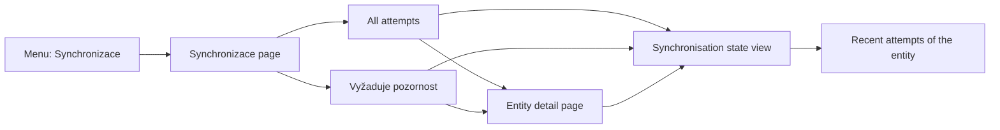

# Proposal

GitHub issue: zabiny/klabis#389

## Why

The synchronisation engine records every attempt it makes, but nothing in the application shows that history, and there is no place to see which records currently need attention. A user with the synchronisation permission can only find a conflict or a stopped record by already knowing which member, event or registration it belongs to. Conflicts and terminal failures therefore go unnoticed until someone stumbles on them.

## What Changes

- **New "Synchronizace" page** in the Administrace section of the main menu, visible only to users with the synchronisation permission:
  - a chronological list of every recorded synchronisation attempt across all linked entities (when, which entity, what triggered it, direction, outcome, failure reason, who performed it), filterable by entity kind, outcome and date range, paged;
  - a "Vyžaduje pozornost" view listing linked entities that are currently waiting for a decision or have stopped after repeated failures;
  - each row names the entity in human-readable form (e.g. member name, event name, "member – event" for a registration) and links to the entity's own page;
  - each row offers the actions the entity's **current** synchronisation state allows (synchronise now, restart, confirm and resolve a difference) by opening the existing synchronisation state view of that entity. An attempt is never replayed; actions always act on the entity as it stands now.
- **History in the per-entity synchronisation view**: the existing synchronisation state view (opened from member list/detail, event list/detail, registration dialog and the new page) gains a section listing that entity's most recent attempts.
- No change to how synchronisation runs, how conflicts are resolved (the two-step confirm-then-resolve flow stays as is), retry behaviour or history retention.

Out of scope: visibility of batch runs (member discovery, registration discovery, scheduler passes) — those are not recorded per run today; free-text search by entity name.

## Capabilities

### New Capabilities

_None._

### Modified Capabilities

- `data-synchronization`: adds a cross-entity overview of synchronisation attempts and of entities needing attention, with actions reachable from it; makes an entity's attempt history visible in its synchronisation state view.
- `application-navigation`: adds the "Synchronizace" entry to the Administrace section, gated by the synchronisation permission.

## Impact

- **Backend (sync module):** read-side queries over recorded attempts (paged, filtered, across records and per record) and over records by status; a way for each synchronised entity kind to describe an entity in human-readable form, supplied by the module that owns the entity; new REST resources and a root link for the menu.
- **Backend (events, members modules):** their existing synchronisation integrations provide the human-readable description of their entities.
- **API:** additive only — new read endpoints under `/api/sync/…`, a new root link, and an additional link from the per-entity synchronisation state to its attempt history. Existing `/api/{entityType}/{id}/sync…` operations unchanged.
- **Frontend:** new page, menu entry, history section in `SyncStatusOverlay`.
- **Data:** no migration; reads existing attempt and record tables.
