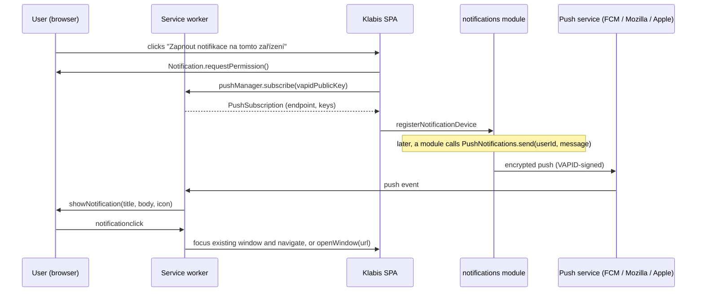
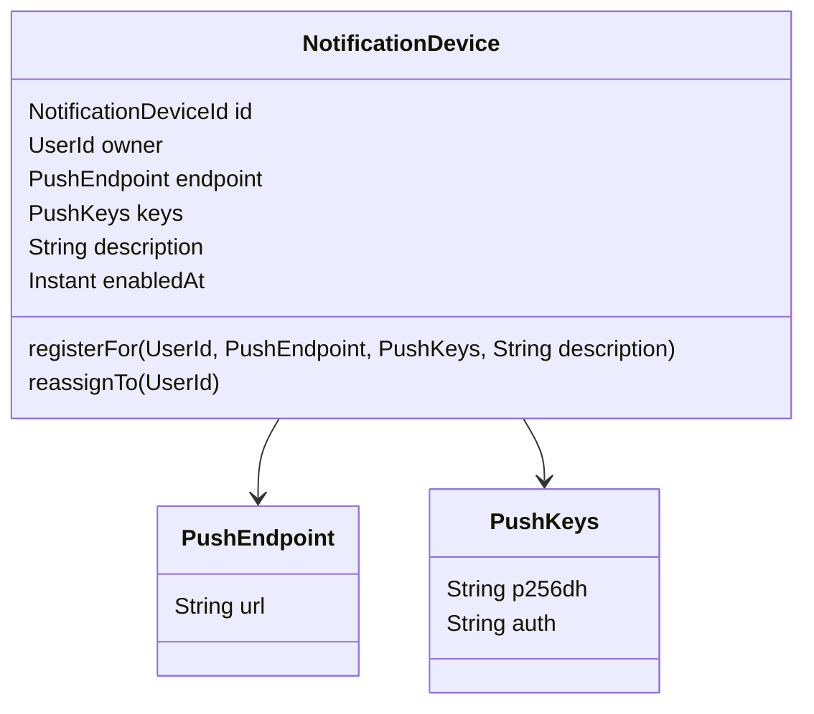

## Context

- The app is an installable PWA. After `fix-pwa-service-worker-updates` it has a registered, self-updating service worker built from `frontend/src/sw.ts` (no fetch handler) and `getServiceWorkerRegistration()` in `frontend/src/pwa/registerServiceWorker.ts`. This change depends on that one and must be implemented after it.
- Users authenticate with OAuth2/OIDC. The access token carries `UserId` and an optional member profile. Notifications target a **user**, not a member, so the bootstrap admin and non-member legal guardians can use them too.
- Home page entries are driven by root links (`RootController` + per-module `RepresentationModelProcessor<EntityModel<RootModel>>`, e.g. `RootProfileLinkProcessor` → `profile`).
- Expected load: 200–300 users, a handful of devices each. Sending is fire-and-forget, without a queue.



## Goals / Non-Goals

**Goals:**
- Per-device opt-in with an explicit user gesture, device list management, and a test notification.
- A small, stable internal API that other modules use to notify a user.
- Automatic cleanup of dead subscriptions.

**Non-Goals:**
- Business notifications (#89, #27, …), each in its own follow-up change.
- Per-category notification preferences (#28).
- An in-app notification inbox or history, read receipts, guaranteed delivery or retries.
- Local notifications without push; offline mode.

## Decisions

### D1: New `notifications` application module

`com.klabis.notifications` as a Spring Modulith module. It depends only on `common` (`UserId`, security, HAL support). Business modules depend on its published API. The notifications module never depends on them, so "who gets notified about what" stays in the owning module.

Published API (module root package):

```java
public interface PushNotifications {
    void send(UserId recipient, PushMessage message);   // async, best effort
}
record PushMessage(String title, String body, String targetPath) {}  // targetPath e.g. "/events/123", nullable
```

`send` returns immediately: delivery runs on an `@Async` executor, after the caller's transaction commits when one is active. Failures are logged and never propagate to the caller.

*Alternative:* callers publish domain events and `notifications` listens. This was rejected because `notifications` would then have to know every business event and build the texts for it.

### D2: Domain model



| Element | Status | Description |
|---|---|---|
| `NotificationDevice` | added | Aggregate root: one browser installation that can receive pushes for one user. |
| `NotificationDeviceId` | added | Identity (UUID). |
| `PushEndpoint` | added | Push service URL; unique across all devices; must be `https`. |
| `PushKeys` | added | Client public key + auth secret for payload encryption. Stored encrypted with the existing column-encryption support, because they are personal data. |
| `description` | added | Derived by the backend from the `User-Agent` at registration, e.g. "Chrome · Android". |

Rules:
- Registering an endpoint that already exists for **another** user reassigns it to the current user. This happens when the same browser logs in as a different user, and keeps one browser from receiving two users' notifications.
- Registering it again for the **same** user updates the keys (idempotent).
- A device is deleted when its owner removes it, or when the push service answers `404` / `410` (spec: *Unreachable Devices Are Removed Automatically*).

Persistence: table `notification_device` in `V001__initial_schema.sql` (per backend convention), with a unique index on `endpoint`, plus memento + JDBC repository per `backend-patterns`.

### D3: Web Push library — `com.zerodeplibs:zerodep-web-push-java`

It has zero transitive dependencies, uses the JDK `HttpClient` and supports VAPID + `aes128gcm`. The latest release is 2.1.5 (Dec 2025); confirm via `maven-metadata.xml` before adding it.

*Alternative:* `nl.martijndwars:web-push` 5.1.2. It pulls in BouncyCastle + Apache async HTTP client and is barely maintained.

Push request: `TTL` 24 h, `Urgency: normal`. The JSON payload is `{title, body, url, tag}`, kept below 2 KB.

### D4: VAPID configuration and feature toggle

```yaml
klabis:
  notifications:
    vapid:
      public-key:  ${KLABIS_VAPID_PUBLIC_KEY:}
      private-key: ${KLABIS_VAPID_PRIVATE_KEY:}
      subject:     ${KLABIS_VAPID_SUBJECT:mailto:admin@example.org}
```

The feature is on only when both keys are set (`@ConditionalOnProperty`-style condition on the sender and the root link processor). With no keys, `PushNotifications` is a no-op bean, so callers never need to check, and the home page entry is hidden. Keys are generated once (e.g. `npx web-push generate-vapid-keys`). Rotating them invalidates all subscriptions. Local dev: `runLocalEnvironment.sh` sets a fixed dev key pair. Thanks to the PWA dev mode (`devOptions`, see `fix-pwa-service-worker-updates` D7), push works on `localhost:3000` too.

### D5: Frontend

- **Page** `/notifications` (`NotificationSettingsPage`). It reads `getNotificationSettings`, computes the device state (`unsupported` | `ios-needs-install` | `denied` | `off` | `on`) from:
  - `'PushManager' in window`,
  - `Notification.permission`,
  - `display-mode: standalone` on iOS,
  - `registration.pushManager.getSubscription()`.

  It marks the current device by comparing `subscription.endpoint` with the device list.
- **Enable:** `Notification.requestPermission()` runs only inside the click handler. Then `pushManager.subscribe({userVisibleOnly: true, applicationServerKey: vapidPublicKey})`, then the `registerNotificationDevice` template.
- **Disable:** call the device's `removeNotificationDevice` template, then `subscription.unsubscribe()`.
- **Logout** (`AuthContext2.logout`): best-effort `subscription.unsubscribe()` before `signoutRedirect`. The backend row stays until the next send gets `410` and removes it. This meets the spec (no notifications reach the device) without an extra endpoint.
- **Service worker** (`src/sw.ts`), added to the worker from the dependency change:
  - `push` → `showNotification(title, {body, icon: '/pwa-192x192.png', badge, tag, data: {url}})`,
  - `notificationclick` → find a same-origin window client, `focus()` + `navigate(url)`; otherwise `clients.openWindow(url)`,
  - `pushsubscriptionchange` → re-subscribe and re-register (best effort; cookies are not available in the SW, so it posts to an open client, and when there is none the device is re-registered on the next page visit).
- **Home page:** a tile "Notifikace" shown when the root link `notifications` is present.
- All texts go through `src/localization/labels.ts`.

### D6: Authorization

Any authenticated user may manage only their own devices. Device ids are resolved through `owner = current user`, and a foreign id behaves as not found. No new authority. The test notification goes only to the caller's devices.

## API

Spec-first in a new `docs/openapi/spec/notifications.yaml` (tag `Notifications`), registered in `klabis.yaml` and the codegen config.

| Operation | Method + path | Request | Response |
|---|---|---|---|
| `getNotificationSettings` | `GET /api/notifications` | – | `NotificationSettings` |
| `registerNotificationDevice` | `POST /api/notifications/devices` | `RegisterNotificationDeviceRequest` | `201`, `Location` → device |
| `removeNotificationDevice` | `DELETE /api/notifications/devices/{deviceId}` | – | `204` |
| `sendTestNotification` | `POST /api/notifications/test` | – | `204` |

Schemas:

```yaml
NotificationSettings:
  properties:
    vapidPublicKey: {type: string}           # base64url, for pushManager.subscribe
    devices:
      type: array
      x-hal-entity-items: true
      items: {$ref: '#/components/schemas/NotificationDevice'}
NotificationDevice:
  properties:
    id:          {type: string, format: uuid}
    description: {type: string}
    enabledAt:   {type: string, format: date-time}
    endpoint:    {type: string}              # owner-only; lets the SPA mark the current device
RegisterNotificationDeviceRequest:
  required: [endpoint, p256dh, auth]
  properties:
    endpoint: {type: string, format: uri, maxLength: 1000}
    p256dh:   {type: string, maxLength: 200}
    auth:     {type: string, maxLength: 100}
```

HAL:

| Resource | Links | Templates |
|---|---|---|
| Root | `notifications` → `getNotificationSettings` (only when VAPID is configured) | – |
| `NotificationSettings` | `self` | `registerNotificationDevice`; `sendTestNotification` (only when ≥ 1 device) |
| each `NotificationDevice` item | `self` | `removeNotificationDevice` |

## Glossary

| Term | Meaning |
|---|---|
| Notification device | One browser profile on one physical device that the user opted in on. It is represented by its push subscription. |
| Push subscription | Endpoint URL + keys issued by the browser's push service for this site. |
| Push service | The browser vendor's relay (FCM for Chrome/Edge, Mozilla autopush, Apple Push for Safari) that delivers to the device. |
| VAPID | Key pair that identifies Klabis to push services and signs every push request. |
| Push message | Title, short text and target page sent to a user. |

## Risks / Trade-offs

- **iOS:** push works only for an app added to the home screen (iOS 16.4+), and Apple may stop delivering when notifications are shown rarely or ignored. → Explained on the settings page; test on a real device.
- **A push request goes to third-party push services (Google, Mozilla, Apple).** → The payload is end-to-end encrypted. The privacy-safe content rule in the spec keeps sensitive data out anyway. Mention it in the GDPR documentation.
- **Logout relies on the browser unsubscribe; when it fails (offline), the device may receive notifications until the next 410.** → Acceptable for best-effort delivery. The user can also remove the device from the list.
- **Async send loses messages on restart.** → Acceptable: there are no guarantees by design. A persistent outbox can be added later if a consumer needs it.
- **The endpoint is exposed to its owner.** → It is a capability URL, but it is useless without the VAPID private key. It is returned only to the owner.

## Migration Plan

1. Merge after `fix-pwa-service-worker-updates`.
2. Generate the production VAPID key pair, store it as secrets (`KLABIS_VAPID_*`).
3. Deploy. Without the keys the feature stays hidden, so the deploy is safe before the secrets exist.
4. Rollback: remove the keys (feature hidden) or redeploy the previous version. The table can stay.

## Open Questions

- Should explicit logout keep the subscription instead (more convenient on a personal phone, less safe on a shared PC)? Default: **unsubscribe** (spec requirement).
- Should devices be removed when a membership is suspended or the user account is deleted? Default: no change now. Consumers decide recipients, and suspended users cannot log in to change anything.
