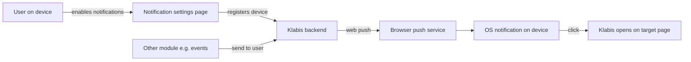

# Proposal

## Why

Klabis can reach users only by e-mail, which is easy to miss for time-critical information (registration deadlines, event changes). Several planned features (#89 deadline reminders, #27 negative balance, #28 notification preferences) need a channel that pops up on the user's phone or desktop like a native app. The app is already installable as a PWA. Web push is the standard way to deliver OS notifications to an installed PWA and to desktop browsers, including when the app is closed.

## What Changes

- New **notification settings page** ("Notifikace"), reachable from the home page. On it the user can:
  - enable or disable notifications on the current device (the OS permission prompt is shown only after an explicit click),
  - see all their devices that receive notifications and remove any of them,
  - send a test notification to all their devices.
- The page explains why notifications are unavailable: browser not supported, permission blocked, or iOS without the app installed to the home screen.
- Clicking a notification opens (or focuses) Klabis on the page the notification refers to.
- A device whose browser subscription expired or was revoked is removed automatically.
- Explicitly logging out on a device stops notifications to that device.
- Backend gets a new `notifications` module that stores device subscriptions per user and sends push messages. Other modules call an internal API: "send notification (title, text, target page) to user X". No business notifications are part of this change; consumers like #89 come in follow-up changes.
- The feature is available only when the server is configured with push credentials. Without them the home page entry is hidden.

## Capabilities

### New Capabilities

- `push-notifications`: enabling and disabling OS notifications per device, managing the user's notification devices, the test notification, notification click behavior, and the availability conditions.

### Modified Capabilities

_None._ The home page entry is specified within `push-notifications`. `application-navigation` requirements are unchanged.

## Impact

- **Depends on** `fix-pwa-service-worker-updates`: a reliably registered service worker (`src/sw.ts`, `getServiceWorkerRegistration()`), into which this change adds the `push` and `notificationclick` handlers.
- **Backend:**
  - new module `com.klabis.notifications` (domain, JDBC persistence + Flyway migration, REST API, sender),
  - new dependency on a Web Push (VAPID) library,
  - new configuration properties for the VAPID key pair,
  - a root link processor for the home page entry.
- **API:** new endpoints under `/api/notifications` in a new `docs/openapi/spec/notifications.yaml` (spec-first).
- **Frontend:**
  - new notification settings page and route,
  - a home page entry,
  - push subscription handling in the service worker,
  - unsubscribe on explicit logout.
- **Operations:** a VAPID key pair has to be generated once and configured in production. Rotating it invalidates all subscriptions.
- **GDPR:** a stored subscription is personal data tied to a user. It is removed when the user removes the device, logs out on it, or the push service reports it as gone.
