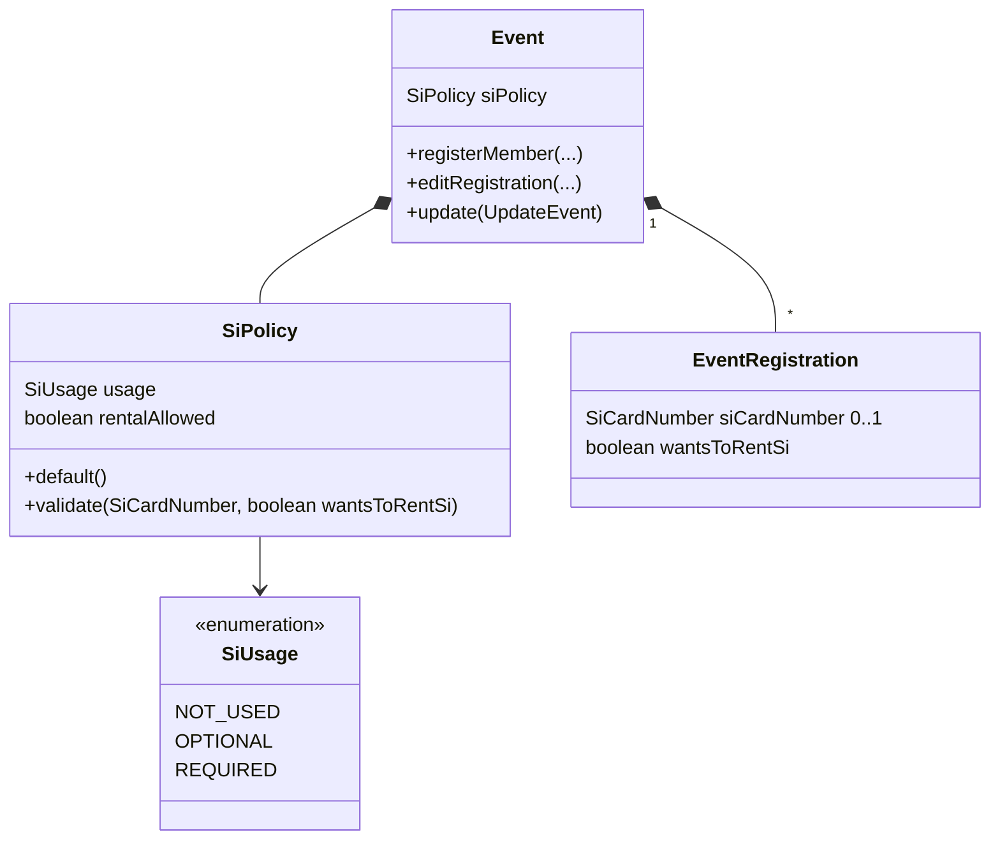

# Design

## Context

`EventRegistration.create` rejects a missing `SiCardNumber`, `events.event_registrations.si_card_number` is `NOT NULL`, and `RegisterEventRequest` / `EditRegistrationRequest` declare `siCardNumber` as required with `pattern: '\d{6,7}'` — out of step with `SiCardNumber` and the spec (4–8 digits). The event already has per-event offers modelled the way this change needs (`sharedTransportEnabled` / `sharedAccommodationEnabled` on `Event`, the request schemas and `EventDto`).

HAL-FORMS cannot shape a template per event: `HalFormsSupport` drops a property only for field security, and `required` comes from static record annotations. The shared-service tick boxes are therefore always in the registration templates; the **frontend** hides them, using the event it loads alongside the registration (`RegistrationDialogEventContext`, `useRegistrationDialogData`), and `Event.editRegistration` keeps the current choice when an offer is off (`Event.java:881-884`).

Events are created through `Event.CreateEvent` by the API (`CreateEventConverter`), by `EventsDataBootstrap` (27 events) and by many tests, most through a constructor that fills defaults; ORIS imports go through `Event.createFromOris`.

This change builds on `gh-331-event-registration-notes` (archived first): the read-only registration detail and the registration-form requirement it modifies.

## Goals / Non-Goals

**Goals:**
- Per-event SI policy, enforced by the `Event` aggregate on register and on edits of SI values.
- Registration form shaped by the policy the way the shared-service offers are.

**Non-Goals:**
- Mapping ORIS SI / RentSI — done in `oris-event-registration-sync`.
- Rental fees, rental stock, or showing rental requests in the registrations list / event summary — open question in issue #371.
- Reading an SI policy from ORIS event details on import (imported events get "required, rental allowed").
- Synchronising the SI policy with ORIS — it is a Klabis-owned field, absent from the event's sync projection.
- A per-event template-shaping mechanism in `common` HAL-FORMS.

## Decisions

### D1 — `SiPolicy` value object on `Event`

`SiPolicy(SiUsage usage, boolean rentalAllowed)` with `SiUsage ∈ {NOT_USED, OPTIONAL, REQUIRED}`. `rentalAllowed` is forced to `false` when `usage = NOT_USED` (normalised in the factory, so the UI hiding the tick box and the domain agree).

`SiPolicy.default()` = `REQUIRED` with rental allowed. It is:
- the domain default — `Event.create` with no policy given (example data, tests, any programmatic caller) gets it;
- what `Event.createFromOris` applies internally (ORIS races normally offer rental, and synchronised ORIS registrations may carry rental requests) — `CreateEventFromOris` does not change.

The **API** has no default: `CreateEventRequest.siUsage` is required, so a manager creating an event in Klabis must pick the usage in the form. Example data does not need per-event policies.

*Alternative:* `Event.create` rejecting a missing policy, with bootstrap and tests passing one explicitly — rejected by the user: a sensible domain default is enough.

*Alternative:* three booleans (`siUsed`, `siRequired`, `rentalAllowed`) — rejected: allows the meaningless "required but not used" combination.

### D2 — The aggregate validates what is entered or changed

`SiPolicy.validate(siCardNumber, wantsToRentSi)`:

| usage | SI number | rent | result |
|---|---|---|---|
| NOT_USED | – | – | accepted (nothing is offered) |
| OPTIONAL | empty or valid | allowed only if `rentalAllowed` | accepted |
| REQUIRED | valid | allowed only if `rentalAllowed` | accepted |
| REQUIRED | empty | true and `rentalAllowed` | accepted |
| REQUIRED | empty | otherwise | rejected "SI card number is required" |

Rent requested on an event without rental → rejected. `EventRegistration` itself only guarantees the format (`SiCardNumber`) and no longer requires presence.

**On register** (`Event.registerMember`) the whole policy is validated. Values the policy does not offer are not taken: under NOT_USED no SI number is stored, without rental `wantsToRentSi` is false.

**On edit** (`Event.editRegistration`) — mirroring the shared-service offers:
- a value the policy does not offer keeps its current value (NOT_USED → SI number kept; no rental → `wantsToRentSi` kept);
- the policy is validated on **every** edit, against the effective values (after "not offered means kept"). An edit of the category, notes or shared-service choices is refused with the SI error while the registration does not fit the policy;
- when the policy does not offer rental, a kept `wantsToRentSi = true` is validated as `false` (and stays stored as it is). Otherwise a registration whose rental request outlived the rental option could not be edited at all, because the form cannot clear a value it does not offer; such a registration needs only an SI number (under REQUIRED).

So a registration that does not fit the policy — one brought in from ORIS, or one recorded before the policy changed — has to be brought in line (SI number filled in, or rental request fixed) with its next edit, whatever the user was changing. The edit form is the same as the registration form and enforces the same rules; a separate "only when SI changed" path would be a second rule in the domain and the dialog for little benefit.

*Trade-off:* a user with EVENTS:REGISTRATIONS cannot change, for example, the category of such a registration until its SI values fit the policy.

*Alternative:* validate only when the SI number or `wantsToRentSi` changes — rejected: manual testing showed the stricter rule is the expected behaviour of the shared form.

Changing the policy (D1) never touches existing registrations: recorded numbers and rental requests are kept and simply not shown / not required while the policy says so.

### D3 — The registration dialog shapes the form from the event, like the shared-service offers

The registration templates (`registerForEvent`, `editRegistration`) always carry `siCardNumber` (no longer `required`) and `wantsToRentSi`. `siUsage` and `siRentalAllowed` are added to `RegistrationDialogEventContext`; the dialog then:

| usage | SI field | "Chci si půjčit čip" |
|---|---|---|
| NOT_USED | hidden | hidden |
| OPTIONAL | shown, optional | shown when rental allowed |
| REQUIRED, no rental | shown, required | hidden |
| REQUIRED, rental allowed | shown, required unless the tick box is ticked | shown |

Hidden fields are stripped in `postprocessPayload`, so the profile SI number prefilled into the form (`EventRegistrationController`) is not sent for a NOT_USED event. The "required unless renting" rule is enforced in the browser (Yup schema built from the event context) and again by the domain (D2). `SiCardNumberField` draws the required marker from the computed rule, not unconditionally.

*Alternative:* a per-call property / `required` override in `common` HAL-FORMS — rejected: a framework change (and `backend-patterns` update) for something the existing pattern covers.

### D4 — Event form and PATCH semantics

`siUsage` is an inline enum in `CreateEventRequest` (required, no default) and in `UpdateEventRequest` as `type: [string, 'null']` per the PATCH rules, both mapped through `schemaMappings` (`CreateEventRequest_siUsage`, `UpdateEventRequest_siUsage`) to the domain `SiUsage`; `x-hal-input-type: SiUsage` so the frontend uses the `SiUsage` label group. In PATCH an explicit `null` keeps the current value (as `name` does); `UpdateEvent.from` carries the policy. `siRentalAllowed` is a plain boolean (default false on create). The create form in `EventsPage` lists its fields explicitly, so both new fields are added there; a required enum select with no preselected value already works (`HalFormsSelect` placeholder).

## Domain Model

| Element | Change |
|---|---|
| `SiPolicy`, `SiUsage` | **Added** — `SiPolicy.default()` = REQUIRED with rental |
| `Event.siPolicy`; `CreateEvent`, `UpdateEvent` | **Changed** — carry the policy; `CreateEvent` defaults to `default()`; `createFromOris` applies `default()` |
| `CreateEventConverter` (MapStruct) | **Changed** — assembles `SiPolicy` from the request |
| `EventRegistration.siCardNumber` | **Changed** — optional |
| `EventRegistration.wantsToRentSi`; `CreateEventRegistration`, `EditRegistrationCommand` | **Added** |
| `Event.RegisterCommand` | **Changed** — the unenforced `\d{6,7}` pattern annotation removed |
| readers of the SI number (`EventRegistrationMemento`, `EventRegistrationController`, `EventRegistrationService`) | **Changed** — handle an absent number |
| `events.events` | + `si_usage VARCHAR(20) NOT NULL DEFAULT 'REQUIRED'`, + `si_rental_allowed BOOLEAN NOT NULL DEFAULT TRUE` |
| `events.event_registrations` | `si_card_number` → `NULL`; + `wants_to_rent_si BOOLEAN NOT NULL DEFAULT FALSE` |

## API

No new endpoints, link names or template names.

| Schema | Change |
|---|---|
| `CreateEventRequest`, `UpdateEventRequest` | + `siUsage` (D4), + `siRentalAllowed` (boolean) |
| `EventDto` | + `siUsage`, + `siRentalAllowed` |
| `RegisterEventRequest`, `EditRegistrationRequest` | `siCardNumber` no longer `required`, pattern `^\d{4,8}$`; + `wantsToRentSi` (boolean, default false) |
| `RegistrationDto` | `siCardNumber` may be absent; + `wantsToRentSi` |
| `RegistrationDialogEventContext` (frontend) | + `siUsage`, `siRentalAllowed` (D3) |
| `events.yaml` descriptions of shared-service properties | corrected: they are always in the template, the dialog hides them |

## Glossary

| Term | Meaning |
|---|---|
| SI policy | Per-event setting saying whether an SI card is not used, optional or required, and whether rental is allowed. |
| SI card rental (půjčení čipu) | The participant asks the organiser to lend them an SI card for the event instead of using their own. |

## Risks / Trade-offs

- [An absent SI number reaches a reader that assumes one] → all readers are inside the events module (memento, controller, service); each handles absence explicitly with a test. `RegistrationEditedEvent` already tolerates null and has no consumers; no other module reads the number.
- [Browser rule and domain rule drift apart] → the domain stays authoritative; a scenario test covers the "required unless renting" error from the server too (shown as a generic form error).
- [A registration that does not fit the policy cannot be edited until it does] → intended (D2): every edit is validated against the current policy; such registrations stay visible on the registration detail, and the SI error tells the editor what to fix.
