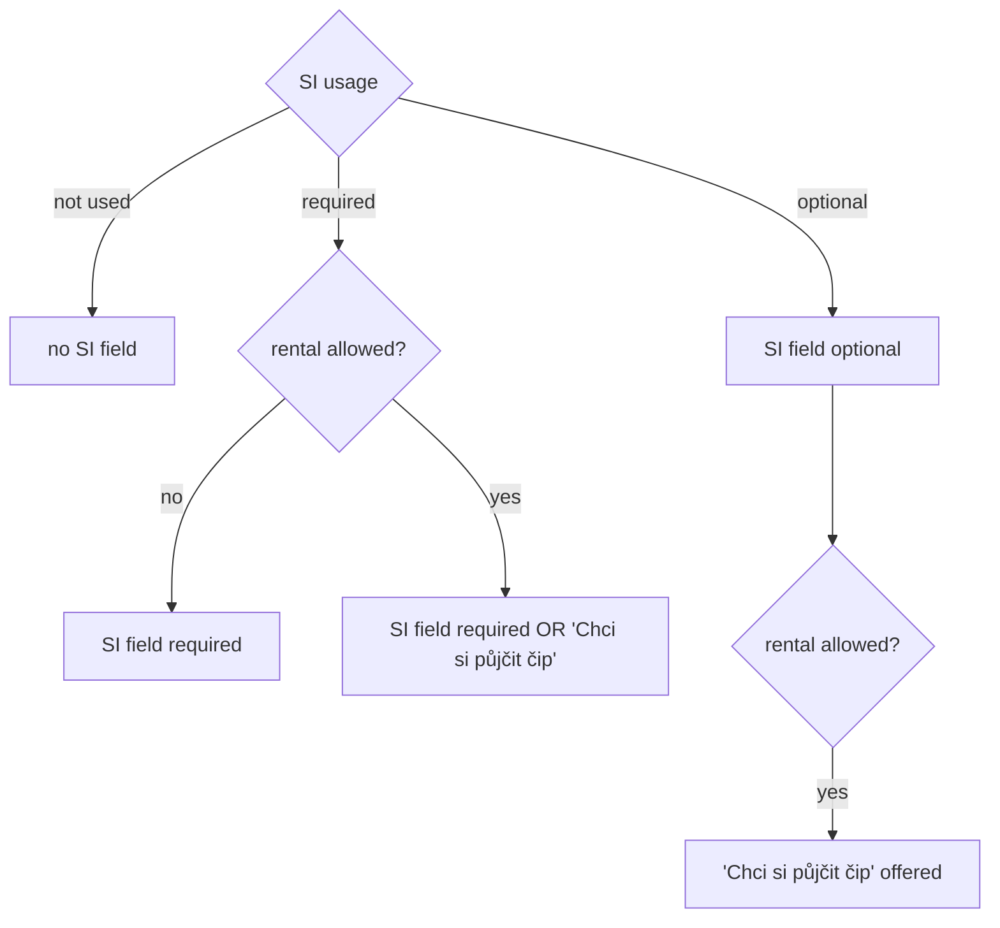

# Proposal

## Why

Every registration today requires an SI card number. That does not fit every event: trainings and social events do not use SI at all, some events accept registrations without a card known in advance, and many races let a participant rent a card from the organiser. Registrations synchronised from ORIS (`oris-event-registration-sync`) can also arrive without an SI card number when the participant rents one. The event needs to say how it uses SI, and the registration needs to record a rental.

## What Changes

- An event gets an **SI policy** set by the manager or coordinator in the event form:
  - **SI usage**: not used / optional / required — the event manager chooses it in the event form when creating an event in Klabis; there is no preselected value.
  - **SI rental allowed**: yes / no (unticked by default in the form; meaningful only when SI is used).
  - Events imported from ORIS, and events created outside the event form (example data), get "required, rental allowed"; the manager or coordinator can change it afterwards.
- The registration form and edit form follow the policy:
  - not used → no SI card field;
  - optional → SI card field not required;
  - required → SI card field required, unless the member ticks "Chci si půjčit čip" where rental is allowed.
- A registration records whether the member wants to rent an SI card ("půjčení čipu"); it is shown on the registration detail.
- Changing the policy on an event with existing registrations is always allowed; SI card numbers and rental requests already recorded are kept.
- Every edit of a registration must fit the event's current SI policy: editing any detail of a registration that does not fit the policy (e.g. one synchronised from ORIS) is refused until its SI values are fixed. Values the policy does not offer are kept as they are.
- Where rental requests are shown beyond the registration detail is an open question (issue #371).

## Capabilities

### New Capabilities

_None._

### Modified Capabilities

- `events`: the event form gains the SI policy (usage + rental), editable while DRAFT or ACTIVE.
- `event-registrations`: registration and edit forms follow the event's SI policy; registrations record SI rental; SI card validation applies only when a number is entered or required; the registration form / read-only detail show SI values only where the event uses them.

## Impact

- **Backend (`events` module):** `Event` gains an SI policy; `EventRegistration` gains the rental flag and an optional SI card number; `events.events` gains two columns and `events.event_registrations.si_card_number` becomes nullable (V001 updated in place). Events created without an explicit policy get "required, rental allowed".
- **API (`docs/openapi/spec/events.yaml`):** additive — SI policy on event create/update/detail, `wantsToRentSi` on registration request/response, `siCardNumber` no longer required in requests and its pattern aligned to 4–8 digits (validated against the policy by the domain).
- **Frontend:** event create / edit form fields; the registration dialog shows, requires or hides the SI field and the rental tick box from the event's policy, the same way it handles the shared-service offers.
- **Depends on:** `gh-331-event-registration-notes` (read-only registration detail, registration-form requirement).
- **Follow-up:** `oris-event-registration-sync` maps ORIS SI / RentSI onto this model.
