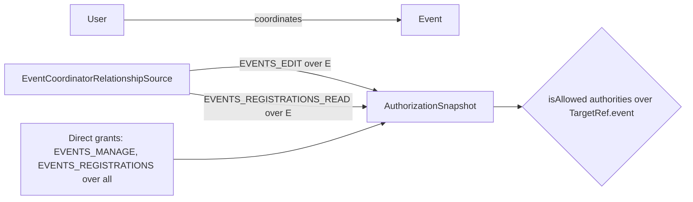
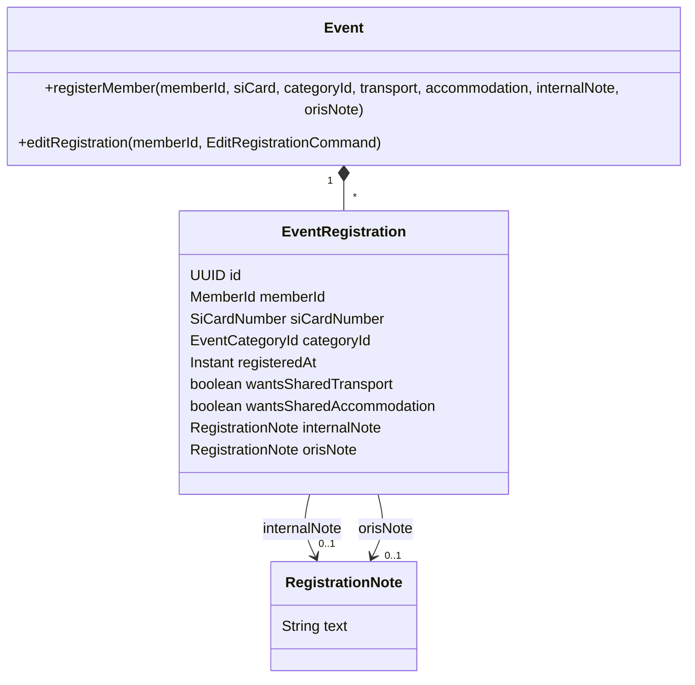

# Design

## Context

A registration is the `EventRegistration` value object inside the `Event` aggregate, persisted as a row of `events.event_registrations` (`EventRegistrationMemento`). It is created by `Event.registerMember(...)` and replaced by `Event.editRegistration(...)` (`withChanges` keeps id and registration time). Registration detail is served by `getRegistration` (`/api/events/{eventId}/registrations/{memberId}`), today declared readable only by the owner or EVENTS:REGISTRATIONS (`x-klabis-authority` + `x-klabis-owner-visible`, enforced by `HasAuthorityMethodInterceptor` before the controller runs, and by `klabisLinkTo` for every link to it). The frontend has no registration page of its own: `EventRegistrationDialog` opens the registration representation, takes its mode from the `registerForEvent` / `editRegistration` template, and shows an error when neither is present; its form is a `customLayout` listing the fields explicitly.

The event coordinator is special-cased today outside the authorization model: `EventAffordanceSupport.isCoordinatorOrHas(evaluator, authority, auth, event)` reads `event.isCoordinator(memberId)` at six call sites, `updateEvent` carries no `x-klabis-authority` because "coordinator" could not be named in the spec, and the registrations list hides `registrationTime` through a `@JsonIgnore` `coordinators` component used as a MEMBER target id. A coordinator can also change the `coordinators` collection itself through `updateEvent` (no field rule on `UpdateEventRequest`). The ReBAC support (`RelationshipSource`, `AuthorizationSnapshot`, `TargetType.EVENT`, `TargetRef.event`, `@TargetGrant` with EVENT targets) can express "user X holds authority Y over event Z", but no authority is held over specific events yet.

## Goals / Non-Goals

**Goals:**
- Coordinator privileges expressed as grants over the coordinated event (first iteration).
- Only EVENTS:MANAGE changes an event's coordinators — the coordinator role now unlocks SI card numbers and notes of all registrants, so it must not be self-propagating.
- Two optional notes on the registration, carried through register, edit and detail.
- Read-only registration detail — for the coordinator, and for the member / EVENTS:REGISTRATIONS once editing is closed.

**Non-Goals:**
- Any ORIS interaction — `oris-event-registration-sync` maps the ORIS note inward, issue #370 outward.
- Showing notes in the registrations list, the accommodation list or exports.
- Operations with more than one target (e.g. `getRegistration`: the member as owner and the event for the coordinator) declared in the spec — that needs multi-target support in `common.authorization`, the generator and `validate.mjs`; such operations are undeclared and checked imperatively over the grant.
- Any other change to what a coordinator may do — publishing / cancelling stays EVENTS:MANAGE only.
- A standalone "Moje přihláška" page — the registration detail stays the registration dialog.

## Decisions

### D0 — Coordinator privileges are relationship-based grants over the event

**Authorities** (`common.users.Authority`):

| Authority | Target type | Grant form | Held by |
|---|---|---|---|
| `EVENTS_EDIT` ("EVENTS:EDIT") — **new** | EVENT | SPECIFIC | the coordinators of the event |
| `EVENTS_REGISTRATIONS_READ` ("EVENTS:REGISTRATIONS_READ") — **new** | EVENT | SPECIFIC | the coordinators of the event |
| `EVENTS_REGISTRATIONS` — **changed** | MEMBER → EVENT | ALL (unchanged) | users granted it directly |
| `EVENTS_MANAGE` — unchanged | EVENT | ALL | users granted it directly |

`EVENTS_MANAGE` deliberately stays ALL-only: it guards 22 operations, 19 of them catalogues and imports with no event to name (event types, disciplines, category presets, `createEvent`, ORIS import), which `validate.mjs` would then reject for lacking an EVENT target id; and naming the event on `publishEvent` / `cancelEvent` would let coordinators publish and cancel. A separate narrow authority keeps today's coordinator rights exactly.

`EVENTS_REGISTRATIONS` is re-typed to EVENT for consistency within the events family. Its MEMBER type was never read: target types are consulted only for SPECIFIC authorities (`AuthorizationSnapshot.fromSources`, `validate.mjs` target check, `FreeGroup` delegation filter), and the MEMBER target on the registration operations exists for `x-klabis-owner-visible`, not for the authority. `AuthorityTest` changes.

Neither new authority appears in the permissions dialog (`assignableAuthorities()` = ALL-holdable only) nor in free-group delegation (`FreeGroup` delegates MEMBER-typed SPECIFIC authorities only). They are not added to the `Authority` enum in `common.yaml` either — they are never on the wire; a comment there says so. `Authority.delegatable()` is renamed `holdableOverTargets()`: with coordinator-only authorities in the set, "delegatable" no longer describes it.

**`EventCoordinatorRelationshipSource`** (`events.infrastructure`): `grantsOf(userId)` returns `EVENTS_EDIT` and `EVENTS_REGISTRATIONS_READ` over every event whose coordinators include the user's member id — all coordinated events regardless of status, as `event.isCoordinator` today. It reads event **ids only** through a new `EventRepository` port method backed by the existing id query (`EventRepositoryAdapter.findIdsByCoordinator`, index `idx_event_coordinators_member_id`) — never `findAll(EventFilter.withCoordinator)`, which loads full aggregates with their registrations on every authenticated request.

**Call sites:**

| Today | After |
|---|---|
| `updateEvent` — no `x-klabis-authority`, imperative `isCoordinatorOrHas(EVENTS_MANAGE)` | declarative: `x-klabis-authority: [EVENTS_MANAGE, EVENTS_EDIT]`, the shared `EventIdParam` gains `x-klabis-target-id: EVENT` — it also marks `getEvent`, `publishEvent`, `cancelEvent`, harmlessly: their authorities are ALL-only or absent, and `{id}` is truly their target |
| `EventAffordanceSupport.addManagementAffordances` — `isCoordinatorOrHas(EVENTS_MANAGE)` | `isAllowed([EVENTS_MANAGE, EVENTS_EDIT], event, false)` |
| shared-services summary, accommodation list access, `accommodation-list` link in `EventDetailsPostprocessor`, registrations sort by registration time — `isCoordinatorOrHas(EVENTS_REGISTRATIONS)` | `isAllowed([EVENTS_REGISTRATIONS, EVENTS_REGISTRATIONS_READ], event, false)` |
| `RegistrationSummaryDto.registrationTime` — `x-klabis-authority: EVENTS_REGISTRATIONS` + owner-visible against hidden `coordinators` (MEMBER) | `x-klabis-authority: [EVENTS_REGISTRATIONS, EVENTS_REGISTRATIONS_READ]` (owner-visible dropped) against a hidden `eventId` component marked `x-klabis-target-id: EVENT`; `coordinators` removed |

`isCoordinatorOrHas` is deleted. `Event.isCoordinator` stays for domain use (calendar feed).

**Coordinators are changed by EVENTS:MANAGE only.** `UpdateEventRequest.coordinators` gets `x-klabis-authority: EVENTS_MANAGE` and `x-klabis-read-authority: [EVENTS_READ]`: a coordinator sees the field read-only in the edit form and a submitted change from them is refused. `EVENTS_READ` is held by every user, so the field is shown to whoever sees the edit form at all. This is the one user-visible change of this iteration (`events` spec delta).

*Alternative:* one role authority `EVENTS_COORDINATE` checked as `has(X) || isAllowed(EVENTS_COORDINATE, event)` — rejected: it names a role, not a permission, and could not make `updateEvent` declarative. *Alternative:* `EVENTS_MANAGE` gaining SPECIFIC — rejected, see above.

### D1 — Notes are part of the registration value object

Both notes are attributes of `EventRegistration` and flow through the existing `CreateEventRegistration` / `EditRegistrationCommand`, so they obey the same timing rules (`assertRegistrationsOpen`) and keep the registration's identity and registration time on edit. Notes are personal free text: they are left out of `EventRegistration.toString()` and out of `RegistrationEditedEvent` (persisted by Modulith in `event_publication`).

*Alternative:* a separate "registration notes" entity editable outside the window — rejected: the issue ties notes to the registration and no use case needs a different window.

### D2 — `RegistrationNote` value object

A small value object holding trimmed text of 1–255 characters; blank input maps to "no note". Used for both notes so the rule lives in one place. 255 is the club's own limit; the ORIS note limit is not documented (see Open Questions). The request schemas declare `maxLength: 255`, so the form limits each note input to 255 characters (with a character counter) and the backend rejects longer input with a validation error; that limit applies to the raw input, before trimming — a note padded with spaces past 255 characters is rejected, which is accepted.

### D3 — Who reads a registration detail, and how it is checked

`getRegistration` is no longer declared in the spec: `x-klabis-authority` / `x-klabis-owner-visible` are removed, with a spec comment pointing here — the same treatment `updateEvent` had for the same reason. With a declaration, `HasAuthorityMethodInterceptor` refuses the coordinator before any controller code runs, and `klabisLinkTo` drops every link to the registration for them; one target cannot express "owner of the member **or** grant over the event".

One helper in the events REST layer, `RegistrationReadAccess.canRead(eventId, memberId)` = owner **or** `isAllowed([EVENTS_REGISTRATIONS, EVENTS_REGISTRATIONS_READ], TargetRef.event(eventId), false)`, is the single rule:

- `getRegistration` refuses with 403 when it does not hold;
- every producer of a link to `getRegistration` checks it explicitly before adding the link — registrations-list rows (`RegistrationSummaryPostprocessor`), accommodation list items (`AccommodationListItemPostprocessor`), and the `newRegistration` / own-registration links on the event (`EventController`). Once undeclared, `klabisLinkTo` would offer these links to anyone.

`editRegistration` / `unregisterFromEvent` stay declared (owner or EVENTS:REGISTRATIONS), so a coordinator-only caller never gets those templates. Field security on `RegistrationDto`:

| Field | Owner | EVENTS:REGISTRATIONS | Coordinator |
|---|---|---|---|
| `siCardNumber` | yes | yes | yes |
| `internalNote`, `orisNote` | yes | yes | yes |
| everything else | yes | yes | yes |

The coordinator sees the whole registration, SI card number included — they need it to register the member at the event presentation; the registrations list keeps hiding SI card numbers from everyone.

*Alternative:* keep the declaration and add a `@HandleAuthorizationDenied` handler that re-checks the grant — rejected: links built through `klabisLinkTo` would still be dropped for the coordinator.

*Alternative:* show notes to the coordinator in the registrations list — rejected by the user: notes are detail-only.

### D4 — Frontend: read-only registration detail

`EventRegistrationDialog` gains a **read-only mode**: when the registration representation carries neither `registerForEvent` nor `editRegistration` but is an existing registration, the dialog shows the registration's data without inputs or a submit action, instead of the `noRegistrationAffordance` error. The error stays for a new-registration representation without the register template (closed registrations, sanctions).

The registrations list offers a **"Detail"** row action on every row that carries the registration link but no edit template — the coordinator's rows, and the member's / EVENTS:REGISTRATIONS user's rows after the edit window closes. This is how "both notes are shown" after the deadline is reached.

The two notes are added to the dialog's `customLayout` with explicit `renderField` calls (textarea via `x-hal-input-type`), in the form and in the read-only view; labels go to `labels.ts`.

## Domain Model

| Element | Change |
|---|---|
| `RegistrationNote` | **Added** — value object, trimmed text 1–255 chars |
| `EventRegistration.internalNote`, `.orisNote` | **Added** — optional; excluded from `toString()` |
| `CreateEventRegistration`, `EditRegistrationCommand`, `Event.RegisterCommand`, `Event.registerMember`, `EventRegistrationService` | **Changed** — carry both notes |
| `events.event_registrations` | **Changed** — `internal_note VARCHAR(255) NULL`, `oris_note VARCHAR(255) NULL` (in V001) |
| `Authority.EVENTS_EDIT`, `Authority.EVENTS_REGISTRATIONS_READ` | **Added** — EVENT, SPECIFIC (D0) |
| `Authority.EVENTS_REGISTRATIONS` | **Changed** — target type MEMBER → EVENT |
| `Authority.delegatable()` | **Renamed** — `holdableOverTargets()` |
| `EventRepository` | **Changed** — + coordinated event ids of a member |
| `EventCoordinatorRelationshipSource` | **Added** — grants both new authorities over coordinated events |

## API

No new endpoints, link names or template names.

| Schema / operation | Change |
|---|---|
| `updateEvent` | + `x-klabis-authority: [EVENTS_MANAGE, EVENTS_EDIT]` (D0); comment rewritten |
| `EventIdParam` | + `x-klabis-target-id: EVENT` (shared by `getEvent`, `updateEvent`, `publishEvent`, `cancelEvent`; D0) |
| `UpdateEventRequest.coordinators` | + `x-klabis-authority: EVENTS_MANAGE`, `x-klabis-read-authority: [EVENTS_READ]` (D0) |
| `getAccommodationList` | comment rewritten (names the grant instead of a coordinator helper) |
| `RegistrationSummaryDto` | `registrationTime`: authorities `[EVENTS_REGISTRATIONS, EVENTS_REGISTRATIONS_READ]`, owner-visible dropped, target = hidden `eventId` (EVENT); hidden `coordinators` removed; descriptions rewritten. Notes are never in the list. |
| `RegisterEventRequest` | + `internalNote` (string, maxLength 255, optional, `x-hal-input-type: textarea`), + `orisNote` (same shape) |
| `EditRegistrationRequest` | + `internalNote`, + `orisNote` (same shape; absent/empty = no note) |
| `RegistrationDto` | + `internalNote`, + `orisNote` (string, optional) |
| `getRegistration` | `x-klabis-authority` / `x-klabis-owner-visible` removed; checked by `RegistrationReadAccess` (D3); templates `editRegistration` / `unregisterFromEvent` unchanged in meaning |
| links to `getRegistration` (list rows, accommodation items, event links) | added only when `RegistrationReadAccess.canRead` holds (D3) |
| `Authority` enum in `common.yaml` | unchanged; comment that EVENT-targeted authorities are internal |

## Glossary

| Term | Meaning |
|---|---|
| Internal note (Interní poznámka) | Free-text remark on a registration meant only for the club. |
| ORIS note (Poznámka do ORIS) | Free-text remark on a registration meant for the organiser's ORIS entry; synchronised with ORIS by later changes. |
| EVENTS:EDIT | Authority to edit one specific event; held by that event's coordinators. |
| EVENTS:REGISTRATIONS_READ | Authority to read the registrations of one specific event in full (registration times, accommodation list, registration detail); held by that event's coordinators. |
| Registration detail | The registration dialog in read-only mode: the registration's data without inputs or a submit action. |

## Risks / Trade-offs

- [`getRegistration` and the links to it are guarded by imperative code] → one helper is the only rule; `@WebMvcTest`s for owner, EVENTS:REGISTRATIONS, coordinator grant and other member on the endpoint and on each link producer.
- [Refactor silently widens or narrows coordinator rights] → the existing coordinator tests stay as acceptance tests, rewired from `withCoordinator` fixtures to `@WithKlabisMockUser(targetGrants = …)` with the same expectations (`EventControllerTest`, `EventRegistrationControllerTest`), plus one integration test that a real coordinator gets the grants from the source.
- [A wrong `x-klabis-target-id` on a hidden record component silently denies] → `validate.mjs` does not check property-level target types against SPECIFIC field authorities; covered by a positive `@WebMvcTest` (coordinator sees `registrationTime`).
- [Extra query per request for the snapshot] → id-only indexed lookup on `event_coordinators.member_id`, the same cost class as the group sources.
- [A future operation declares `EVENTS_EDIT` or `EVENTS_REGISTRATIONS_READ` with an event target and unintentionally admits coordinators] → intended by design: these authorities exist precisely for the coordinator; their glossary entries state the scope.

## Open Questions

- ORIS's own maximum length for an entry note is undocumented; if it is shorter than 255, `oris-event-registration-sync` / #370 decide how to handle longer Klabis notes. Does not affect this change.
