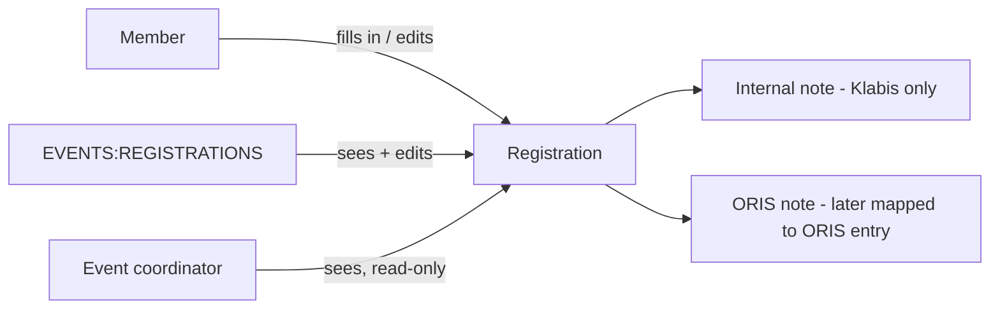

# Proposal

## Why

GitHub issue #331: a member has no way to attach a note to their event registration. Members need two different kinds of note — a remark meant only for the club (e.g. "arriving late, keep me a seat in the car") and a remark meant for the event organiser that belongs to the registration in ORIS (e.g. "late start please"). Today both end up in side channels (e-mail, chat) and get lost.

## What Changes

- **First iteration (refactoring, behaviour unchanged apart from the coordinators rule below):** the event coordinator's privileges move from ad-hoc checks of the event's coordinator list (`isCoordinatorOrHas`) to relationship-based grants. Two new authorities held only over specific events — `EVENTS:EDIT` and `EVENTS:REGISTRATIONS_READ` — are granted to each coordinator over the events they coordinate. `EVENTS:REGISTRATIONS` is re-typed to events. The coordinator's read-only access to the registration detail below is built on `EVENTS:REGISTRATIONS_READ`.
- Also in the first iteration: only users with EVENTS:MANAGE can change an event's coordinators; a coordinator sees them read-only. The coordinator role now unlocks the SI card numbers and notes of all registrants, so coordinators must not be able to appoint further coordinators.
- A registration gains two optional free-text notes:
  - **Interní poznámka** (internal note) — stays in Klabis, never leaves the club.
  - **Poznámka do ORIS** (ORIS note) — recorded in Klabis now; it is the value that the ORIS registration synchronisation (`oris-event-registration-sync`, and later issue #370 for Klabis → ORIS) maps to the note of the ORIS entry.
- The member fills in both notes on the registration form and can change them in the registration edit form, under the same timing rules as the rest of the registration.
- A user with EVENTS:REGISTRATIONS can see and edit both notes on any member's registration.
- The event coordinator can see both notes (read-only) on the registration detail of any registration for the events they coordinate. To make that possible, the coordinator can open the detail of any registration of their event in read-only form.
- Notes are shown only on the registration detail / edit form, never in the registrations list.
- A registration that can no longer be edited (or may only be read) opens as a read-only registration detail from a "Detail" action in the registrations list, instead of an error.

## Capabilities

### New Capabilities

_None._

### Modified Capabilities

- `events`: only EVENTS:MANAGE changes the coordinators of an event.
- `event-registrations`: registration form and edit form carry the two notes; a registration without an edit action opens read-only; registration detail shows them; the event coordinator gains read-only access to the registration detail of their events; the registrations list explicitly does not show notes.

## Impact

- **Authorization (`common.users.Authority`, `events` module):** two new SPECIFIC-only authorities over events (`EVENTS_EDIT`, `EVENTS_REGISTRATIONS_READ`), `EVENTS_REGISTRATIONS` target type MEMBER → EVENT (no runtime effect, it is held over everything only), a new `EventCoordinatorRelationshipSource`; every `isCoordinatorOrHas` call site, the imperative `updateEvent` check and the hidden `coordinators` field of the registrations list are replaced by grants. No authority is added to the assignable catalogue or to group delegation.
- **Backend (`events` module):** `EventRegistration` value object gains two optional note values; registration and edit commands carry them; persistence adds two nullable columns to `events.event_registrations` (V001 is updated in place).
- **API (`docs/openapi/spec/events.yaml`):** additive — two optional properties on `RegisterEventRequest`, `EditRegistrationRequest` and `RegistrationDto`; `getRegistration` loses its declarative authorization and is checked by one helper (owner, EVENTS:REGISTRATIONS or the coordinator grant), which also guards every link to it; `UpdateEventRequest.coordinators` gets a field rule.
- **Frontend:** registration dialog gains a read-only mode and renders the notes; the registrations list gets a "Detail" row action.
- **Follow-up:** `oris-event-registration-sync` maps the ORIS note to the ORIS entry note; issue #370 sends it outward.
