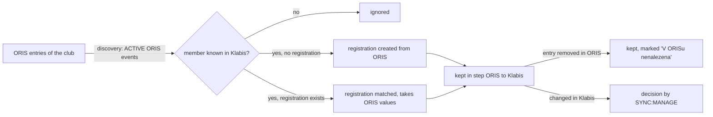

# Proposal

## Why

Events are already imported from ORIS and kept in step automatically, but the registrations of club members are not. A member entered into an ORIS event by the club's registrar (přihlašovatel), or who registered directly in ORIS, is invisible in Klabis — the registrations list, the shared-transport counts and the accommodation list are incomplete, and the registrar has to compare both systems by hand. This change brings ORIS entries of club members into Klabis and keeps them in step, ORIS → Klabis only. Sending Klabis changes to ORIS is issue #370.

Depends on `gh-331-event-registration-notes` (ORIS note) and `event-si-policy` (optional SI card, SI rental).

## What Changes

- **Discovery:** a scheduled run (and an on-demand action on the event detail page for users with SYNC:MANAGE, which brings in new entries only) reads the club's ORIS entries of every ACTIVE event that is kept in step with ORIS, and brings in each entry of a member who exists in Klabis and is paired with their ORIS club membership — sanctioned members included. Entries of anybody else are ignored.
- **Bringing in an entry:** when the member has no registration for the event, one is created from ORIS (category, SI card, SI rental, ORIS note, registration time) regardless of the Klabis registration deadline and SI policy. When the member already has a registration, the two are matched and the registration takes the ORIS values.
- **Kept in step:** later ORIS changes to a matched entry reach the registration automatically.
- **Nothing is deleted:** an entry removed from ORIS leaves the Klabis registration in place, marked "V ORISu nenalezena"; the mark disappears if the entry comes back.
- **Klabis changes are never silently overwritten:** changing the category, SI card, SI rental or ORIS note of a matched registration in Klabis — or unregistering while the ORIS entry still exists — asks a user with SYNC:MANAGE for a decision (until #370 sends such changes to ORIS). Internal note and shared-service choices never cause a decision.
- **Visibility:** the synchronisation state of a registration is reachable from its detail like that of any synchronised entity: the headline state for anyone who can see the registration, the details and actions for users with SYNC:MANAGE. No badge in the registrations list.
- **Configuration:** reuses the existing ORIS club id (`oris.client.my-club-id`).

## Capabilities

### New Capabilities

_None._

### Modified Capabilities

- `event-registrations`: registrations of club members entered in ORIS appear in Klabis and are kept in step; registrations removed in ORIS are marked; Klabis edits of synchronised fields ask for a decision; synchronisation state is reachable from a registration.

`data-synchronization` is not modified: registrations use the engine exactly as described there (pairing, direction, conflicts, retries, history).

## Impact

- **Backend:** new sync entity type `EVENT_REGISTRATION` (`sync` module enum + path segment `event-registrations`) and a read-only pairing-lookup port in `sync`; new ORIS registration adapter and discovery job in `events.infrastructure.orissync`; `Event` gains operations to import / synchronise a registration from ORIS without the registration-window check and a "missing in ORIS" mark on `EventRegistration`; listeners mark registrations dirty on Klabis edits / unregistration and retire them when the event finishes or is cancelled.
- **API:** `sync.yaml` path segment enum gains `event-registrations`; `RegistrationDto` / `RegistrationSummaryDto` gain the "missing in ORIS" mark; event detail gains an on-demand "load registrations from ORIS" affordance; registration detail gains the `sync` link to its synchronisation state.
- **Configuration:** `klabis.events.oris-entries-discovery-cron`, `klabis.events.oris-entries-cache-ttl`.
- **ORIS load:** one `getEventEntries` call per ACTIVE ORIS event per run, cached for a short TTL.
