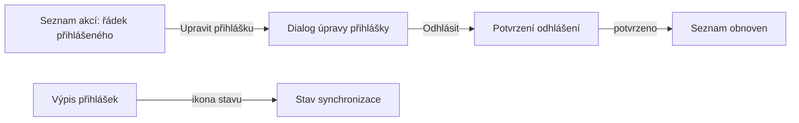

# Proposal

## Why

Stav synchronizace přihlášky s ORIS je vidět jen v jejím detailu, takže ve výpisu přihlášek nepoznáme, které z nich čekají na rozhodnutí. Přihlášený člen navíc musí k úpravě přihlášky nebo odhlášení do detailu akce, ačkoli seznam akcí už o jeho přihlášce ví. Změna odstraňuje tyto zbytečné kliky.

## What Changes

- **Stav synchronizace ve výpisu přihlášek:** řádek přihlášky zapojené do synchronizace s ORIS ukazuje ikonu stavu synchronizace, se stejnými oprávněními jako detail přihlášky (headline stav vidí každý, kdo vidí přihlášku; podrobnosti a akce jen SYNC:MANAGE). Dosavadní pravidlo „výpis nezobrazuje stav synchronizace“ se ruší.
- **Odhlásit v dialogu úpravy přihlášky:** dialog úpravy nabídne tlačítko „Odhlásit“, pokud je odhlášení dostupné. Po kliknutí se dialog zavře a zobrazí se stejné potvrzení odhlášení jako v seznamu akcí.
- **Úprava přihlášky ze seznamu akcí:** řádek akce, na kterou je uživatel přihlášen a může přihlášku upravit, nabídne akci „Upravit přihlášku“, která otevře dialog úpravy.
- Žádný nový HAL odkaz ani nová šablona: dialog úpravy vychází z šablony `editRegistration` a podrobnosti si načte z její URL.

## Capabilities

### New Capabilities

_None._

### Modified Capabilities

- `event-registrations`: výpis přihlášek ukazuje stav synchronizace (mění se požadavek „Synchronisation State Is Reachable From A Registration“); dialog úpravy přihlášky nabízí odhlášení.
- `events`: řádek seznamu akcí nabízí přihlášenému uživateli úpravu jeho přihlášky.

## Impact

- Backend: postprocessor výpisu přihlášek (`EventRegistrationController`) přidává položkám odkaz `sync`, dávkový dotaz na záznamy synchronizace (vzor seznamu akcí).
- Frontend: `EventDetailPage.tsx` (výpis přihlášek), `EventRegistrationDialog.tsx` (tlačítko Odhlásit), `EventsPage.tsx` (akce úpravy v řádku).
- Žádná změna datového modelu ani oprávnění.
