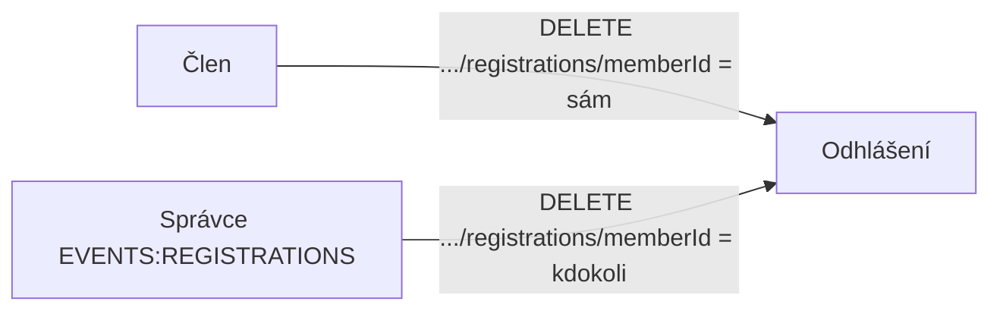

# Proposal

## Why

Odhlášení z akce umí jen samotný člen (endpoint bez `memberId` v cestě, odhlašuje vždy přihlášeného uživatele). Uživatel s oprávněním EVENTS:REGISTRATIONS tak může cizí přihlášku upravit, ale ne odhlásit, a v dialogu úpravy přihlášky tlačítko „Odhlásit“ nevidí.

## What Changes

- **Jeden společný endpoint odhlášení:** `DELETE /api/events/{eventId}/registrations/{memberId}` nahrazuje stávající `DELETE /api/events/{eventId}/registrations` (odhlášení sebe sama). Stejná pravidla jako u úpravy přihlášky: člen odhlásí sebe, uživatel s EVENTS:REGISTRATIONS kohokoli. Časová pravidla (před datem akce a před uzávěrkou) a chybové stavy zůstávají.
- **BREAKING (API):** původní endpoint `DELETE /api/events/{eventId}/registrations` zaniká; klienti používají šablonu `unregisterFromEvent`, jejíž cíl se mění, takže frontend nepotřebuje změnu odkazů.
- **Šablona `unregisterFromEvent`:** nabízí se na přihlášce (detail) i na položce seznamu akcí vlastníkovi přihlášky a navíc uživateli s EVENTS:REGISTRATIONS u cizí přihlášky; vždy cílí na zdroj konkrétní přihlášky.
- **Dialog úpravy přihlášky** nabídne „Odhlásit“ i správci u cizí přihlášky (řídí se přítomností šablony, bez změny frontendu mimo ověření).
- Koordinátor akce (jen čtení přihlášek) odhlašovat nemůže, stejně jako dnes nemůže přihlášky upravovat.

## Capabilities

### New Capabilities

_None._

### Modified Capabilities

- `event-registrations`: požadavek „Unregister from Event“ se rozšiřuje o odhlášení cizí přihlášky uživatelem s EVENTS:REGISTRATIONS; „View Own Registration“ nabízí akci odhlášení také správci; dialog úpravy nabízí odhlášení i správci.

## Impact

- OpenAPI spec `docs/openapi/spec/events.yaml`: operace `unregisterFromEvent` přesunuta na cestu s `memberId`, `x-klabis-authority: EVENTS_REGISTRATIONS` + `x-klabis-owner-visible: true`, odstraněn `ActingMember`; regenerace backend rozhraní a frontend typů.
- Backend: `EventRegistrationController` (odhlášení podle `memberId`, afordance v detailu a v řádku seznamu akcí v `EventController`), testy controlleru.
- Frontend: bez změny kódu očekáváno (dialog a seznam akcí jedou podle šablony); ověřit testem.
- Žádná změna datového modelu.
