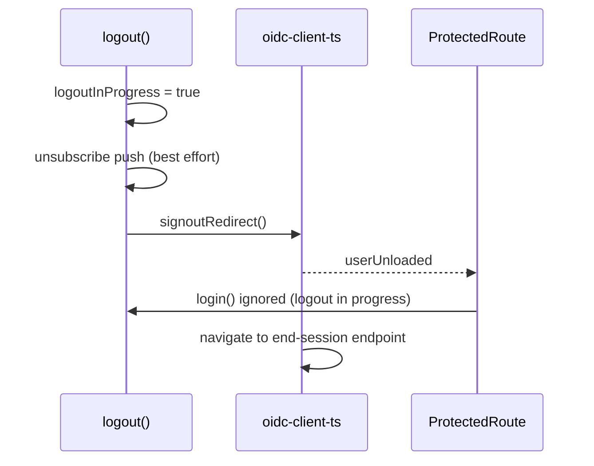

## Context

`logout()` in `AuthProvider` runs: best-effort push unsubscribe → `getUser()` → `removeUser()` → `signoutRedirect({id_token_hint})`. Removing the user fires the `userUnloaded` event, `AuthProvider` clears its user details, and `ProtectedRoute` (`frontend/src/App.tsx`) reacts to `isAuthenticated === false` by calling `login()` → `signinRedirect()`.

Both redirects end in `window.location.assign(...)` after a few asynchronous steps (metadata, PKCE state storage). The browser keeps the navigation that starts last. When the sign-in wins, `/connect/logout` is cancelled, the server session survives, and the authorization request completes silently.

oidc-client-ts 3.3.0 `signoutRedirect()` (`_signoutStart`) itself loads the stored user, sets `id_token_hint` from it, calls `removeUser()` and only then navigates. Dropping our own `removeUser()` alone therefore does not remove the race — `userUnloaded` still fires before navigation.

## Goals / Non-Goals

**Goals:**
- A logout that was started always reaches the authorization server's end-session endpoint.
- No automatic sign-in is triggered by the application while a logout is in progress.
- A failed logout leaves the application usable (user can click "Odhlásit" again, automatic sign-in works again).

**Non-Goals:**
- Changing the silent-renew / token-expiry flows that also call `removeUser()`.
- Changing backend logout endpoints or post-logout redirect configuration.
- Reworking `ProtectedRoute` routing.

## Decisions

**D1: Guard `login()` with a logout-in-progress flag inside `AuthProvider`.**
A `useRef` flag is set at the start of `logout()` and `login()` returns early while it is set. The flag is reset in the error path. On success the page navigates away, so no reset is needed.

Alternatives considered:
- *Ignore `userUnloaded` during logout (keep user details until navigation)* — keeps the protected UI rendered, but other consumers of `isAuthenticated` would still see stale "logged in" state and the guard would be spread across event handling. Rejected as less direct.
- *Guard in `ProtectedRoute`* — requires exposing logout state through the auth context to every consumer; the flag belongs to the component that owns both `login` and `logout`. Rejected.
- *Only drop explicit `removeUser()`* — does not fix the race (library removes the user too). Rejected.

**D2: Let oidc-client-ts remove the user and resolve `id_token_hint`.**
`logout()` calls `signoutRedirect()` without its own `getUser()`/`removeUser()`; the library does both in the correct order. Less code, one source of truth.

**D3: Push unsubscribe stays first and best-effort.**
The flag is set before the push unsubscribe, so no sign-in can start during the (up to 1.5 s) unsubscribe window either.

## Risks / Trade-offs

- [Flag stays set if `signoutRedirect()` neither navigates nor throws] → navigation promise in oidc-client-ts never resolves on success by design; on failure it rejects and the catch resets the flag. Acceptable.
- [Race is timing-dependent and unit tests cannot reproduce browser navigation ordering] → unit test asserts that `login()` during logout does not call `signinRedirect`; plus repeated manual/Playwright logout verification for both test users with backend log check for `/connect/logout`.

## Glossary

- **Logout in progress** — period between the user clicking "Odhlásit" and the browser leaving the application for the end-session endpoint (or the logout failing).
