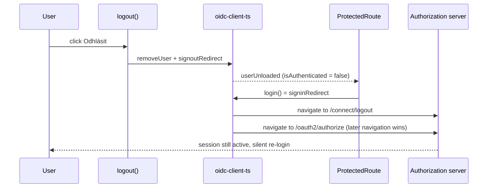

## Why

Clicking "Odhlásit" sometimes silently logs the user back in instead of ending the session. The frontend starts a new sign-in while the sign-out redirect is still in flight, so the authorization server never receives the logout request and the user lands back in the application. This is a defect against already-specified behavior and blocks reliable user switching (also used in QA testing).

## What Changes

- Frontend `AuthProvider` (`frontend/src/contexts/AuthContext2.tsx`) tracks that a logout is in progress; `login()` does nothing while it is set, and the flag is cleared when the logout fails so the user can retry.
- `logout()` stops calling `removeUser()` and passing `id_token_hint` explicitly — `signoutRedirect()` in oidc-client-ts 3.3.0 already removes the stored user and fills the hint from it.
- Best-effort push unsubscribe before the redirect stays unchanged.
- Unit tests in `frontend/src/contexts/AuthContext2.test.tsx` cover the guard; existing push-unsubscribe ordering tests keep their assertions.

## No Behavior Change Justification

**Specs reviewed:**
- `openspec/specs/users-authentication/spec.md` — "RP-Initiated Logout" already requires that logout terminates the session and redirects to the post-logout URI; the fix makes the frontend comply, no requirement changes.
- `openspec/specs/users/spec.md` — "OpenID Connect Logout" and refresh-token invalidation on logout are unaffected; backend endpoints do not change.
- `openspec/specs/push-notifications/spec.md` — stopping notifications on logout keeps its current ordering (before the redirect).

**Why no spec update is needed:**
This is a bug fix of a frontend race condition. The specified behavior (logout ends the session) stays the same; only the implementation stops violating it.

## Impact

- Frontend only: `frontend/src/contexts/AuthContext2.tsx`, `frontend/src/contexts/AuthContext2.test.tsx`.
- No backend, API, or OpenAPI changes.
- Backend static resources need to be refreshed after the frontend change.
