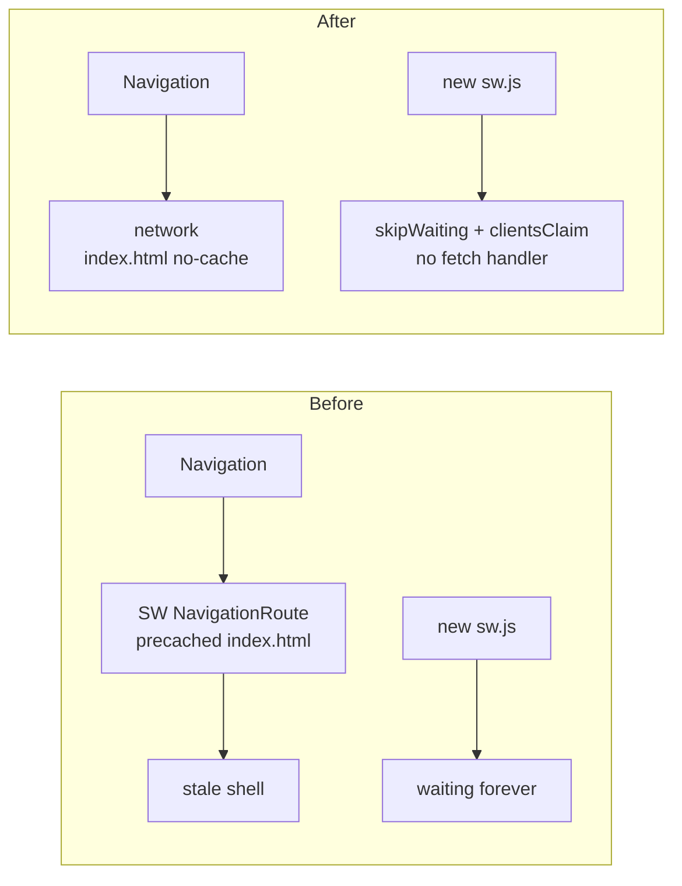

## Why

Users of the installable app (PWA) stay on stale frontend releases for days or weeks. The precaching service worker serves an old `index.html` for every navigation, and its replacement never activates. Since commit `74d736e1` nothing registers the service worker or sends `SKIP_WAITING`. `registerType: 'autoUpdate'` has no effect together with `injectRegister: false`. On top of that, `index.html` is served with `Cache-Control: max-age=3600, public`, so even browsers without a service worker can load an outdated shell for up to an hour after a deploy. That shell then references deleted hashed assets and renders a blank page.

Offline mode is not a requirement. The precache is therefore all cost and no benefit, and it must go before web push notifications (which need a reliably registered and updating service worker) can be built on top of it.

## What Changes

- **Frontend – service worker:** switch `vite-plugin-pwa` from `generateSW` to `injectManifest` with a hand-written `src/sw.ts`. It has no precache, no navigation route and no fetch handler. It calls `skipWaiting()` + `clients.claim()` and carries no migration code for the old worker (clean browsers are assumed).
- **Frontend – registration:** always register the service worker (scope `/`, `updateViaCache: 'none'`) from a small module the future notification feature can reuse. It uses `/sw.js` in production and the plugin's dev worker in development.
- **Frontend – development mode:** enable `vite-plugin-pwa` `devOptions`, so the manifest, the service worker and (later) push can be tested on the Vite dev server (`localhost:3000`) with HMR.
- **Frontend – stale bundle on resume:** an installed app that is resumed from the background keeps old JS in memory. When the app becomes visible again after being hidden for a while and a newer build is deployed, it reloads.
- **Frontend – manifest:** add `id: '/'`. Drop the now-obsolete `workbox` options (`globPatterns`, `navigateFallback*`, `runtimeCaching`).
- **Backend – cache headers:** serve `index.html` (direct, `/`, SPA forwards, `/auth/callback`) and `silent-renew.html` with `Cache-Control: no-cache`. The existing policies for `/assets/**`, `sw.js` and the manifest stay.
- **Backend – remove the `pwa` profile:** delete `PwaDisabledController` and serve the manifest and `sw.js` in every profile. The profile only existed to avoid a poor local-development experience caused by the precaching worker, and removing the precache removes that cause.

## No Behavior Change Justification

**Specs reviewed:**
- `openspec/specs/non-functional-requirements/spec.md`: no requirement on PWA, service worker, offline or HTTP caching.
- `openspec/specs/users-authentication/spec.md`: unaffected. The OAuth2 flows (`/oauth2`, `/login`, `/auth/callback`, `silent-renew.html`) keep working the same way. Only the caching of the shell changes.
- `openspec/specs/application-navigation/spec.md`, `openspec/specs/dashboard/spec.md`: unaffected. No navigation or UI change.
- No other spec mentions PWA installation, service workers or offline behavior (grep for `pwa|service worker|offline|install`).

**Why no spec update is needed:**
The change fixes delivery infrastructure: how fast a deployed release reaches the browser. Features, API contracts, authorization and UI stay the same. The app remains installable in production, where the `pwa` profile was already active. Removing the profile only changes local and test environments. Offline support was never specified and is not offered today in any working form.

## Impact

- `frontend/vite.config.ts`, new `frontend/src/sw.ts`, new SW registration and stale-bundle modules, `frontend/src/main.tsx`, `frontend/tsconfig*.json` (WebWorker lib for `sw.ts`).
- `backend/.../common/ui/FrontendConfiguration.java`; `PwaDisabledController.java` deleted; the `pwa` profile disappears from deployment configuration.
- Regenerated static resources in `backend/src/main/resources/static/` (`sw.js`; `workbox-*.js` no longer emitted).
- No migration code: a browser that still has the old precaching worker switches to the new one after one more navigation and keeps the old caches until its site data is cleared.
- Developer docs: see `docs/pwa-offline-mode.md` for how to re-introduce precaching later.
