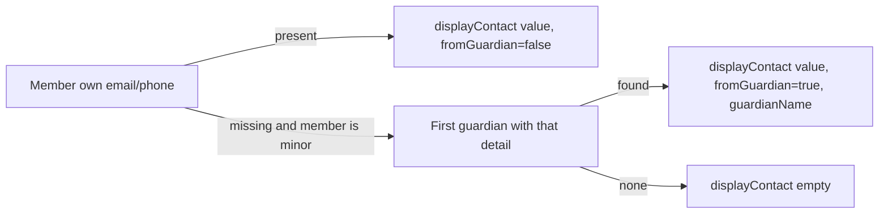

# Proposal

## Why

A minor member may have no own e-mail or telephone, because their contact can be covered by a legal guardian. Today the member detail and the member list then show empty contact fields, although a guardian's contact exists and is the one to use to reach the minor.

## What Changes

- Wherever a member's contact is shown, an empty e-mail or telephone of a minor is replaced by the contact of the minor's legal guardian (the first guardian, ordered by surname, who has that detail). E-mail and telephone are resolved independently, so they may come from different guardians.
- Users with MEMBERS:MANAGE see the replaced value marked as "contact of legal guardian" together with the guardian's name. Other users see the value only, without the marker.
- Member detail: the contact section shows the effective contact.
- Member list (visible to MEMBERS:MANAGE only): the contact column shows e-mail and telephone as two lines in one cell (previously e-mail only).
- The member API gets a new derived field `displayContact`; the raw `email` and `phone` stay unchanged so the edit form never copies a guardian's contact into the minor's own record.

## Capabilities

### New Capabilities

### Modified Capabilities
- `members`: Member List (contact column with e-mail and telephone) and Member Detail (effective contact with guardian fallback and marker for MEMBERS:MANAGE).

## Impact

- OpenAPI spec `docs/openapi/spec/members.yaml`: `MemberDetailsResponse`, `MemberSummaryResponse` (new `displayContact`); regenerate bundle and frontend types.
- Backend `members` module: resolving the effective contact via `GuardianContactResolver` / `LegalGuardianGroupPort` in the member detail and list assembly.
- Frontend: `MemberDetailPage`, `MembersPage`.
