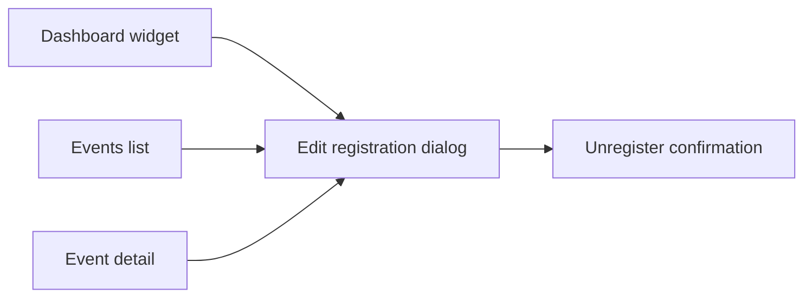

# Proposal

## Why

Editing an event registration is reachable only from the events list and the registrations table, while the two places members use most — the dashboard and the event detail — offer only register/unregister. In addition, the edit form opens with most values empty (category, notes, shared transport/accommodation), so members must re-enter data they already gave.

## What Changes

- Dashboard "Moje nadcházející akce": each listed event shows an "Upravit přihlášku" action when the event's HAL+FORMS `editRegistration` affordance is present; it opens the registration edit dialog.
- Event detail: the "Odhlásit se z akce" button is replaced by "Upravit přihlášku", shown by the same affordance. Unregistering stays available inside the edit dialog (existing confirmation flow).
- Bug fix: the registration edit form is prefilled from the existing registration (category, SI card number, rental request, notes, shared transport/accommodation) instead of showing empty fields.
- Frontend and specification only; the backend already exposes `editRegistration` on the event summary/detail and the registration representation.

## Capabilities

### New Capabilities

### Modified Capabilities

- `dashboard`: "Upcoming Registrations Widget" gains a per-event edit-registration action driven by the affordance.
- `event-registrations`: "Unregister from Event" no longer offers a dedicated button on the event detail (reached via the edit dialog); new requirements for the event detail edit action and for a prefilled edit form.

## Impact

- Frontend: `HomePage.tsx`, `useMyUpcomingRegistrations.ts`, `EventDetailPage.tsx`, `useHalFormData.ts` (shared by every HAL+FORMS form), `EventRegistrationDialog.tsx` unchanged in logic.
- Regression risk limited to HAL+FORMS forms whose template target equals the current resource.
- No backend, API or data model change.
