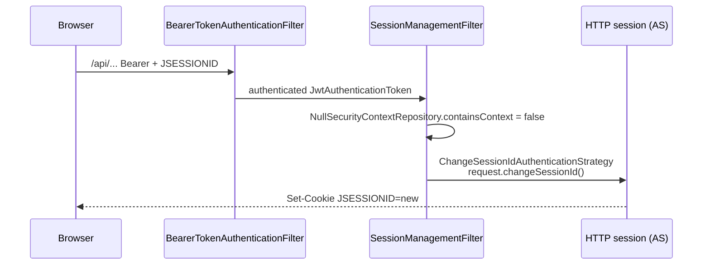

## Context

Motivation: see `proposal.md`. Verified against Spring Security 7.0.4 sources (`SessionManagementConfigurer`, `SessionManagementFilter`, `AbstractSessionFixationProtectionStrategy`).

- The API chain (`defaultSecurityFilterChain`, `@Order(5)`, matcher `/api/**`, `/ical/**`, `/actuator/**`, `/swagger-ui/**`, `/v3/api-docs/**`) calls `.sessionManagement(s -> s.sessionCreationPolicy(STATELESS))`.
- `sessionCreationPolicy(..)` adds an entry to `propertiesThatRequireImplicitAuthentication`. This switches `requireExplicitAuthenticationStrategy` to `false`, so `configure()` installs a `SessionManagementFilter`.
- With STATELESS, `init()` gives that filter a `NullSecurityContextRepository`. `containsContext()` is therefore always `false`. The filter treats every authenticated request as a "fresh" login and calls the session authentication strategy. The default strategy is `ChangeSessionIdAuthenticationStrategy`.
- `onAuthentication` changes the id only when `request.getSession(false) != null` and the requested id is valid. That is exactly the case when the browser sends the authorization server `JSESSIONID`. On `:8443` this is same-origin. On `:3000` the cookie is host-scoped (`localhost`), so it also travels through the Vite proxy.
- The authentication sources affected are the bearer JWT (`BearerTokenAuthenticationFilter`) and the iCal token (`IcalTokenAuthenticationFilter` via `ResourceServerCustomizer`).



Related: commit `85c0fc4d` ("keep users signed in across access token renewals") extended the AS session timeout to 8 h. It made the 5-minute access token TTL and a single `UserManager` work for `prompt=none` renewal. That fix assumes the session id stays stable between renewals. This change removes the remaining cause that breaks the assumption.

## Goals / Non-Goals

**Goals:**
- Bearer and iCal-token requests on the API chain never create, rotate or invalidate an HTTP session.
- The authorization server session stays valid for `prompt=none` silent renewal while the SPA calls the API.
- Regression test that fails on the current configuration.
- Remove the E2E workaround if it is no longer needed.

**Non-Goals:**
- Changes to the authorization server, login or docs chains. Session fixation protection on form login stays (the authorization server chain is session-based and must rotate the id at login).
- The SPA chain (`@Order(4)`, also explicit STATELESS). It is `permitAll` and never has an authenticated principal, so its `SessionManagementFilter` never calls the strategy. It is left as is.
- Token TTL, session timeout or the frontend renewal logic.

## Decisions

### D1: Disable session fixation on the API chain via `sessionFixation(none)`

```java
.sessionManagement(session -> session
        .sessionCreationPolicy(SessionCreationPolicy.STATELESS)
        .sessionFixation(fixation -> fixation.none()))
```

`SessionFixationConfigurer.none()` sets `NullAuthenticatedSessionStrategy` as the default strategy. `SessionManagementFilter` still runs, but its `onAuthentication` is a no-op. Session fixation protection has no purpose on this chain. Authentication is per request (bearer or iCal token) and never stored in a session, so there is no session to fixate. Add a short comment with this reason next to the configuration.

Alternatives considered:

| Option | Verdict |
|---|---|
| `.sessionAuthenticationStrategy(new NullAuthenticatedSessionStrategy())` | Equivalent result. Rejected only because `sessionFixation(none)` states the intent in the DSL. Either is acceptable. |
| `.requireExplicitAuthenticationStrategy(true)` (no `SessionManagementFilter` at all) | Not usable. With an explicit `sessionCreationPolicy`, `shouldRequireExplicitAuthenticationStrategy()` throws `IllegalStateException("Invalid configuration that explicitly sets requireExplicitAuthenticationStrategy to true but implicitly requires it ...")` (verified in 7.0.4 source). |
| Drop `.sessionManagement(..)` entirely (default: no `SessionManagementFilter`) | Rejected. The policy falls back to `IF_REQUIRED`, and the chain would then load the `SecurityContext` from the AS session (`HttpSessionSecurityContextRepository`). `/api/**` would accept the session cookie as authentication while CSRF is ignored on these paths. That is a CSRF hole. |

### D2: Test first, at integration level

New `@SpringBootTest` + MockMvc test in `backend/src/test/java/com/klabis/common/security/` (style of `AuthorizationServerPromptNoneTest`):

1. Arrange an AS session and a real access token through the authorization code flow (form login with the `admin`/`admin123` test bootstrap into a `MockHttpSession`, then code exchange), as in `OidcFlowE2ETest`. Do not use the `jwt()` request post-processor. It injects the security context directly and bypasses `BearerTokenAuthenticationFilter`, so it may not reproduce the defect.
2. `GET /api` with `Authorization: Bearer` + the session. Expect `200`, no `Set-Cookie` header, and an unchanged `session.getId()`.
3. Same session: `/oauth2/authorize?prompt=none&...` returns a redirect with `code=` (not `error=login_required`). This proves the AS session survived the API call.

Step 2 must fail on the current configuration (red) before D1 is applied.

MockMvc note: `MockHttpServletRequest.changeSessionId()` changes the id of the `MockHttpSession` in place. Asserting on the session id before and after detects rotation. Asserting only on `Set-Cookie` would not, because MockMvc does not emit the cookie for a rotated mock session.

### D3: The E2E workaround is re-evaluated, not removed blindly

`loginAs` currently restores cookies plus `oidc.user:*` `sessionStorage` entries (`frontend/e2e/support/fixtures.ts`). After the fix, try cookie-only re-entry (original D4 of `add-e2e-playwright-tests`). The app boots, redirects to `/oauth2/authorize`, and the AS issues a code without the login form.

- If cookie-only re-entry is stable across a full local run, `loginAs` restores cookies only.
- The `api` fixture still needs a bearer token. It currently reads it from the stored `oidc` entry. Keep that entry in the stored state for the `api` fixture even if `loginAs` drops the restore. Moving the `api` fixture to a fresh token is out of scope.
- If cookie-only re-entry is still flaky for another reason (SameSite, timing), keep the restore and only update the explanation in `fixtures.ts` and `frontend/CLAUDE.md`.

## Risks / Trade-offs

- [Session fixation protection removed on a chain] → It never had a meaningful effect there. Authentication is never persisted to the session on this chain. Form-login fixation protection on the AS chain is unchanged.
- [Other callers relied on the rotated id] → None known. Rotation was racy and caused failures, not features.
- [MockMvc does not reproduce browser cookie races] → The test asserts the root cause (id unchanged, no `Set-Cookie`). The E2E task D3 confirms the browser behaviour.
- Rollback: revert the single DSL line. No data or configuration migration.

## Glossary

| Term | Meaning |
|---|---|
| AS session | HTTP session of the authorization server, established by the `/login` form, identified by the `JSESSIONID` cookie |
| Session id rotation | Changing the session id while keeping its attributes (servlet `changeSessionId()`), done by Spring's session fixation protection |
| Silent renewal | Background renewal of the SPA access token through a hidden iframe calling `/oauth2/authorize?prompt=none` with the AS session cookie |
