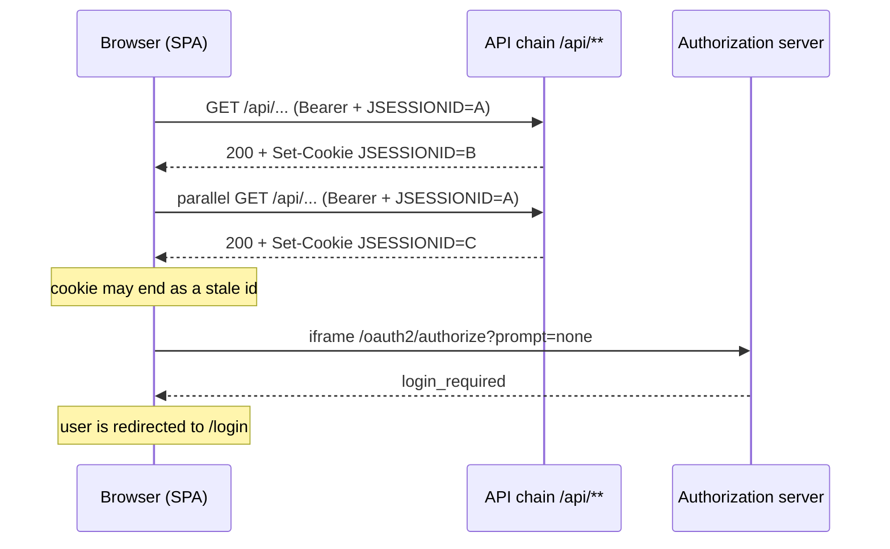

## Why

Every bearer-authenticated request on the API filter chain (`/api/**`, `/ical/**`) rotates the authorization server session id (`JSESSIONID`). Concurrent `/api` calls race on `Set-Cookie`, so the browser can keep a stale id and lose the authorization server session. The public `klabis-web` client has no refresh token and renews silently through an iframe `prompt=none` request, which needs a live session. When the session is lost, silent renewal fails and the user is sent back to the login form. This is a production logout cause that the recent session-timeout fix (`85c0fc4d`) does not cover.

## What Changes

- API filter chain in `WebSecurityCommonConfiguration`: keep `SessionCreationPolicy.STATELESS` and turn off session fixation protection (`sessionFixation(none)`). Bearer requests then never touch the HTTP session.
- New backend integration test: a bearer `/api` request that carries an existing authorization server session must not return `Set-Cookie`, must not change the session id, and must leave the session usable for `/oauth2/authorize?prompt=none`.
- E2E suite: re-check whether a role session can re-enter through the authorization server cookie alone (original design D4 of `add-e2e-playwright-tests`). Simplify `loginAs` in `frontend/e2e/support/fixtures.ts` if it can. Keep the `sessionStorage` restore only if it is still needed.
- `frontend/CLAUDE.md`: remove the "known backend defect" note in the E2E authentication paragraph and describe the resulting mechanism.

## No Behavior Change Justification

The fix restores behaviour that the specifications already require. It does not add or change requirements. The session id rotation is an unintended side effect of a Spring Security default. No spec describes it.

**Specs reviewed:**
- `openspec/specs/non-functional-requirements/spec.md` — scenario "Production public client does not receive a refresh token on authorization code exchange" already requires that "silent token renewal in same-origin deployments is served by the authorization endpoint's `prompt=none` mechanism". The defect breaks this, and the fix restores it.
- `openspec/specs/users-authentication/spec.md` — login, logout and session termination are unaffected. Logout still ends the authorization server session. Bearer token validation and authorization of API calls stay the same.

**Why no spec update is needed:**
The change only stops a framework component from rotating a session it does not own on a stateless chain. API responses, status codes, authorization rules and HAL payloads are unchanged. Users see fewer unexpected logouts, which matches the specified behaviour.

## Impact

- Backend: `backend/src/main/java/com/klabis/common/security/WebSecurityCommonConfiguration.java` (API chain only) and one new integration test.
- Frontend E2E: `frontend/e2e/support/fixtures.ts` (`loginAs`), and possibly `frontend/e2e/auth.setup.ts` if the stored state shrinks.
- Docs: `frontend/CLAUDE.md` E2E authentication paragraph.
- No API contract, OpenAPI spec, database or configuration changes.
