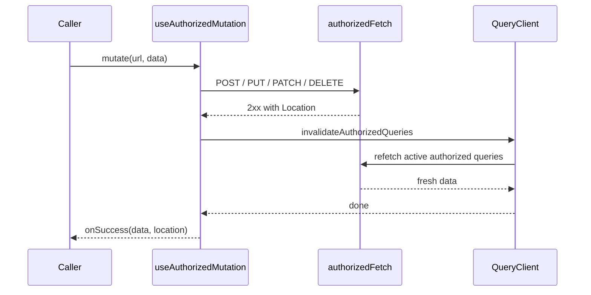

## Context

`hooks/useAuthorizedFetch.ts` owns both hooks over `authorizedFetch`:
- `useAuthorizedQuery` stores every response under `['authorized', pathname, search]`. This includes the route resource of `HalRouteContext`.
- `useAuthorizedMutation` is a bare fetch wrapper that returns `{data, location}`.

What happens to the cache after a successful mutation is left to each caller:

| Caller | After success |
|---|---|
| `HalFormDisplay`, `ReverseConfirmModal` | `invalidateAllCaches()`, then `route.refetch()`, toast |
| `FinanceTransactionDialog`, `BulkSyncOrisModal`, `SyncMembersFromOrisModal`, `useOrisEventImport` | `invalidateAllCaches()` |
| `usePermissionsEditor` | `invalidateAllCaches()`, toast |
| `GroupsPage` | `invalidateQueries(['authorized', '/api/invitations/pending'])`, `invalidateQueries(['authorized', '/api/groups'])`, `route.refetch()` |
| `NotificationSettingsPage` | `route.refetch()` |
| `MemberFeeChoicePage` | `refetch()` of its own query |
| `CalendarFeedSection`, `ChangePasswordDialog` | nothing |
| `pwa/usePushReregistration` (plain `authorizedFetch` POST in an effect) | `invalidateQueries(['authorized', pathname])` |

`invalidateAllCaches` (`useFormCacheInvalidation`) is a three-line wrapper around `invalidateQueries({queryKey: ['authorized']})`. TanStack Query refetches every active query that matches, and the route query is one of them, so a `route.refetch()` that follows it fetches the route a second time.

The hook-level options `onSuccess`, `onError` and `headers` of `useAuthorizedMutation` have no production caller. Frontend `CLAUDE.md` (gotcha 6) warns against hook-level `onSuccess`, because it can fire more than once in StrictMode.

## Goals / Non-Goals

**Goals:**
- One rule in one module: a successful mutation leaves no stale `authorized` query behind, and callers never have to remember it.
- The `['authorized', …]` key scheme is known only to `useAuthorizedFetch.ts`.
- A narrower interface: `useAuthorizedMutation({method})` → `mutate({url, data}, {onSuccess, onError})`.
- The rule is tested once, at the seam, against a real `QueryClient`.

**Non-Goals:**
- Error mapping and error texts. They are covered by `show-error-messages-in-czech` (design D9: `ApiError` parsed in `buildFetchError`).
- Toasts, `Location` navigation and closing dialogs. They differ legitimately per caller.
- Targeted invalidation, or invalidation that depends on the mutated resource.
- Replacing the 33 test mocks of `useAuthorizedMutation` with MSW or a fetch stub.
- `HalFormDisplay` props and dialog state (candidate 6 of the architecture review).

## Decisions

1. **Invalidation lives in `useAuthorizedMutation`'s `mutationFn`.** After a successful response, `mutationFn` awaits `invalidateAuthorizedQueries(queryClient)` and only then returns `{data, location}`.

   Consequences:
   - The per-call `onSuccess` runs only after the active queries hold fresh data. This is the same ordering the callers achieve today by awaiting `invalidateAllCaches()` first.
   - `isPending` stays `true` during the refetch, so submit buttons stay disabled until the screen is consistent.
   - The work runs once per mutation, unaffected by StrictMode or by how many observers there are.
   - A failed response throws before invalidation, so nothing is refetched.

   *Alternatives:*
   - **Global `MutationCache.onSuccess` in `main.tsx`.** It would have a zero interface, but it separates the rule from the file that owns the key scheme and applies to any future mutation outside `authorized`. Rejected.
   - **A `useHalAction` hook** bundling invalidation, toast, error mapping and `Location`. Rejected: its interface is wider, and toast and errors legitimately differ per caller (feedback banner, result inside the modal, no toast). A deletion test of the bundle would mostly move code rather than hide it.
   - **Hook-level `useMutation({onSuccess})`.** Rejected per gotcha 6.

2. **`invalidateAuthorizedQueries(queryClient)` is exported from `useAuthorizedFetch.ts`.** It is a plain function, not a hook, so the hook and `pwa/usePushReregistration` can share it. `usePushReregistration` mutates through `authorizedFetch` inside an effect, outside the hook. It then invalidates everything instead of one hand-built key. Re-registration happens only when the push endpoint changes, so the broader refetch costs nothing that matters.
   - *Alternative:* export `authorizedQueryKey(url)` and keep targeted invalidation for this one caller. Rejected because it adds a second exported concept for a single caller.

3. **Redundant refetches after mutations are removed.** This covers `route.refetch()` in `HalFormDisplay`, `ReverseConfirmModal`, `GroupsPage` and `NotificationSettingsPage`, and `refetch()` in `MemberFeeChoicePage`. Every refetched query is an active `authorized` query, so decision 1 already refreshes it before `onSuccess`. `route.refetch()` stays available for refreshes that do not follow a mutation.

4. **Invalidation stays global** (`['authorized']`), as it already is for 7 of the 13 callers. With the expected load (KISS), refetching the active queries of one screen after a write is cheaper to reason about than deciding which resources a write affects. Inactive queries are only marked stale and refetch when they are next used.

5. **`UseAuthorizedMutationOptions` narrows to `{method}`.** `onSuccess`, `onError` and `headers` are removed because no production code passes them. Every caller already passes callbacks per call.

6. **Tests: replace, do not layer.**
   - The rule is pinned in `useAuthorizedFetch.test.ts`, with a real `QueryClient` and a stubbed `authorizedFetch`, following `useLegalGuardians.test.tsx`. The tests cover four things:
     - refetch before `onSuccess`;
     - `isPending` during the refetch;
     - no refetch on failure;
     - `invalidateAuthorizedQueries`.
   - Caller tests drop their mocks of `useFormCacheInvalidation` and their assertions that `invalidateAllCaches` or `route.refetch` was called. Invalidation is no longer the callers' behaviour, so asserting it per caller would layer a second test over the same rule.
   - Tests that mock `useAuthorizedMutation` keep their mocks. The seam is unchanged and its interface only narrowed.

7. **Sequencing.** This change lands before the frontend tasks of `show-error-messages-in-czech` (1.7–1.9, 8.1) and before deepening `HalFormDisplay`, because all three touch the same callers and both later changes build on the narrower interface.

## Risks / Trade-offs

- **[Risk] A failed refetch turns a successful write into a reported failure.** → `invalidateQueries` does not reject when a refetch fails, because `refetchQueries` defaults to `throwOnError: false`. A seam test pins that a successful mutation still resolves when the refetch returns an error.
- **[Risk] A failing refetch keeps `isPending` `true` through query retries.** `useAuthorizedQuery` passed `retry: options?.retry`, so an explicit `undefined` overrode the `QueryClient` default (`retry: 1`) and fell back to the library default of 3 retries with backoff (about 7 s). → `useAuthorizedQuery` passes `retry` only when the caller sets it (task 1.4).
- **[Trade-off] `isPending` lasts longer**, by one round of GETs for the screen's active queries. → Buttons stay disabled until the data is consistent, which is the intended effect. With the expected load the delay is a single request round.
- **[Trade-off] Callers that refreshed nothing now trigger extra GETs:** `MemberFeeChoicePage`, `NotificationSettingsPage`, `CalendarFeedSection` and `ChangePasswordDialog`. → Bounded by the active queries of one screen. It is accepted in the proposal as non-functional.
- **[Risk] Caller tests that mock `useAuthorizedMutation` cannot see the invalidation.** → Intended. The rule is tested once at the seam, and the browser check in tasks 3.3 confirms the route is fetched once per mutation.
- **[Risk] A future mutation bypasses the hook through `authorizedFetch`**, as `usePushReregistration` does. → `invalidateAuthorizedQueries` is the documented way to keep the rule for such a mutation. The tasks 3.1 grep check keeps the key scheme inside `useAuthorizedFetch.ts`.
