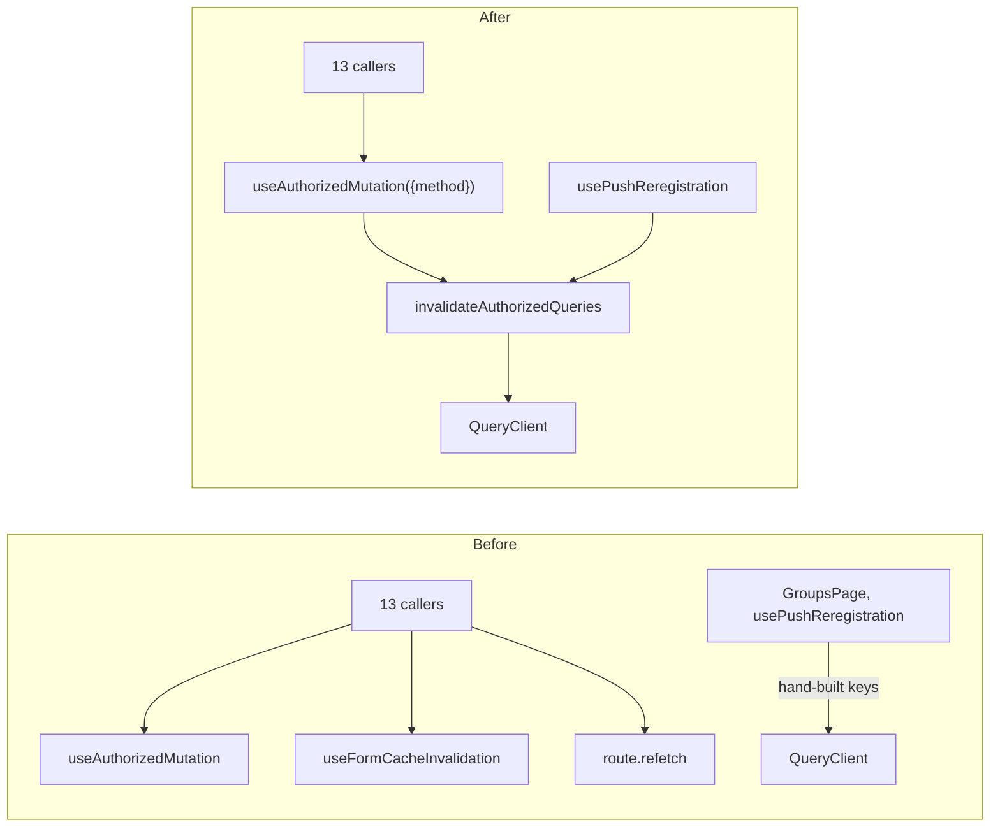

## Why

After a successful mutation the cached server data is stale, but every caller of `useAuthorizedMutation` has to remember that and repair the cache itself. The 13 callers handle it in five different ways:

- seven invalidate everything through `useFormCacheInvalidation`;
- two of those also call `route.refetch()`, which fetches the route a second time because the route query already sits under the `authorized` key;
- `GroupsPage` and `usePushReregistration` build `['authorized', …]` query keys by hand;
- two pages refetch only their own query;
- two do nothing.

The rule therefore leaks across the seam, and the query-key scheme lives in more than one file. The next changes that touch these files (frontend part of `show-error-messages-in-czech`, deepening `HalFormDisplay`) should build on the narrower interface.

## What Changes

- `useAuthorizedMutation` invalidates all `authorized` queries itself. After a successful response its `mutationFn` awaits `invalidateAuthorizedQueries` and only then resolves. As a result:
  - `isPending` stays `true` until the active queries are refetched;
  - the caller's `onSuccess` sees fresh data;
  - a failed mutation invalidates nothing.
- `useAuthorizedFetch.ts` exports `invalidateAuthorizedQueries(queryClient)`. The hook uses it internally, and `pwa/usePushReregistration` (which mutates through `authorizedFetch` outside the hook) uses it too. The `['authorized', …]` key scheme is no longer known anywhere else.
- `useAuthorizedMutation` options narrow to `{method}`. The unused hook-level `onSuccess`, `onError` and `headers` are removed. Callers pass callbacks per call (`mutate(vars, {onSuccess, onError})`), as they all already do.
- Removed:
  - `hooks/useFormCacheInvalidation.ts`;
  - the manual `invalidateAllCaches()` calls in its 7 callers;
  - the now redundant `route.refetch()` / `refetch()` after mutations in `HalFormDisplay`, `ReverseConfirmModal`, `GroupsPage`, `NotificationSettingsPage` and `MemberFeeChoicePage`;
  - the hand-built query keys in `GroupsPage`.
- Stays with callers: toast texts, `Location` navigation (`HalFormDisplay` only) and error handling. Error mapping is covered by `show-error-messages-in-czech` (design D9).

## No Behavior Change Justification

**Specs reviewed:**
- `openspec/specs/membership-fees/spec.md` (fee choice), `users/spec.md` (password change, permissions), `user-groups/spec.md` (pending invitations), `calendar-items/spec.md` (calendar feed token), `members/spec.md`, `events/spec.md`, `member-synchronization/spec.md`, `data-synchronization/spec.md`, `non-functional-requirements/spec.md`. All are unaffected:
  - no requirement says which data a page reloads after an action;
  - every scenario that shows data after an action is still satisfied, with data at least as fresh as today.

**Why no spec update is needed:**
The change moves cache invalidation from the callers into the mutation module and deletes duplicates. Requests sent, responses, toasts, navigation and error handling are unchanged. The one observable difference is that four callers which did not invalidate before now refresh the active queries after a successful mutation:

- `MemberFeeChoicePage`
- `NotificationSettingsPage`
- `CalendarFeedSection`
- `ChangePasswordDialog`

That means extra GET requests, and in `CalendarFeedSection` the token's "last set" information is updated right away. This is accepted as non-functional, with the expected load as the reason.

## Impact

- **Frontend, production:**
  - `hooks/useAuthorizedFetch.ts`;
  - `hooks/useFormCacheInvalidation.ts` (deleted);
  - its callers: `HalFormDisplay`, `ReverseConfirmModal`, `FinanceTransactionDialog`, `usePermissionsEditor`, `BulkSyncOrisModal`, `SyncMembersFromOrisModal`, `useOrisEventImport`;
  - `GroupsPage`, `NotificationSettingsPage`, `MemberFeeChoicePage`, `pwa/usePushReregistration`.
- **Frontend tests:**
  - new seam tests in `hooks/useAuthorizedFetch.test.ts`;
  - `useLegalGuardians.test.tsx` triggers the refetch through a mutation;
  - invalidation and `route.refetch` assertions are removed from caller tests (`HalFormDisplay`, `useOrisEventImport`, `MemberDetailPage`, `MemberDetailPage.groups`, `EventDetailPage`, `NotificationSettingsPage`);
  - the 33 test files that mock `useAuthorizedMutation` keep their mocks.
- **Sequencing:** lands before the frontend tasks of `show-error-messages-in-czech` (1.7–1.9, 8.1) and before deepening `HalFormDisplay` (candidate 6 of the architecture review). All three touch the same callers.
- No backend, API or spec changes.
