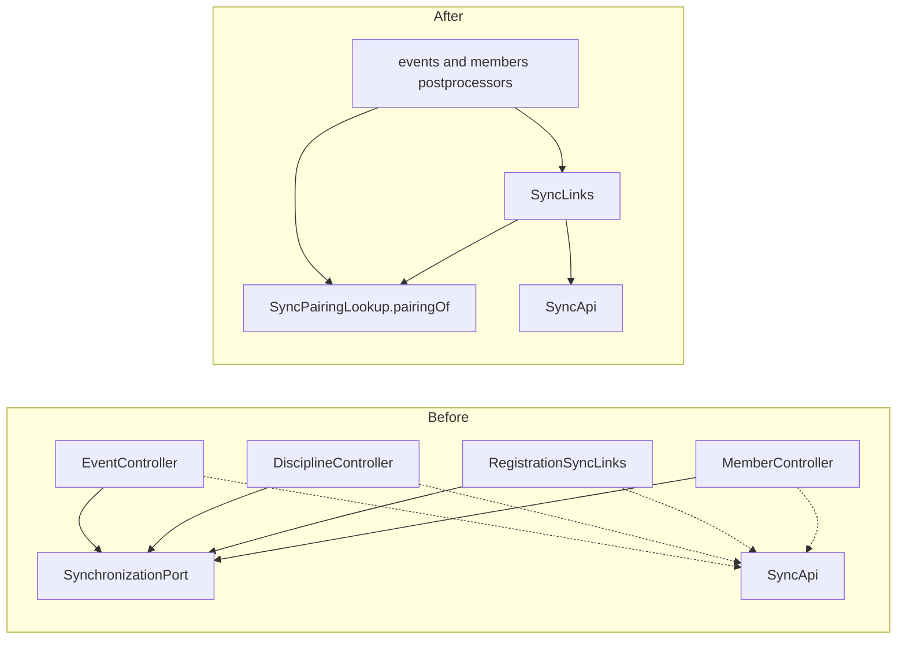

## Why

Every synchronised entity type re-implements the same sync link in its own REST code: a batch `findActiveByTargets` per list page carried in an `Enrolled*Ids` record, a `findByTarget(...).isPresent()` fallback for the detail, and a `methodOn(SyncApi)` link with rel `sync`. Four copies exist (events, disciplines, event registrations, members) and each new integration expected by ADR-005 would add a fifth. The copies already disagree. Lists ask "is there an active pairing" and details ask "is there any record", so the same entity answers differently on its row and on its detail page. `EventDetailsPostprocessor` also reads `SyncStatus` and `ExternalSystem` itself.

## What Changes

- New `SyncPairingLookup.pairingOf(SyncTarget)` returning `SyncPairing` (`NONE` / `ACTIVE` / `RETIRED`). It is the single question "how is this entity paired" (see `GLOSSARY.md`, *Sync pairing*).
- New `SyncLinks.addTo(model, target)` in `sync.infrastructure.restapi`. It adds the `sync` link whenever the entity has a pairing.
- The callers express their own rules in terms of `SyncPairing`:
  - details and rows of events, members, disciplines and event registrations call `SyncLinks.addTo`;
  - an event row adds the link only while the event is DRAFT or ACTIVE;
  - the discipline edit lock (service and affordance) is "has a pairing";
  - ORIS registration discovery on an event is "has an active pairing".
- Removed: `EnrolledEventIds`, `EnrolledMemberIds`, `EnrolledDisciplineIds`, `RegistrationSyncLinks`, both `addSyncLinkIfEnrolled` helpers, and the per-page batch lookups in `EventController`, `MemberController` and `DisciplineController`. REST code in `events` and `members` stops depending on `SynchronizationPort`, `SyncRecord`, `SyncStatus` and `ExternalSystem`.

## No Behavior Change Justification

**Specs reviewed:**
- `openspec/specs/events/spec.md`: unaffected.
  - The row indicator stays limited to ORIS-imported DRAFT/ACTIVE events and is absent on FINISHED/CANCELLED rows (Row-Level Management Actions).
  - Synchronisation state stays reachable from the detail and from the row (Synchronisation State Is Reachable From The Event).
  - Past synchronisations stay available after an event finishes (ORIS-Imported Events Are Kept In Step Automatically).
- `openspec/specs/disciplines/spec.md`: unaffected. "A discipline that came from ORIS SHALL NOT be editable" is still enforced, now consistently on the row as well.
- `openspec/specs/data-synchronization/spec.md`, `openspec/specs/member-synchronization/spec.md`: unaffected. The member row indicator and the synchronisation endpoints are unchanged.
- `openspec/specs/event-registrations/spec.md`: unaffected. The registration `sync` link keeps its current rule (any record).

**Why no spec update is needed:**
The change moves the pairing question into one module and removes duplicates. No requirement or scenario changes. Two details become observable for an *archived ORIS discipline* in the discipline list, both accepted as non-functional:

- its row no longer offers `updateDiscipline`. Today that action is refused with 409, so the row now matches the existing spec and the server;
- its row now carries the `sync` link, as its detail already does. No spec covers this.

## Impact

- `backend/.../sync/application` (`SyncPairingLookup`, `SyncPairingLookupService`), `sync/domain` (`SyncRecordRepository`, new `SyncPairing`), `sync/infrastructure/jdbc`, `sync/infrastructure/restapi` (new `SyncLinks`).
- `backend/.../events/infrastructure/restapi` (`EventController`, `DisciplineController`, `EventRegistrationController` and their postprocessors), `events/application/DisciplineManagementService`.
- `backend/.../members/infrastructure/restapi/MemberController`.
- Tests: controller tests retarget mocks from `SynchronizationPort` to `SyncPairingLookup`. New tests cover `SyncLinks` and the `pairingOf` query.
- Sequencing: lands before `inline-single-impl-ports`, which touches the same controllers' constructors.
