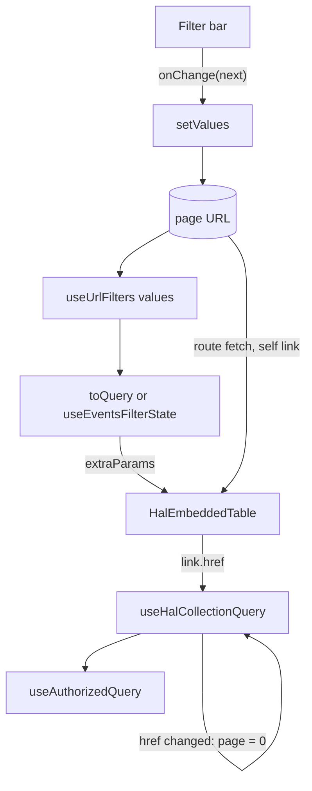

## Context

Five pages keep filters in the page URL:

| Page | Filter code | Defaults | Request parameters | Page reset on filter change |
|---|---|---|---|---|
| `EventsPage` | `useEventsFilterState` (129 lines) | `year`, `when` written once on mount through a ref | year + time window → `dateFrom`/`dateTo`, `q` ≥ 2, `registeredBy=me` | `key={selectedYear ?? timeWindow}`: not on `q`, event type or "registered by me" |
| `MembersPage` | inline | `status` written whenever absent (`useDefaultSearchParam`) | `status` always, `q` ≥ 2, `incomplete` | none |
| `MemberAccountManagePage` | `useTransactionFilters` | none | URL names already match the backend (`occurredAtFrom`) | none (own page state in `TransactionsTableContent`) |
| `SyncOverviewPage` (attempts tab) | `useSyncAttemptFilters` | none | date → instant (`from`, `to`) | `key={JSON.stringify(extraParams)}` |
| `CalendarPage` | inline toggle `mySchedule` | none | none: the page URL goes to the API unchanged | no table |

Every copy repeats the same steps: read with `searchParams.get`, write or delete each key, then build `extraParams` in a memo. Events adds `eslint-disable` and a `join(',')` dependency to avoid render loops.

Two mechanics shape the design:

- **The page URL goes to the backend.** `HalRouteContext` fetches the route resource with the page's full `search`. The backend builds a collection's self link from the request parameters (ADR-002), and `HalEmbeddedTable` builds the table request from that self link plus `extraParams`. URL values that the backend reads therefore have to stay valid backend values. This is why `registeredBy=me` and `occurredAtFrom` use backend encodings.
- **The table keeps page and sort in local state.** `KlabisTableCore` holds `page` in `useState(0)` and resets it only on a sort or page-size change. `useTableSort` resolves the sort once, in its `useState` initialiser. A remount is today the only way to make either follow a new filter or a new `tableId`.

`TransactionsTableContent` (`FinancesPage`) forks `KlabisTableCore`'s query code, because its cells need the whole page's rows (`reversedIds` marks reversed transactions across the visible page).

## Goals / Non-Goals

**Goals:**
- One module turns a declared filter schema into URL state. Pages stop reading and writing parameters by hand.
- The table owns its state rules: a different collection starts on page 0, and a different `tableId` re-resolves its sort. No page needs a `key` remount.
- One collection-query module serves `KlabisTableCore` and the transactions table, so the page-reset rule exists once.
- Adding a calendar filter means adding one schema entry.

**Non-Goals:**
- Event rules (year and time-window coercion, the date range, the default sort per time window). They stay in `useEventsFilterState`.
- `FulltextSearchInput` (debounce, `minChars`).
- Filter bar components and their `value`/`onChange` interface.
- The `tab` parameter of `SyncOverviewPage`. It is navigation, not a filter.
- Column configuration of `KlabisTableWithQuery`, and the HAL link access in pages (candidate 5 of the architecture review).

## Decisions

### 1. `useUrlFilters(schema)` → `{values, setValues}`

One call per page, for the whole filter bar:

```ts
const {values, setValues} = useUrlFilters({
    status:         {type: 'string', default: DEFAULT_MEMBER_STATUS},
    q:              {type: 'string'},
    incomplete:     {type: 'boolean'},
    dateFrom:       {type: 'string', param: 'occurredAtFrom'},
    eventTypeIds:   {type: 'string[]', param: 'eventTypeId'},
    registeredByMe: {type: 'boolean', param: 'registeredBy', trueValue: 'me'},
});
```

| Schema key | Meaning |
|---|---|
| `type` | `string`, `boolean` or `string[]`. Sets the TypeScript type of `values` |
| `default` | value used when the parameter is absent. May be computed by the caller (events: the current year) |
| `param` | URL parameter name when it differs from the key |
| `trueValue` | for `boolean`: the URL value meaning `true` (default `'true'`) |

Reading:
- `string`: `get(param)`, or `default`, or `''`;
- `boolean`: `get(param) === trueValue`;
- `string[]`: `getAll(param)`.

`values` keeps a stable identity while the parameters it reads are unchanged, so callers can use it in memo dependencies without `join(',')`.

Writing, with `setValues(next)` in one `setSearchParams` call:
- a key with a `default` is always written, an empty one as `''`. An empty string therefore means "explicitly nothing": `year=''` is "no year", while a missing `year` is the current year;
- a key without a `default` is written when it is not empty and deleted when it is (`''`, `false`, `[]`);
- `string[]` is written by deleting the key and appending each value;
- parameters not in the schema are left alone.

Values must stay valid backend values for any parameter the backend reads, because the page URL is also sent in the route fetch (see Context).

- *Alternative:* a hook per parameter, `useSearchParam(key, codec)`. Rejected because every page would still assemble and split its filter object, which keeps half of today's duplication.
- *Alternative:* request translation (`minLength`, renames for the API) inside the schema. Rejected because the event and sync translations are domain rules. Pushing them into the schema would move complexity rather than hide it.

### 2. Defaults are derived, never written

A missing parameter yields the default in `values`, and the hook never writes it to the URL. Navigating to a bare `/members` while the page is mounted yields the default with no effect, no ref and no `replace`. Once the user changes any filter, `setValues` writes the keys that have defaults, so the URL is explicit from then on. The events and members scenarios "filter state is preserved in the URL" stay satisfied.

- *Alternative:* write the default with `replace` whenever it is absent (today's `useDefaultSearchParam`). Rejected because it needs an effect, a second render and a `replace` per bare navigation, and the value it writes is one the page already derives.

### 3. Request translation stays with the page

- Members: `toQuery(values)` next to the page sends `status` always and `q` only with ≥ 2 characters. The check repeats the `FulltextSearchInput` rule on purpose (decision of the grilling session).
- Sync attempts: `toQuery(values)` converts dates to instants (`from`, `to`).
- Account transactions and the calendar need no translation. Their URL values already are the backend parameters.
- Events: `useEventsFilterState` keeps its interface (`filterValue`, `extraParams`, `defaultSort`, `handleFilterChange`). Internally it reads and writes through `useUrlFilters` and keeps the event rules. Its write-once default effect and the `dateFrom`/`dateTo` cleanup are removed.

The page hooks `useTransactionFilters` and `useSyncAttemptFilters` are deleted: over `useUrlFilters` they would be pass-throughs.

### 4. `useHalCollectionQuery(link, sort)` owns page, page size and the request

It is extracted from `KlabisTableCore` and returns `{rows, pageData, error, page, setPage, rowsPerPage, setRowsPerPage}`. It owns:
- the page state;
- the persisted page size (`klabis-table-rows-per-page`);
- the request URL (`page`, `size`, `sort` on top of `link.href`);
- the `useAuthorizedQuery` call;
- **the reset rule:** when `link.href` changes, `page` becomes 0 in the same render, using the "store the previous value in state" pattern. No request for the old page number is sent.

`link.href` already carries the filter (`HalEmbeddedTable` adds `extraParams` to the self link), so every filter change resets the page with no new prop. `KlabisTableCore` and `TransactionsTableContent` both use the hook, and `TransactionsTableContent` derives `reversedIds` from `rows`. `rows` comes from `_embedded[collectionName]`, so the transactions table passes `transactions`.

- *Alternative:* a `resetPageOn` prop set by each page. Rejected because the interface would grow by something every caller decides differently today.
- *Alternative:* copy the reset rule into the fork. Rejected because the rule would exist twice, and the fork would have to be merged later anyway (candidate 7 of the architecture review).

### 5. `useTableSort` follows `tableId`

When `tableId` changes, `useTableSort` re-resolves the sort (URL → localStorage → `defaultSort`) in the same render, with the same pattern as decision 4. `EventsPage` switches `tableId` with the time window, so each window gets its own default sort without a remount. That also fixes the case of a selected year, where today's `key` does not change.

### 6. Tests: replace, do not layer

- `useUrlFilters.test.tsx` with `MemoryRouter`:
  - reading every type, including `param`, `trueValue` and `string[]`;
  - a missing parameter gives the default and writes nothing;
  - the write rules of decision 1;
  - unrelated parameters are kept;
  - navigation to a bare URL returns the defaults;
  - `values` keeps its identity across unrelated renders.
- `useHalCollectionQuery.test.tsx` with a real `QueryClient` and a stubbed `authorizedFetch`, following `useLegalGuardians.test.tsx`: after `setPage(2)`, a new `link.href` produces a request with `page=0` and no request for page 2. Written first, it fails on today's code.
- `useTableSort.test.tsx`: a new `tableId` re-resolves the sort.
- Pure tests of the `toQuery` functions (members, sync attempts).
- Kept:
  - `useEventsFilterState.test.ts`, whose interface is unchanged; only the "URL normalised" assertion for a coerced time window goes, because the hook no longer writes to the URL;
  - the `MembersPage` test "keeps the default active-only filter … after returning via the menu link".
- Removed:
  - `useDefaultSearchParam.test.tsx`;
  - the `useTransactionFilters` block in `TransactionHistory.test.tsx`, rewritten as page-level assertions on the request URL.

### 7. Sequencing

Lands before `gh-109-calendar-user-filters` and `gh-110-calendar-group-filter`, so new calendar filters become schema entries. No file overlap with `deepen-sync-links` or `deepen-mutation-cache-invalidation`. `show-error-messages-in-czech` touches `error.message` renders in `CalendarPage` and `SyncOverviewPage`, which are other lines, so the order does not matter.



## Glossary

No new domain terms. Filters, pages and sorting are general UI concepts.

## Risks / Trade-offs

- **[Risk] Resetting during render loops** if the previous-value state is updated wrongly. → Follow the React "storing information from previous renders" pattern, covered by the seam test that counts requests.
- **[Trade-off] A shared bare URL follows future changes of a default.** → Intended. A bare URL means "the defaults", not a snapshot.
- **[Risk] A schema value that the backend does not accept** breaks the route fetch, because the page URL is sent to the backend. → The schema keeps today's encodings (`registeredBy=me`, `occurredAtFrom`). Decision 1 records the rule.
- **[Trade-off] Old events bookmarks with `dateFrom`/`dateTo` keep filtering** through the route self link, now also after a filter change. → The old format dates from May 2026 and bookmarks of it are rare at club size. It is accepted in the proposal.
- **[Risk] Page tests that mock `useSearchParams` or rely on the `key` remount** break silently. → Page tests render inside `MemoryRouter`. A failing page test is fixed by asserting the request URL, not by restoring a remount.
