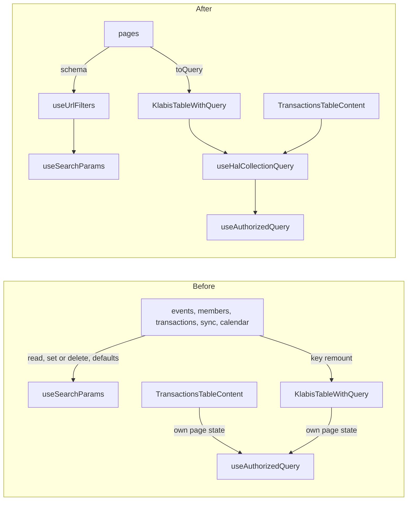

## Why

Five list pages keep their filters in the page URL, and each one re-implements the same steps by hand: read the parameters, write or delete each one, build the request parameters. Default values are handled in three different ways: a write-once ref in events, `useDefaultSearchParam` in members, and nothing elsewhere. The fix `4bb3ac0a` for members came out of that difference.

The table also never returns to the first page when a filter changes. `KlabisTableWithQuery` resets `page` only on a sort or page-size change. Pages work around this in different ways:
- sync remounts the table through `key={JSON.stringify(extraParams)}`;
- events remounts through `key={selectedYear ?? timeWindow}`, which also re-initialises the per-time-window sort, but not when a year is selected;
- members and the account transactions do nothing, so a search typed on page 3 can show an empty table.

The calendar is about to get more filters (`gh-109-calendar-user-filters`, `gh-110-calendar-group-filter`), and each would add another hand-written copy.

## What Changes

- New `useUrlFilters(schema)` → `{values, setValues}`, one call per page.
  - The schema declares each filter's `type` (`string`, `boolean`, `string[]`), an optional `default`, an optional URL `param` name, and `trueValue` for booleans (default `'true'`).
  - A missing parameter means the default value. Defaults are never written to the URL.
  - `setValues` writes a key that has a default even when it is empty (`''`), deletes an empty key without a default, and leaves other parameters alone.
- New `useHalCollectionQuery(link, sort)`, extracted from `KlabisTableCore`. It owns page, page size, the request URL and the query, and resets the page to 0 during render whenever `link.href` changes. `KlabisTableCore` and the account transactions table (`TransactionsTableContent` in `FinancesPage`) both use it.
- `useTableSort` re-resolves the sort (URL → localStorage → default) when `tableId` changes.
- Callers:
  - `useEventsFilterState` keeps its interface. It is reimplemented over `useUrlFilters` and keeps the event rules: year and time-window coercion, the date range, the default sort, `q` ≥ 2 characters.
  - members, account transactions, sync attempts and calendar (`mySchedule`) call `useUrlFilters` directly. When the request parameters differ from the URL values, a pure `toQuery(values)` function sits next to the page: members (`q` ≥ 2, `status` always sent) and sync attempts (date → instant).
- Removed:
  - `useTransactionFilters`, `useSyncAttemptFilters`, `useDefaultSearchParam` and the inline filter code in `MembersPage`;
  - the `key` remount workarounds in `EventsPage` and `SyncOverviewPage`;
  - the events cleanup of the old `dateFrom`/`dateTo` URL parameters;
  - the page, page-size and URL code duplicated in `TransactionsTableContent`.

## No Behavior Change Justification

**Specs reviewed:**
- `openspec/specs/events/spec.md`: unaffected. Filter state is preserved in the page URL (Filter state is preserved in the page URL, Year filter persists in the URL), the default time window is "Budoucí", and the default sort per time window stays.
- `openspec/specs/members/spec.md`: unaffected. The active-only default filter and the search stay.
- `openspec/specs/calendar-items/spec.md`: unaffected. Filter state lives in the URL and is restored from a shared URL (Filter state lives in the URL and resets across sessions).
- `openspec/specs/member-accounts/spec.md`: unaffected. History Pagination, Sorting, and Filtering (date range, type, sort) stays.
- `openspec/specs/data-synchronization/spec.md`: unaffected. The sync attempt filters and paging through older attempts stay.
- `openspec/specs/non-functional-requirements/spec.md`: unaffected. Pagination links and parameters are unchanged.

**Why no spec update is needed:**
The change moves URL filter handling and the table's page and sort state into one module each, and deletes duplicates. Requests, filters and their URL encoding stay the same. Four details become observable. No spec covers them, and all four are accepted as non-functional:

1. After a filter change, the table returns to the first page: members, events (`q`, event type, "registered by me") and account transactions. Today a non-empty result can show as an empty page.
2. A bare URL (`/members`, `/events`) stays bare. Default values are no longer written into the address bar.
3. An old events bookmark with `dateFrom`/`dateTo` is no longer cleaned up when a filter changes.
4. On the events list with a year selected, switching the time window now applies that window's default sort, as it already does without a year.

## Impact

- **Frontend, production:**
  - new `hooks/useUrlFilters.ts` and `hooks/useHalCollectionQuery.ts`;
  - `components/KlabisTable/KlabisTableWithQuery.tsx`, `hooks/useTableSort.ts`;
  - `pages/events/useEventsFilterState.ts`, `pages/events/EventsPage.tsx`;
  - `pages/members/MembersPage.tsx`;
  - `pages/finances/FinancesPage.tsx`, `pages/finances/MemberAccountManagePage.tsx`;
  - `pages/sync/SyncOverviewPage.tsx`;
  - `pages/calendar/CalendarPage.tsx`;
  - deleted: `pages/finances/useTransactionFilters.ts`, `pages/sync/useSyncAttemptFilters.ts`, `hooks/useDefaultSearchParam.ts`.
- **Frontend tests:**
  - new seam tests for `useUrlFilters`, `useHalCollectionQuery` and `useTableSort`, plus pure tests for the `toQuery` functions;
  - `useDefaultSearchParam.test.tsx` is deleted;
  - the `useTransactionFilters` block in `TransactionHistory.test.tsx` is rewritten against page behaviour;
  - `useEventsFilterState.test.ts` stays, except the "URL normalised" assertion.
- **Sequencing:** lands before `gh-109-calendar-user-filters` and `gh-110-calendar-group-filter`. There is no file overlap with `deepen-sync-links` or `deepen-mutation-cache-invalidation`.
- No backend, API or spec changes.
