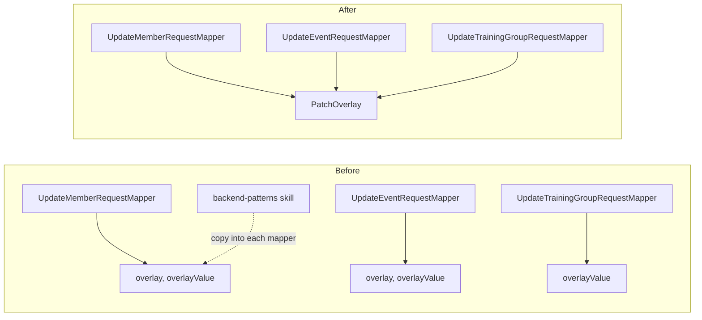

## Why

Three PATCH endpoints (`updateMember`, `updateEvent`, `updateTrainingGroup`) resolve the three `JsonNullable` states (undefined, present-null, present value) in their request mapper. Each mapper carries its own private copy of the same two helpers: `overlay` and `overlayValue`. Five copies exist, and the `backend-patterns` skill tells authors to copy them again for every new PATCH endpoint.

Each copy also restates the rules in its own javadoc, and one restatement has already drifted. `UpdateTrainingGroupRequestMapper` documents that a present-null "falls through to the command's own `Assert` and surfaces as a 400". The code keeps the baseline value instead, and `TrainingGroupControllerTest` pins that it does.

## What Changes

- New `common.patch.PatchOverlay` with two static methods, one per PATCH rule:
  - `overlay(JsonNullable<T>, Consumer<T>)` is for a field that can be cleared. A present field is applied, including a present null (which clears the field). An undefined field is left alone.
  - `overlayNonNull(JsonNullable<T>, Consumer<T>)` is for a field with no cleared state. Only a present value that is not null is applied. A present null and an undefined field both keep the baseline.

  The rules are documented once, on the class.
- `UpdateMemberRequestMapper`, `UpdateEventRequestMapper` and `UpdateTrainingGroupRequestMapper` call `PatchOverlay`. Their private helper copies are deleted, and their javadoc only lists which fields have no cleared state. This removes the stale javadoc of `UpdateTrainingGroupRequestMapper`.
- Unchanged:
  - `UpdateEventRequestMapper.overlaySiPolicy`, which combines two request fields into one value object. Its javadoc refers to `PatchOverlay.overlayNonNull` for the rule it follows.
  - The `IllegalArgumentException` → `InvalidUpdateException` wrapping in `UpdateMemberRequestMapper`.
- `backend-patterns` (`references/rest-controller.md`, `references/aggregate-checklist.md`): the PATCH overlay pattern uses `PatchOverlay` instead of copying the helpers into each mapper.

## No Behavior Change Justification

**Specs reviewed:**
- `openspec/specs/members/spec.md`: unaffected. The scenarios "Partial update preserves unchanged fields" and the empty-body PATCH keep holding, because the member mapper applies the same rule to every field as before.
- `openspec/specs/events/spec.md`, `event-categories/spec.md`: unaffected. Event editing keeps its field semantics, including the SI policy and the category merge.
- `openspec/specs/user-groups/spec.md`: unaffected. Training group editing keeps the baseline for an explicit null, as it does today.
- `openspec/specs/non-functional-requirements/spec.md`: unaffected. PATCH templates and field-level authorization are untouched. `RequestBodyFieldAuthorizationAdvice` checks the request DTO before the mapper runs.

**Why no spec update is needed:**
The helpers move into one module with unchanged bodies. Every field keeps the rule it has today. Requests, responses, status codes and authorization stay the same. The only text that changes is a stale javadoc, which is corrected to describe the existing behaviour.

## Impact

- `backend/.../common/patch` (new `PatchOverlay`, new `PatchOverlayTest`).
- `members/infrastructure/restapi/UpdateMemberRequestMapper`, `events/infrastructure/restapi/UpdateEventRequestMapper`, `groups/traininggroup/infrastructure/restapi/UpdateTrainingGroupRequestMapper`.
- `.claude/skills/backend-patterns/references/rest-controller.md`, `references/aggregate-checklist.md`.
- Existing controller tests (`UpdateMemberApiTest`, `EventControllerTest`, `TrainingGroupControllerTest`) stay unchanged and must pass.
- Sequencing:
  - It lands before `modularize-event-facets`, which rewrites the ranking, fee and categories part of `UpdateEventRequestMapper`.
  - With `inline-single-impl-ports`, the only overlap is the javadoc link to `ManagementPort` in `UpdateMemberRequestMapper`. Whichever change lands second fixes it.
