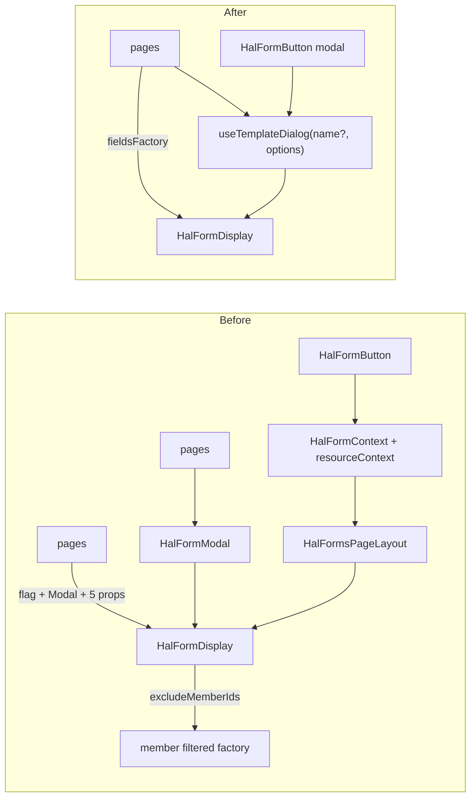

## Why

Opening a HAL-FORMS template in a modal and submitting it is done four different ways:

- `HalFormButton` → `HalFormContext` → `HalFormsPageLayout`;
- `HalFormModal`, used in 6 files;
- hand-rolled `useState` flag + `<Modal>` + `<HalFormDisplay>`, in about 10 pages;
- row action menus that keep `{item, template, templateName}` in state.

Every caller outside the context path has to pass `template`, `templateName`, `resourceData`, `pathname`, `onClose` and a title. Callers also derive the submit URL themselves, with `pathname`, `extractNavigationPath(toHref(row._links.self))` or `'/api' + …`. Row templates need casts such as `owner as typeof owner & {_templates?…}`.

`HalFormButton` does not cover what those callers need: success message, error hook, submit label, note, size, member filter and row resources. So callers bypass it. The generic `HalFormDisplay` also carries two member-specific props (`excludeMemberIds`, `includeOnlyMemberIds`, both marked `TODO: remove`). This is candidate 1 of the 2026-11-04 frontend architecture review, and it builds on `deepen-mutation-cache-invalidation`.

## What Changes

- New hook `useTemplateDialog(name?, options)` in `components/HalNavigator2/`. It returns `{available, availableOn(resource, name?), label, open(resource?, name?), dialog}`.
  - It finds the template in the resource's `_templates`, owns the open/closed state and renders `Modal` + `HalFormDisplay`.
  - The submit URL comes from `template.target`, otherwise from the resource's `self` link.
  - The resource is either the page resource (options) or a row (`open(row)`). The template name can be fixed in the hook or passed to `open()`, which covers row action menus.
  - Options: `resource`, `title`, `size`, `note`, `submitLabel`, `successMessage`, `onSubmitSuccess`, `onSubmitError`, `navigateOnSuccess`, `fieldsFactory`, `postprocessPayload`.
- The modal variant of `HalFormButton` is rebuilt on the hook. `HalFormRequest.resourceContext` (the snapshot workaround for nested providers) is removed. `HalFormContext` / `HalFormsPageLayout` remain only for the inline panel (`modal={false}`).
- All modal call sites migrate to the hook: membership-fees, legal-guardians, groups, training-groups, members, events, category presets and event types.
- The member-picker filter moves to the caller as `fieldsFactory={createMemberFilteredFactory(…)}`. `excludeMemberIds` / `includeOnlyMemberIds` are removed from `HalFormDisplay`.
- Removed: `HalFormModal`, the hand-rolled modal flags and `actionModal` state, the `_templates` cast types in `pages/groups/types.ts` / `pages/training-groups/types.ts` where they exist only for this, and the redundant `route.refetch()` in dialog `onClose` handlers (the route query is already invalidated by `useAuthorizedMutation`).
- Out of scope: inline edit (`useInlineEditing`), the inline panel (`modal={false}`), `EventRegistrationDialog` and dialogs that are not HAL-FORMS forms (`PermissionsDialog`, `ChangePasswordDialog`).

## No Behavior Change Justification

**Specs reviewed:**
- `openspec/specs/user-groups/spec.md`: unaffected. "Member-Picker Dialogs Hide Existing Members" is kept: the same filtered factory is passed through `fieldsFactory` instead of `excludeMemberIds` / `includeOnlyMemberIds`.
- `openspec/specs/members/spec.md`: unaffected. The suspension dialogs (including the negative-balance warning through `onSubmitError`), account activation and resume keep their texts and flows.
- `openspec/specs/membership-fees/spec.md`, `legal-guardians/spec.md`, `events/spec.md`, `event-types/spec.md`, `category-presets/spec.md`, `calendar-items/spec.md`, `data-synchronization/spec.md`: unaffected. The same templates are submitted to the same URLs, with the same toasts, navigation and dialog texts.

**Why no spec update is needed:**
The change moves "find the template, open it, submit it to the right URL, close it" from each caller into one module. Every migrated call site keeps its current dialog title, submit label, success message and post-submit navigation. Where the hook's default title differs from what a page shows today, the title is passed explicitly (see design). Removing `route.refetch()` from `onClose` only drops a duplicate GET: after a successful submit the route is already refetched through `authorized` invalidation, and after a cancel nothing has changed.

## Impact

- Frontend only: `components/HalNavigator2/` (new hook, `HalFormButton`, `HalFormsPageLayout`, `halFormContext.ts`, `HalFormDisplay`, `HalFormModal` deleted), `components/KlabisFieldsFactory.tsx`, `components/membership-fees/`, `components/legal-guardians/`, and pages in `members/`, `events/`, `groups/`, `training-groups/`, `membership-fees/`.
- Tests: new hook tests use a HAL fixture and a stubbed `fetch`. Page tests that mock `HalFormDisplay` / `HalFormModal` / `Modal` are rewritten together with the migration of each page.
- No backend, API or OpenAPI spec change.
