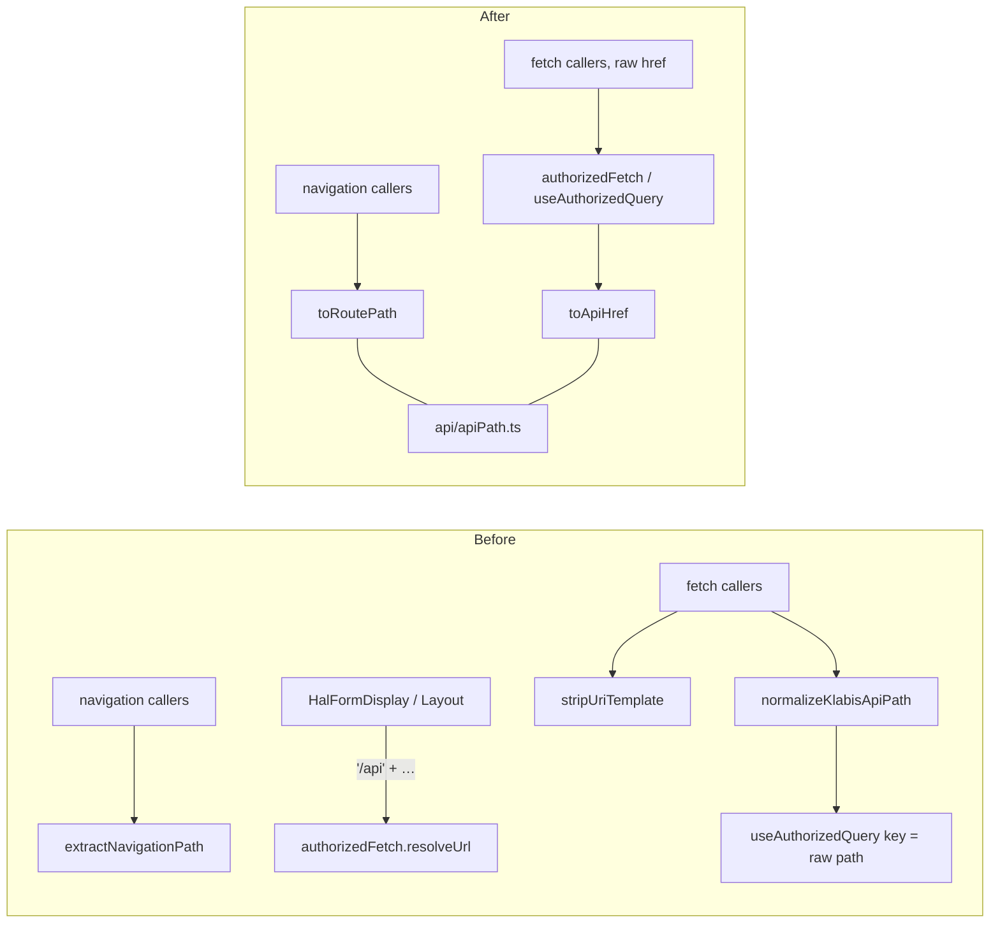

## Why

The rule "API paths carry an `/api` prefix, router paths don't" is implemented six times in the frontend: `extractNavigationPath`, `normalizeKlabisApiPath`, `stripUriTemplate`, `toPath` in `useAuthorizedFetch`, `resolveUrl` in `authorizedFetch`, and hand-built `'/api' + …` strings in `HalFormDisplay`, `HalFormsPageLayout` and `Layout`. Callers pick one of them before every fetch or navigation, sometimes the wrong one: `PastCampaignsSection` and `CampaignDetail` use the navigation helper to build a fetch URL.

The query key of `useAuthorizedQuery` is the path exactly as the caller passed it. `/members/1` and `/api/members/1` therefore get two cache entries, and the same resource is fetched twice. This is candidate 2A of the 2026-11-04 frontend architecture review. It is stacked on `deepen-template-dialogs` (PR #411).

## What Changes

- New module `api/apiPath.ts` with two functions:
  - `toApiHref(href)` turns any href (absolute URL, `/api/x`, `/x`, with or without a URI template) into `/api/x?q`;
  - `toRoutePath(href)` turns it into the router path `/x?q`.
- The `/api` prefix is recognised only when it is followed by `/`, `?`, `#` or the end of the string, so a path like `/apiary` is no longer cut.
- `authorizedFetch` and `useAuthorizedQuery` normalise through `toApiHref`. Callers pass raw HAL hrefs and stop pre-normalising them.
- The query key of `useAuthorizedQuery` is built from `toApiHref(url)`, so every form of the same href shares one cache entry.
- All navigation callers move to `toRoutePath`. All fetch callers drop their pre-normalisation and the hand-built `'/api' + …` prefixes.
- Removed: `utils/navigationPath.ts` (`extractNavigationPath`), `normalizeKlabisApiPath` and `stripUriTemplate` from `utils/halFormsUtils.ts`, `toPath` in `useAuthorizedFetch.ts`, and the prefix branch of `resolveUrl`.
- Out of scope:
  - `api/url.ts` `normalizeUrl`: it builds absolute URLs for OIDC and is import-free on purpose;
  - `parseHalHref` / `serializeHalHref`, which handle query parameters;
  - `toHref` / `asLinkArray`, which handle the link shape;
  - literal `/api/...` strings built from route params.

## No Behavior Change Justification

**Specs reviewed:**
- `openspec/specs/application-navigation/spec.md`: unaffected. Menu items, links and the URLs shown in the browser keep the same router paths.
- `openspec/specs/non-functional-requirements/spec.md`: unaffected. It describes backend link targets (`/api/users/{id}/permissions`, `/api/events/{eventId}`) and reserved backend URLs. None of them change, and none of its scenarios describe how the frontend derives fetch or router paths.
- Feature specs (`members`, `events`, `membership-fees`, `user-groups`, `data-synchronization`, `push-notifications`): unaffected. Every page requests the same backend resources and navigates to the same routes.

**Why no spec update is needed:**
Every href resolves to the same backend URL and router path as before. The only externally visible difference is that the same resource is no longer fetched twice under two cache keys. The stricter prefix match changes results only for paths starting with `/api` followed by another letter, and no backend or router path has that shape.

## Impact

- Frontend only:
  - `api/` (new `apiPath.ts`, `authorizedFetch.ts`);
  - `hooks/useAuthorizedFetch.ts`, `contexts/HalRouteContext.tsx`, `hooks/useHalActions.ts`, `hooks/useRootNavigation.ts`, `hooks/useHalForm*.ts`, `hooks/useLegalGuardians.ts`;
  - `components/HalNavigator2/`, `components/membership-fees/`, `components/groups/`, `components/dashboard/`, `components/events/`, `components/sync/`;
  - pages in `calendar/`, `events/`, `members/`, `sync/`, `HomePage.tsx`, `Layout.tsx`.
- Tests: new table-driven `apiPath.test.ts`; the `normalizeKlabisApiPath` cases in `halFormsUtils.test.ts` move there; a cache-key test for `useAuthorizedQuery`; tests that mock the removed helpers are updated.
- Docs: `.claude/skills/hal-navigator-patterns/references/component-api.md` (HATEOAS utility functions).
- No backend, API or OpenAPI spec change.
