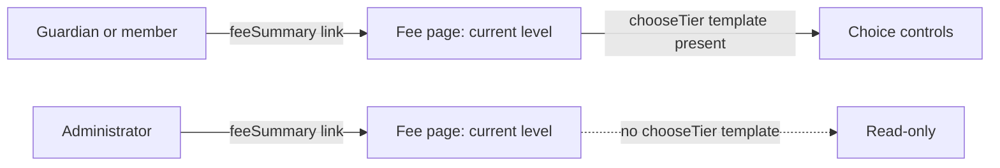

# Design

## Context

See proposal.md. The four fee operations `getFeeSummary`, `getChoice`, `chooseTier`, `removeChoice` are owner-only (`x-klabis-owner-visible` without `x-klabis-authority`) and carry `x-spring-provide-args: @ActingMember MemberId`. `getFeeHistory` already admits owner OR `MEMBERS:MANAGE` OR `MEMBERS:EDIT_PROFILE` (see archived `add-member-fee-history-page`, D2).

`MEMBERS:EDIT_PROFILE` is a `SPECIFIC` grant (`TargetType.MEMBER`). It is held by every member over themselves (`SelfProfileRelationshipSource`) and by a legal guardian over each minor of their group (`LegalGuardianGroupRelationshipSource`). A membership administrator holds `MEMBERS:MANAGE` but not `MEMBERS:EDIT_PROFILE` over other members.

## Goals / Non-Goals

**Goals:**
- Guardian (member or non-member) sees the minor's current level and can choose, change, withdraw.
- Administrator sees the current level read-only.

**Non-Goals:**
- Administrator choosing on behalf of a member (emergency assignment stays the tool).
- Changing the choice domain logic, deadlines or sanctions.

## Decisions

### D1: Read = MANAGE or EDIT_PROFILE, write = EDIT_PROFILE only

| Operation | Declaration |
|---|---|
| `getFeeSummary`, `getChoice` | `x-klabis-authority: [MEMBERS_MANAGE, MEMBERS_EDIT_PROFILE]`, `x-klabis-target-id: MEMBER` on `memberId` |
| `chooseTier`, `removeChoice` | `x-klabis-authority: [MEMBERS_EDIT_PROFILE]`, `x-klabis-target-id: MEMBER` on `memberId` |

`x-klabis-owner-visible` stays on all four. Owner OR authority holds, and the owner already holds `EDIT_PROFILE` over self, so one declaration covers member and guardian. Because `klabisAfford` evaluates the same declaration, the `chooseTier`/`removeChoice` affordances appear on the summary exactly for the member and the guardian and never for an administrator.

*Alternative: guardian-specific check.* Rejected for the reason recorded in `add-member-fee-history-page` D2.

### D2: Drop `@ActingMember` from the four operations

A non-member guardian has no member profile, so `@ActingMember` throws `MemberProfileRequiredException` before authorization. The argument is unused in the bodies. Remove `x-spring-provide-args` from the four operations; link-building calls in postprocessors lose the trailing `null`.

### D3: Frontend

`MemberFeeSection` already renders the choice links from `summary.votingOpen`/`currentGroup`. Render them only when the summary carries the `chooseTier` affordance (HAL-FORMS template), so the administrator gets a read-only view. `MemberFeeHistoryPage` already shows the section whenever the `feeSummary` link is present; that link now appears for administrator and guardian automatically. The route `/members/:memberId/fee-choice/:year` is reused unchanged.

## API

No new endpoints or HAL link names. Changed visibility only:

| Endpoint | Visible to |
|---|---|
| `GET /api/members/{memberId}/fee-summary/{year}` (`getFeeSummary`) | member, guardian of member, `MEMBERS:MANAGE` |
| `GET /api/members/{memberId}/fee-choice/{year}` (`getChoice`) | member, guardian of member, `MEMBERS:MANAGE` |
| `PUT/POST chooseTier`, `DELETE removeChoice` under `/fee-choice/{year}` | member, guardian of member |

HAL+FORMS affordances `chooseTier` and `removeChoice` on the summary and choice `self` link follow the same rule. `feeSummary` link on fee history is unchanged in name.

## Domain

No domain change. Glossary: no new terms.

## Risks / Trade-offs

- [A holder of global `MEMBERS:EDIT_PROFILE` would also gain choose rights] → `EDIT_PROFILE` is `SPECIFIC`-only (`GrantForm.SPECIFIC`), so no global grant exists; verify with an integration test using an administrator.
- [Choice recorded by someone other than the member] → Assignment `source` already distinguishes member choice from administrator assignment; guardian choice is recorded as the member's own choice (no new source value).
