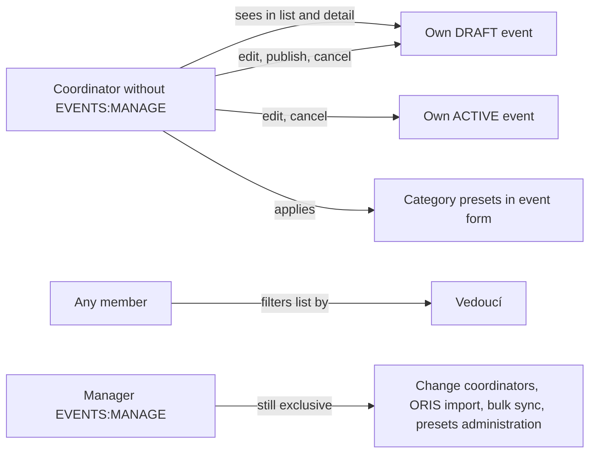

# Proposal

## Why

An event coordinator without EVENTS:MANAGE is meant to look after their own event, but three gaps stop them in practice (GitHub issues #294, #295, #373): they cannot see their own event while it is a draft, so they cannot edit it until a manager publishes it; they cannot use category presets in the edit form, which instead fires repeated forbidden requests; and nobody can filter the events list by coordinator from the UI, although the API supports it. In addition, the club wants coordinators to run the whole lifecycle of their event themselves — including publishing and cancelling it.

## What Changes

- A coordinator sees the events they coordinate in DRAFT status — in the events list and on the event detail page. Other DRAFT events stay hidden from them.
- A coordinator can publish their own DRAFT event and cancel their own DRAFT or ACTIVE event (previously EVENTS:MANAGE only). The publish/cancel row actions in the events list and on the detail page are offered to them accordingly.
- Changing the coordinators collection, ORIS import and bulk ORIS synchronisation remain EVENTS:MANAGE only.
- The events list filter bar gains a "Vedoucí" filter for picking a member; the list then shows only events that member coordinates.
- Category presets become readable by every member; anyone who can create or edit an event (manager or the event's coordinator) can apply a preset in the event form. The "Select from templates" button is offered only to users who may use it and never triggers a forbidden request. Managing presets (the presets page and the admin menu item) stays EVENTS:MANAGE only.
- The duplicated preset-application requirement is consolidated: it lives only in `events` ("Apply Category Preset in Event Form"), and `category-presets` keeps only preset management.

## Capabilities

### New Capabilities

_None._

### Modified Capabilities

- `events`: DRAFT visibility for coordinators (list and detail), coordinator authority extended to publish and cancel, row-level and detail actions for coordinators, "Vedoucí" filter in the filter bar, category preset application available to coordinators and absorbing the "no ongoing link" rule.
- `category-presets`: "Apply Preset to Event" removed (moved to `events`); presets page remains managers-only.

## Impact

- **API spec** (`docs/openapi/spec/events.yaml`): `publishEvent`, `cancelEvent` accept `EVENTS_EDIT` over the event besides `EVENTS_MANAGE`; `listPresets` readable with `EVENTS_READ` (`getPreset` and preset mutations stay `EVENTS_MANAGE`); new HAL links `coordinatorOptions` (events list) and `categoryPresets` (events list, event detail).
- **Backend** (`common.authorization`): `AuthorizationEvaluator` exposes the targets a user holds an authority over, so list queries take DRAFT visibility from the authorization snapshot.
- **Backend** (`events` module): visibility rules in `EventManagementService` / `EventFilter`; `EventsRootPostprocessor` keeps the `category-presets` root link for managers only; `EventListPostprocessor`, `EventDetailsPostprocessor` add the new links; javadoc of `EventCoordinatorRelationshipSource`.
- **Frontend**: `EventsFilterBar` + `useEventsFilterState` (coordinator filter), `CategoryPresetPickerButton` (URL from HAL link, hidden without it).
- **Docs**: ADR-010 amended (it currently forbids coordinators to publish/cancel), `backend/CLAUDE.md` (event coordinator grants), `backend-patterns` skill (new evaluator method).
- **Issues**: closes #294, #295, #373.
