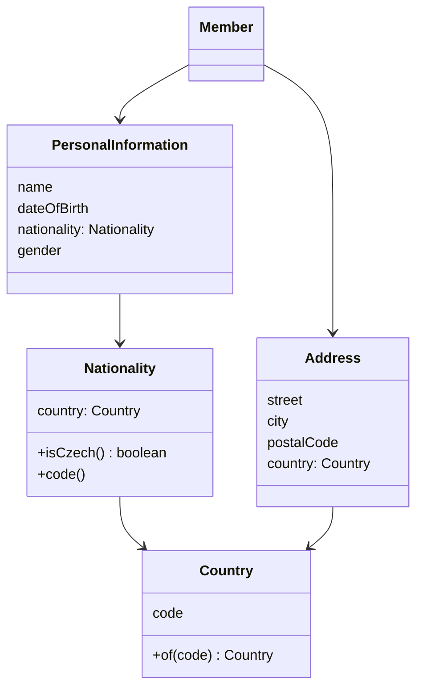

# Design

## Context

See proposal.md for motivation. Current state:

- Nationality is a value object wrapping a two-letter code; it knows whether it is Czech, which drives the birth number rule. Address keeps its country as a plain string with its own copy of the same two-letter format check. Neither checks that the code names a real country.
- Personal information and address are built from strings (`PersonalInformation.of(..., String nationalityCode, ...)`, `Address.of(..., String country)`) by the REST converters, the JDBC memento, the ORIS sync adapter and the data bootstrap.
- Field-level write authority comes from `x-klabis-authority` in the API spec; a field the caller may not write is left out of the `updateMember` HAL+FORMS template, and the member edit page shows template-less fields read-only (gender works this way today).
- The frontend picks field renderers by HAL+FORMS input type (`KlabisFieldsFactory`); address is a composite field with fixed sub-fields, and some composites already inject client-side options into a sub-field select (license level).
- A domain `IllegalArgumentException` becomes a generic "invalid request" problem response, not a field error.

## Goals / Non-Goals

**Goals:**
- One rule for what a valid country code is, living in the domain and used by nationality and address alike.
- The domain exposes countries only as value objects; adapters convert to and from strings.
- One reusable country picker on the frontend for nationality and address country.

**Non-Goals:**
- Restricting nationality to sovereign states; both fields accept the same code list.
- Showing country names outside the member detail page (accommodation list, CSV export keep codes).
- A full country list or search on the frontend.
- A second copy of the country rule in the API layer (see Decision 4).

## Decisions

### 1. Domain: a Country value object, Nationality wraps it

A new value object **Country** holds an ISO 3166-1 alpha-2 code, normalised to upper case, and accepts only codes the platform knows as countries (`Locale.getISOCountries()`, 249 codes on JDK 21). **Nationality** wraps a Country and keeps "is Czech". **Address** holds a Country instead of a string. Personal information and address are created from value objects; creating them from strings goes away.

| Element | Change | Notes |
|---|---|---|
| Country | **added** | ISO 3166-1 alpha-2 code validated against the platform country list, upper-cased |
| Nationality | **changed** | wraps Country instead of a raw code; own format check removed; keeps "is Czech" |
| Address | **changed** | country is a Country; own country format check removed |
| PersonalInformation | **changed** | built from a Nationality instead of a code string; the code-string accessor goes away |
| Member, MemberCompleteness | unchanged behaviour | adapt to the new accessors |

Adapters converting strings ↔ value objects: registration and update request converters/mappers, the JDBC memento, the ORIS projection mapper and sync adapter, `MembersImpl` (accommodation data for events stays a string), the data bootstrap.

**Why Nationality wraps Country instead of being Country:** a country is a place (where an address is); nationality is a person's legal tie to a state, with its own behaviour (Czech nationals need a birth number). Sharing the code rule through Country removes the duplicated format check without merging two concepts.

**Alternatives:** a shared static helper called by both constructors (smaller diff, but no domain concept, and the domain keeps passing strings around); replacing Nationality with Country (loses the "is Czech" home).

### 2. Nationality becomes a MEMBERS:MANAGE-only field

In `UpdateMemberRequest`, `nationality` gets `x-klabis-authority: MEMBERS_MANAGE` and `x-klabis-read-authority: [MEMBERS_MANAGE, MEMBERS_EDIT_PROFILE]`, the same pair as `birthNumber`. Codegen then emits the field authority check (a non-admin value is silently ignored), and the field leaves the template for non-admins, so the edit page renders it read-only with no frontend change. It is already a nullable string, so it gets the `JsonNullable` wrapper the field-security advice needs.

### 3. Frontend: a country picker selected by input type

- `x-hal-input-type: Country` on `nationality` in `RegisterMemberRequest` and `UpdateMemberRequest` makes `KlabisFieldsFactory` render the picker for nationality.
- The address composite renders its `country` sub-field with the same picker instead of a plain input.
- **Picker:** a select with the presets in the fixed order CZ, SK, AT, PL, DE, SE, NO, DK (labels from the country-name helper), then "Jiný stát…". Choosing "Jiný stát…" shows a two-letter input with the resolved name or an "unknown code" hint next to it. A value outside the presets starts in "Jiný stát…" mode with the code filled in.
- **Country-name helper:** `Intl.DisplayNames(['cs'], {type: 'region', fallback: 'none'})`. It returns nothing for an unknown code, which drives the hint. No country list ships with the frontend.
- **Member detail:** nationality and address country are shown through the helper, falling back to the raw code.
- **Registration default:** the registration form starts with `CZ` in nationality and address country when no value is set. Guardian takeover pre-fills only name and contacts, so it does not conflict.

**Alternatives:** HAL+FORMS options sent by the backend (rejected in explore: the address sub-field cannot carry backend options, and the frontend would still need names); a `datalist` combobox (inconsistent across browsers).

### 4. Unknown codes are refused by the domain, reported as a field-level error

The rule lives only in Country. The REST converters (registration, member update) build Nationality and Country through the existing `InvalidFieldValueException` mechanism, the same one used for e-mail, phone, birth number and bank account. An unknown code therefore becomes a 400 problem response with its own error type and field: `invalid-nationality` on `nationality`, `invalid-address-country` on `address.country`. Nothing is saved. No DTO constraint repeats the rule; the OpenAPI `pattern` stays a format pre-check only. The picker also flags unknown codes while typing, so the server check mainly catches codes the browser knows and the JDK does not (e.g. `XK`).

### 5. ORIS sync drops an unknown nationality or country

The member synchronisation spec already requires a detail Klabis cannot accept to be left out. The ORIS projection mapper drops an unknown nationality or address country with a WARN log (ORIS id and field name, never the value), like it already does for e-mail and birth number. A dropped address country makes the address partial, so the existing partial-address rule drops the whole address.

## API Changes

No new endpoints, links or affordances. Changes in `docs/openapi/spec/members.yaml`:

| Schema / property | Change |
|---|---|
| `UpdateMemberRequest.nationality` | add `x-klabis-authority: MEMBERS_MANAGE`, `x-klabis-read-authority: [MEMBERS_MANAGE, MEMBERS_EDIT_PROFILE]`, `x-hal-input-type: Country` |
| `RegisterMemberRequest.nationality` | add `x-hal-input-type: Country` |
| `AddressRequest.country` | description notes that the code must name an existing country; wire format unchanged |

Effect on the `updateMember` HAL+FORMS affordance: for a caller without MEMBERS:MANAGE, the `nationality` property is no longer offered; for an administrator it carries input type `Country`. The `registerMember` affordance's `nationality` property carries input type `Country`. Request and response bodies keep the same field names and two-letter string values.

## Glossary

| Term | Meaning |
|---|---|
| Country | A country or territory identified by its ISO 3166-1 alpha-2 code (e.g. CZ); used for the country of an address |
| Nationality | A member's legal tie to a state, expressed by that state's Country; Czech nationality requires a birth number |
| Common countries | The countries offered directly in the picker: Česko, Slovensko, Rakousko, Polsko, Německo, Švédsko, Norsko, Dánsko |

## Risks / Trade-offs

- [Large mechanical diff from changing how address and personal information are created, mostly in tests] → done as the first task, a behaviour-neutral refactoring committed on its own before any behaviour changes.
- [Browser and JDK country lists differ (e.g. `XK` known to the browser only)] → backend is the authority. The user gets a general error for such a code. Acceptable for an edge case.
- [`Intl.DisplayNames` names depend on the browser's ICU data] → all supported browsers ship Czech region names. The detail page falls back to the raw code.
- [A JDK upgrade could change the country list] → rare (last change ~2011). Production runs on an in-memory database, so there is no stored data to invalidate.

## Migration Plan

None. Production uses an in-memory database rebuilt on start, so no stored codes need checking. Deploy as a normal release.
