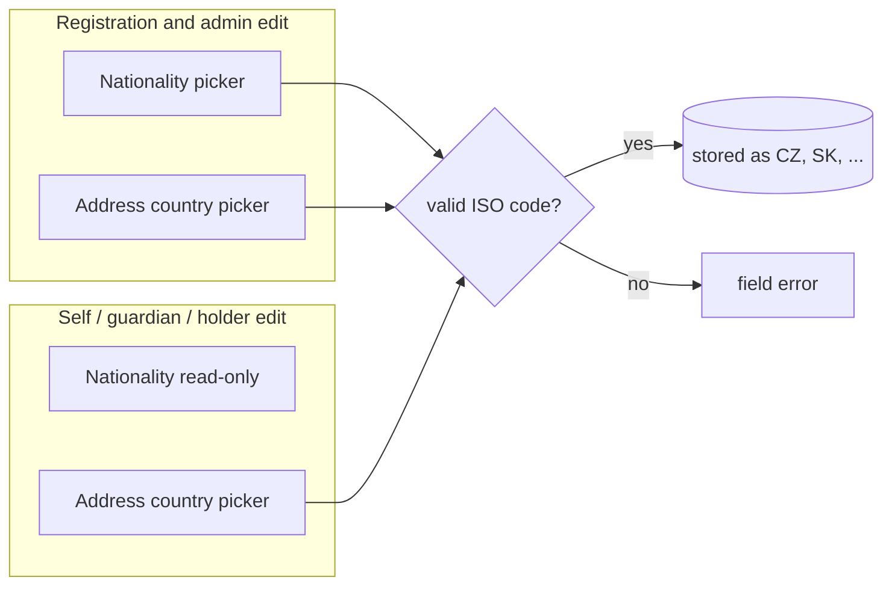

# Proposal

## Why

A member editing their own profile (or a legal guardian editing a child's) may change nationality, but changing it to or away from Czech requires or clears the birth number, which the same user may not touch (#360). Separately, nationality and address country are free-text inputs that accept any two letters, so users must know ISO codes and typos such as `CY` for `CZ` go unnoticed (#335).

## What Changes

- Nationality becomes an administrator-reserved field like first name, last name, date of birth, gender and birth number. A member, a legal guardian or a group owner holding "Úprava údajů člena" sees it read-only; only MEMBERS:MANAGE can change it. The nationality/birth number conflict disappears.
- Nationality (registration, admin edit) and address country (all member forms) become a picker: the most common countries (Česko, Slovensko, Rakousko, Polsko, Německo, Švédsko, Norsko, Dánsko) are offered by Czech name, and "Jiný stát…" lets the user type any other two-letter code with its Czech name shown next to it.
- The registration form pre-fills Česko for both nationality and address country.
- The member detail page shows the Czech country name instead of the code.
- The system refuses a country code that is not an existing ISO 3166-1 alpha-2 code (today only the two-letter format is checked).
- Codes are still stored as ISO 3166-1 alpha-2 (`CZ`). No data migration is needed: production runs on an in-memory database.

## Capabilities

### New Capabilities

None.

### Modified Capabilities

- `members`: nationality joins the administrator-reserved fields (member-editable vs. admin-only field lists, read-only reserved fields in the edit form, the reserved data a holder of profile editing sees, nationality/birth number scenarios now admin-only); new requirement for choosing a country (preset list, other code, registration default, Czech name on the detail page, unknown code refused).
- `legal-guardians`: a guardian sees their child's nationality read-only among the reserved fields.

## Impact

- **API spec** (`docs/openapi/spec/members.yaml`): `UpdateMemberRequest.nationality` gains the MEMBERS:MANAGE field authority, so the field leaves the `updateMember` template for non-administrators. No new endpoints, links or affordances.
- **Backend domain** (members module): a new value object for a country; nationality wraps it, and address uses it for its country. Constructors and factories of address and personal information take value objects instead of strings, so REST mappers, the JDBC memento, the ORIS sync mapper, the data bootstrap and many tests change mechanically.
- **ORIS sync**: the member synchronisation spec already says a detail Klabis cannot accept is left out. The ORIS mapper today validates e-mail, phone and birth number this way but passes nationality and country through unchecked; it must drop an unknown nationality or address country the same way instead of failing the whole member.
- **Frontend**: new country picker field (registration form, member edit form, address composite field), Czech country name in the member detail page, registration defaults.
- **E2E**: member registration and edit steps that fill nationality/country as text must use the picker.
- GitHub issues #360 and #335.
