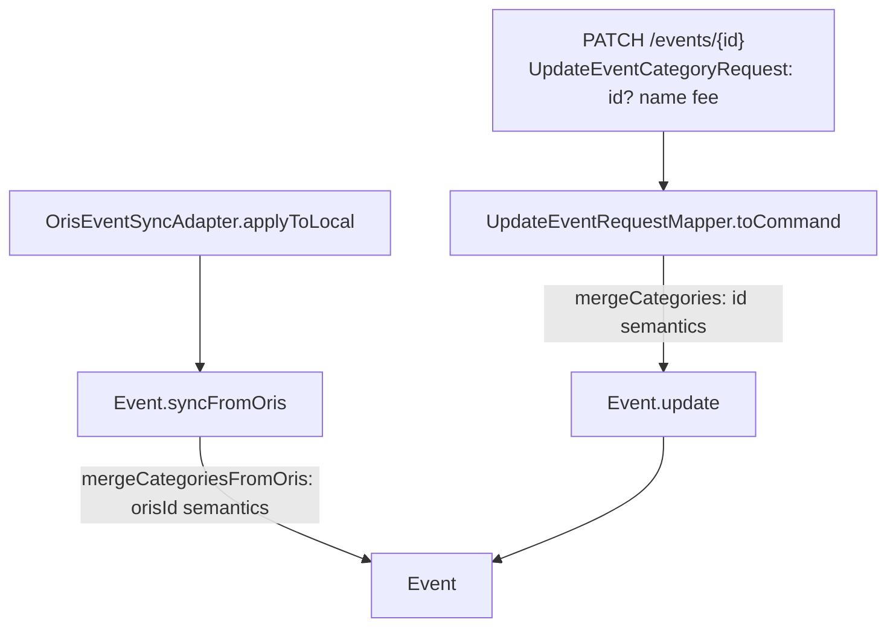

## Context

An event owns a list of categories. A category is `EventCategory(EventCategoryId id, String orisId, String name, Money feeOverride)`: `id` is its local identity and is what an `EventRegistration` points at, `orisId` pairs it with an ORIS `EventClass` and is never set through the REST API, `name` is unique within the event, and a manual category has `orisId == null` (`EventCategory.java:13-26`).

Two writes touch the list:



- `Event.update(UpdateEvent)` (`Event.java:649-684`) validates status, name, date, organizer, deadlines and `validateCategories` (unique name, unique non-null `orisId`), then **replaces** `this.categories` with the command's list. It performs no id resolution.
- `UpdateEventRequestMapper.mergeCategories` (`UpdateEventRequestMapper.java:81-104`) is the only place that resolves a PATCH row's id against the event's current categories: an id must already exist, a row without an id is generated, a current id absent from the request is dropped, and a matched category keeps its `orisId`.
- `Event.syncFromOris(SyncFromOris)` (`Event.java:703-718`) has its own, separate merge by `orisId`, inside the aggregate. `SyncFromOris` is a different command; ORIS never builds an `UpdateEvent` and ORIS import goes through `synchronizationPort.pullAndEnroll`, not `update`.
- `EventController.updateEvent` (`EventController.java:110-122`) fetches the event, builds `UpdateEvent.from(event)`, then applies the mapper. The comment claiming the fetch is for an authorization check is stale: authorization is declared on the generated `EventsApi` (`@HasAuthority({EVENTS_MANAGE, EVENTS_EDIT})`, `@TargetId(EVENT)`).
- `UpdateEvent.from(event)` copies the other fields but passes `event.categories` **by reference** (`Event.java:164`).

`openspec/specs/event-categories/spec.md` requires stable identity across renames and unique names; it never states the request-id rules. The rules exist only in the mapper javadoc, the optional `id` of `UpdateEventCategoryRequest` (`docs/openapi/spec/events.yaml:2118-2130`) and `EventControllerTest`.

No ADR constrains where request assembly or aggregate mutation happens; ADR-002 governs response wrapping only.

## Goals / Non-Goals

**Goals:**
- One home for category identity: the aggregate that owns the categories.
- `UpdateEvent` states what a caller wants, not a list the caller already resolved.
- The REST adapter becomes pure translation.

**Non-Goals:**
- SI-policy composition (stays at the boundary — see D6).
- The `mayViewDraft` boolean on `EventManagementPort.getEvent` (stays — see D7).
- `EventController` filter and sort policy, `EventRegistrationController` access checks.
- The ORIS paths: `SyncFromOris`, `syncFromOris`, `mergeCategoriesFromOris` stay as they are.

## Decisions

**D1 — The command carries changes.** `Event.UpdateEvent.categories` becomes `categoryChanges: List<EventCategoryUpdate>`, with

```java
public record EventCategoryUpdate(EventCategoryId id, String name, Money fee) {}
```

`id == null` means "a new category with this name and fee"; a non-null id means "the category with this id, renamed and repriced". `EventCategoryUpdate` lives in `com.klabis.events` next to `EventCategory` (which is not in `domain` either). `fee` is the same nullable `Money` that `EventCategory.feeOverride` already is.

**D2 — Resolution happens in `Event.update`.** A private step turns changes into categories:

| Change | Result |
|---|---|
| `id == null` | `new EventCategory(EventCategoryId.generate(), null, name, fee)` |
| `id` matches a current category | `new EventCategory(existing.id(), existing.orisId(), name, fee)` |
| `id` matches nothing | `UnknownEventCategoryException(id)` |
| a current category's id has no change | dropped |

The resolved list then goes through the existing `validateCategories`, so duplicate names and duplicate `orisId`s are rejected exactly as today. `EventCategory`'s own factories (`create`, `createFromOris`) are unchanged.

**D3 — Validation order is preserved.** Today the mapper resolves before `EventManagementService` is called, so an unknown category id wins over "this event is finished". `update` therefore resolves at the top, before the status, name, date, organizer and deadline checks. This keeps the observable error for a request that is wrong in two ways, which a spec-free change must not alter. The resolution is a read-only lookup over the current list; running it for a command that is about to be rejected costs nothing.

**D4 — `from(Event)` builds changes and copies the list.** Each current category becomes `new EventCategoryUpdate(category.id(), category.name(), category.feeOverride())`, in the aggregate's order, and the list is a new one. Resolving a baseline produced this way returns the same categories, so `Event.UpdateEvent.from(event)` still means "change nothing". The direct reference to `event.categories` disappears.

**D5 — The mapper translates only.** `UpdateEventRequestMapper.toCommand` keeps `PatchOverlay` for every field. For categories, an absent `categories` leaves the baseline changes in place, a present-null clears them (today: `mergeCategories(null)` returns an empty list), and a present array becomes one `EventCategoryUpdate` per row with `request.id() == null ? null : new EventCategoryId(request.id())`. `mergeCategories` is deleted; no rule remains in the adapter.

**D6 — SI policy stays at the boundary.** `overlaySiPolicy` resolves two independent `JsonNullable` wire fields against a baseline and then joins them into one `SiPolicy`. That is PATCH three-state semantics, which only the adapter knows. The business rule — rental cannot be offered when SI is not used — is already in `SiPolicy`'s compact constructor, and `SiPolicy.validate` guards registrations. Moving the overlay into `update` would place `present`/`absent` knowledge in the domain for no locality gain.

**D7 — `mayViewDraft` stays a boolean.** Its only effect is to treat a DRAFT event as not found (`EventManagementService.java:91-100`). Callers split into two kinds: request handlers that compute it from the evaluator, and system paths (sync adapters, describers) that pass `true` with no authenticated user. Making the application service ask the evaluator would make those system paths see nothing, so the flag is caller intent and belongs in the interface. Renaming or typing it is a separate change.

**D8 — The exception moves with the rule.** `UnknownEventCategoryException` is package-private in `events.infrastructure.restapi` today. It becomes a public class in `com.klabis.events`, still extending `BusinessRuleViolationException` and implementing `UserFacingError` with the same message. `UserFacingError.errorType()` defaults to the class name without `Exception`, kebab-cased, so `/errors/unknown-event-category` and `_shared/problem.yaml` are unchanged (ADR-012).

**D9 — Tests follow the seam.** `EventTest` gains the resolution cases: an existing id keeps name/fee updated with `orisId` preserved, an unknown id is rejected, a row without an id gets a fresh id, a current id absent from the changes is dropped, and duplicate names are still rejected after resolution. `EventControllerTest` keeps one mapping assertion per PATCH shape (`id` present, `id` absent, absent field) and checks the resulting command's changes, not resolved categories. `EventJdbcRepositoryTest` and the ORIS scenario tests only adapt the type they build; their assertions are unchanged.

## Risks / Trade-offs

- **`UpdateEvent`'s interface changes.** Every producer of the record must pass `EventCategoryUpdate`s. Only tests and the REST mapper produce it — ORIS uses `SyncFromOris` — and each call site loses information it never needed (a resolved `EventCategory`), so the migration is mechanical.
- **Two kinds of per-field semantics in one command.** Thirteen components carry resolved values; `categoryChanges` carries intent. The component name makes the difference explicit, and D3 keeps the error order honest.
- **Resolution at the top of `update`.** It runs even when the event turns out not to be updatable. It is a map build over the current categories — no I/O, no mutation — and it is what preserves today's error precedence.
- **`EventCategory` stays mutable-shaped at the boundary of the aggregate.** `EventCategory` is a record, so copying is inherent; the aggregate continues to own the only list that matters.

## Glossary

| Term | Meaning |
|---|---|
| Event category | A fee level of an event: `EventCategoryId` identity, unique name, optional `orisId` pairing it with an ORIS class, optional fee override. |
| Category identity | The rule that a PATCH row with an id keeps that category (and its registrations and `orisId`), a row without an id creates a new category, and a current category missing from the rows is removed. |
| Category change | `EventCategoryUpdate`: a requested name and fee for a known category, or a new category when the id is absent. |

## Domain and API impact

No API change: the request schema, response bodies, status codes and error types are identical. The domain model gains `EventCategoryUpdate` and moves one rule; the `EventCategory` aggregate-local concept is unchanged.
