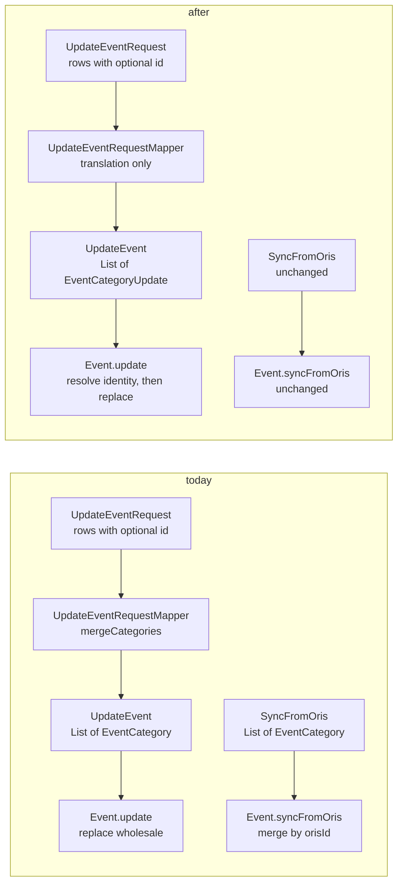

## Why

The rule that gives an event category its identity on a PATCH — a row with an `id` must reference a category already on the event, a row without an `id` is new and gets a generated id, an existing id absent from the request is dropped, and the existing `orisId` survives a rename — lives in `UpdateEventRequestMapper` in the REST adapter. `Event.update` accepts whatever list it is handed and replaces its categories wholesale.

The aggregate already owns the twin rule for ORIS (`Event.syncFromOris` merges by `orisId`), so one concept has two homes. Worse, the REST-side rule is written nowhere in the specs: it exists only in a mapper javadoc, the optional `id` in `UpdateEventCategoryRequest`, and three tests in `EventControllerTest`.

## What Changes

- **`UpdateEvent` carries intent, not resolved values.** The component `categories` becomes `categoryChanges: List<EventCategoryUpdate>`, where the new domain record `EventCategoryUpdate(EventCategoryId id, String name, Money fee)` means "this row" when `id` is null and "that existing category, renamed and repriced" when it is not.
- **`Event.update` resolves the identity.** A change with an id must match a current category (else `UnknownEventCategoryException`), a change without one gets a generated id, a current id absent from the changes is dropped, and a matched category keeps its `orisId`. The resolved list still runs through the existing `validateCategories` (unique name, unique non-null `orisId`).
- **`UpdateEvent.from(event)` yields id-bearing changes** built from the current categories, and copies the list instead of sharing the aggregate's mutable field.
- **`UpdateEventRequestMapper` becomes pure wire translation** — PATCH three-state overlay plus request rows → `EventCategoryUpdate`; `mergeCategories` is deleted.
- **`UnknownEventCategoryException` moves** from `events.infrastructure.restapi` to `com.klabis.events` and becomes public. Its simple name is unchanged, so the error type `/errors/unknown-event-category` and `problem.yaml` stay as they are.
- **Tests move with the rule.** The three id-semantics tests in `EventControllerTest` keep asserting request → command mapping; the resolution cases (existing id kept with its `orisId`, new id generated, missing id dropped, unknown id rejected) move to `EventTest`.

**Deliberately out of scope**, decided while shaping this change:

- **SI-policy composition stays at the boundary.** `overlaySiPolicy` is PATCH three-state semantics plus joining two wire fields into one value object; the domain rule (`rentalAllowed` is false when SI is not used) already lives in `SiPolicy`. Moving the overlay inward would put `present/absent` knowledge into the domain.
- **`getEvent(id, mayViewDraft)` keeps its boolean.** It is caller intent, not a security decision: the sync adapters and describers call it with `true` while no user is authenticated, so an evaluator inside the application service would hide drafts from them.
- **`EventController`'s filter and sort policy is untouched.** Moving it into a service would move complexity without concentrating it.

## No Behavior Change Justification

**Specs reviewed:**
- `openspec/specs/event-categories/spec.md` — unaffected: "Event Categories" requires a stable identity across renames and unique names; both are produced by the same resolution, now evaluated inside the aggregate. The scenarios *Event updated with categories*, *Renaming a category keeps existing registrations attached*, *Category name must be unique within an event* and *Removing a category that has registrations* keep their outcomes.
- `openspec/specs/events/spec.md` — unaffected: "Update Event" names categories as an editable field and defines no id semantics; the "SI Policy Of An Event" requirement is untouched.
- `openspec/specs/event-registrations/spec.md` — unaffected: "Registration Keeps Its Category Across Renames" requires the local id to survive a rename, which is exactly what the resolution preserves.

**Why no spec update is needed:** the request rows, the generated and preserved ids, the error types and the response bodies are identical. Only the place where the identity rule is evaluated changes. The one observable nuance — which error wins when a PATCH targets a finished event *and* names a foreign category id — is preserved deliberately by resolving the changes before the status check, matching today's order (the mapper ran before the service).

## Impact

**Affected code (backend, `events` module):**
- `domain/Event.java` — `UpdateEvent.categories` → `categoryChanges`, `from(Event)` builds changes, `update` resolves them; a new private resolution step.
- `EventCategoryUpdate` — new record next to `EventCategory`.
- `UnknownEventCategoryException` — moves package, becomes public.
- `infrastructure/restapi/UpdateEventRequestMapper.java` — `mergeCategories` deleted; rows become `EventCategoryUpdate`.
- Tests: `EventTest` gains the resolution cases; `EventControllerTest` keeps the mapping assertions; `EventJdbcRepositoryTest` and the ORIS scenario tests adjust their `UpdateEvent` construction.

**APIs:** none — same OpenAPI schema, same status codes, same error types.
**Data:** none.
**Frontend:** none.
