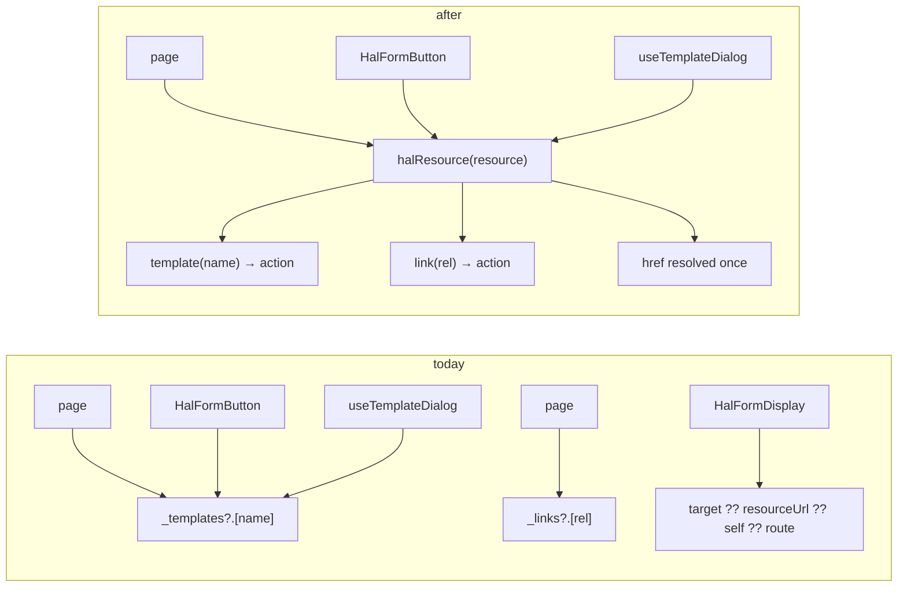

## Why

The frontend answers "which actions does this resource offer?" in three different ways. `useTemplateDialog` knows a template only by key lookup (`resource?._templates?.[name]`, `useTemplateDialog.tsx:51-62`), `HalFormButton` repeats the same check independently (`HalFormButton.tsx:106`), and pages read `_templates` / `_links` directly — 139 raw `_templates` occurrences and 69 `_links?.` occurrences outside tests. On top of that, every one of the 27 dialog call sites restates the texts and navigation that belong to the action itself (success message, dialog title, `navigateOnSuccess`), and the submit URL is assembled in two places (`HalFormDisplay.tsx:100,110` and `templateTarget`).

The result is that the same HAL fact is resolved in several places, each with its own fallbacks, and `templateTarget`, `toHref` and `asLinkArray` have no tests at all.

## What Changes

- **One module, `src/api/halResource.ts`**, a pure factory with two methods — no catalogue, no register of "which resource has which links":
  - `halResource(resource).template(name)` returns `{name, template, href, label, dialogTitle, successMessage}` or `undefined` when the resource carries no such template.
  - `halResource(resource).link(rel)` returns `{rel, link, href, label}` or `undefined`; for an array rel it returns the first non-`templated` link.
  - `href` for a template is `template.target ?? selfHref(resource)`; for a link it is `link.href`.
- **Texts come from naming convention, with fallbacks that never break the UI**: `label = getTemplateLabel(name) ?? template.title ?? name`, `dialogTitle = getDialogTitleLabel(name) ?? label`, `successMessage` keeps today's rule (`template.title ? "<title> — úspěšně uloženo" : labels.ui.savedSuccessfully`), and links read a new `getLinkLabel(rel)` over the existing `labels.links` map with `link.title ?? rel` as fallback.
- **`useTemplateDialog` takes the resolved action** — `open(action, overrides)` — instead of `(resource, name)`; dialog mechanics, portal, success/error handling and per-open overrides are unchanged. `size`, icons and layout stay at the call site.
- **`HalFormButton` and `HalFormDisplay` follow**: the button resolves through `halResource`, the form receives the action's `href` instead of rebuilding `target ?? resourceUrl ?? self ?? route`.
- **`getResourceLink` delegates to `halResource().link()`**, so `templated` filtering has one implementation.
- **Eliminated duplication**: `templateTarget` is deleted (the module owns it) and `toHref` / `asLinkArray` gain the tests they never had.
- **Phase 1** covers the module, the dialog/button/form pipeline, all 27 dialog call sites and `getResourceLink`. **Phase 2** replaces the hand-written `_templates` / `_links` checks in the six row-action columns (`MembersPage`, `EventsPage`, `EventTypesPage`, `CategoryPresetsPage`, `FinancesPage`, `EventDetailPage`); each table keeps its own rendering.

## No Behavior Change Justification

**Specs reviewed:**
- `openspec/specs/non-functional-requirements/spec.md` — unaffected: it constrains what the **server** puts into `_links` and `_templates` (e.g. "Event summary includes registration affordance when open", pagination links). This change only reads those responses; no request, response or link/template changes.
- `openspec/specs/application-navigation/spec.md` — unaffected: navigation affordances and their documented gaps are about what the backend and the main menu offer; the change does not add or hide any destination.
- `openspec/specs/events/spec.md`, `event-registrations/spec.md`, `event-categories/spec.md`, `event-types/spec.md`, `category-presets/spec.md` — unaffected: every action that appears today still appears, with the same label, in the same place; only the code resolving it changes.
- `openspec/specs/members/spec.md`, `member-accounts/spec.md`, `membership-fees/spec.md`, `legal-guardians/spec.md`, `user-groups/spec.md`, `data-synchronization/spec.md` — unaffected: the same affordances are rendered from the same HAL responses.

**Why no spec update is needed:**

No endpoint, payload, authority or action set changes. The SPA consumes exactly the links and templates the server already sends and renders the same buttons with the same Czech texts; the only guarantee this change adds is that a missing translation falls back instead of showing nothing. Because displayed text is user-visible, the migration tasks require each migrated call site to produce the identical label/dialog title/toast it produced before — the module reproduces the current fallback rules verbatim rather than inventing new wording.

## Impact

**Affected code (frontend):**
- New `src/api/halResource.ts` (`halResource`, `HalTemplateAction`, `HalLinkAction`).
- `src/components/HalNavigator2/useTemplateDialog.tsx` — `open(action, overrides)`; template lookup leaves the hook.
- `src/components/HalNavigator2/HalFormButton.tsx`, `HalFormDisplay.tsx` — resolve through the module; the form takes a resolved `href`.
- `src/contexts/HalRouteContext.tsx` — `getResourceLink` delegates to `halResource().link()`.
- `src/api/hateoas.ts` — `templateTarget` deleted; `toHref` / `asLinkArray` keep their exports and gain tests.
- `src/localization/labels.ts` — `getLinkLabel(rel)` and any `labels.links` entries needed so labels stay identical.
- Phase 1 dialog call sites (13 files): `GroupDetailPage`, `TrainingGroupDetailPage`, `RulesTable`, `CampaignDetail`, `MemberDetailPage`, `MembersPage`, `EventsPage`, `EventTypesPage`, `CategoryPresetsPage`, `MembershipFeeGroupDetailPage`, `MembershipFeeTierDetailPage`, `LegalGuardiansSection`, `HalFormButton`.
- Phase 2 row actions: `MembersPage`, `EventsPage`, `EventTypesPage`, `CategoryPresetsPage`, `FinancesPage`, `EventDetailPage`.
- Tests: new module test is the interface's test surface; `useTemplateDialog`, `HalFormButton`, `HalFormDisplay` tests follow the new signature; page tests shrink to "the action appears when HAL offers it".

**Excluded:** `HalLinksSection` / `GenericHalPage` collection navigation, a shared row-action renderer, and any change to query keys or cache invalidation.

**APIs:** none. **Backend:** none. **Build/dev workflow:** unchanged.
