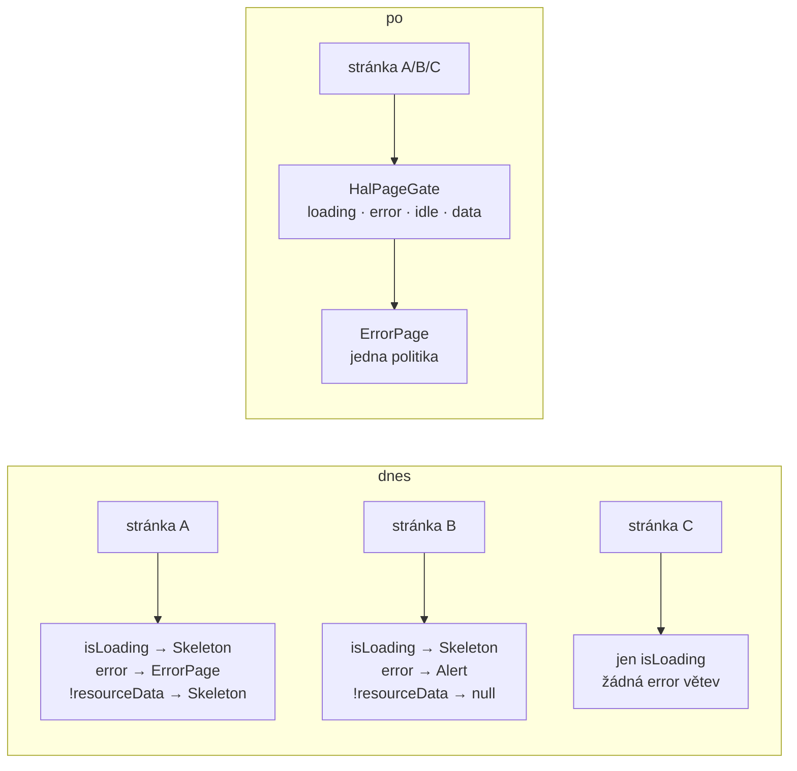

## Why

Every page that owns the HAL resource of its route repeats the same three branches — loading, error, and "no resource yet" — and the error branch is written two incompatible ways: a full `ErrorPage` (404 → `NotFoundPage`, 401/403 → `ForbiddenPage`) on six pages, an inline `<Alert severity="error">` on the rest. On 21 pages that is ~60 lines of near-identical gating, and `queryState`'s `idle` value is unreachable, so "the query has not started yet" is indistinguishable from "the resource is missing".

## What Changes

- **New module `src/pages/HalPageGate.tsx`**: a render-prop component with one optional `loading` slot. It renders the loading view (default `<Skeleton/>`), one error policy (`ErrorPage`), nothing while the query is idle, and otherwise calls its child with the typed resource as the only argument.
- **One error policy**: `ErrorPage` for every gated page. Inline `ErrorDisplay` inside tables, forms and sub-resource sections stays — a failing section is not a failing page.
- **Missing data without an error is loading**, not an empty page; a 404 arrives as `error.status === 404`.
- **`queryState` becomes correct**: `HalRouteProvider` derives `idle` when it does not fetch (auth not ready, `/login`), and the gate renders `null` in that state. The field gains its first consumer instead of being deleted.
- **21 pages adopt the gate**: the 17 that already gate, plus `MembersPage`, `EventsPage`, `NotificationSettingsPage` and `MemberAccountManagePage`, which today handle only loading and would otherwise show a broken page on a failed route.
- **`useHalPageData` stays and gains `queryState`**: it is the boundary the page tests mock, so the gate reads the route state through it. Components (`RulesTable`, `CampaignDetail`, `HalFormsSection`, `HalEmbeddedTable`, `TransactionsTable`, …) keep using it for data and links.
- **`pages/finances/FinancesPage.tsx` holds no page**: its `BalanceCard`, `TransactionsTable` and `TransactionReverseRequest` move to `components/finance/` and the file is deleted.
- **Tests concentrate**: the gate's four states are tested once in the module; page tests keep their happy path and drop the duplicated state assertions.

## No Behavior Change Justification

**Specs reviewed:**
- `openspec/specs/application-navigation/spec.md` — unaffected: it specifies menu composition, navigation after submissions and desktop/mobile availability; it does not name an error container.
- `openspec/specs/non-functional-requirements/spec.md` — unaffected: *"Error Messages Are Shown in Czech"* and *"Error Messages Refer to Things by Their Names"* still hold — `ErrorPage` renders `describeError(...)` like the inline alert did. The spec constrains the text, not where it is shown.
- `openspec/specs/members/spec.md`, `events/spec.md`, `membership-fees/spec.md`, `user-groups/spec.md`, `legal-guardians/spec.md`, `data-synchronization/spec.md` — unaffected: page content, links, affordances and requests are untouched; only which component renders the loading and error states changes.

**Why no spec update is needed:** the change moves a repeated render decision behind one module and fixes an unreachable state value. Requests, responses, rendered data, links, affordances and permissions stay identical. No scenario in any spec describes how a failed route is presented.

**Deliberate visible deviations** (recorded, not spec-relevant): a 403/404 on `MembershipFeesAdminPage`, `TrainingGroupsPage`, `GroupsPage`, `LegalGuardianGroupsPage` and `LegalGuardianDetailPage` now shows `ForbiddenPage`/`NotFoundPage` instead of an inline alert, and the four newly gated pages show a page-level error where they previously showed a partially rendered page. Both keep the same Czech message and the same authorization outcome.

## Impact

**Affected code (frontend only):**
- New `src/pages/HalPageGate.tsx` + its test.
- `src/contexts/HalRouteContext.tsx`: `queryState` derivation (`idle` when `!shouldFetch`); `src/hooks/useHalPageData.ts`: exposes `queryState` alongside the existing fields.
- 21 pages under `src/pages/` (calendar, events, finances, groups, legal-guardians, legal-guardian-groups, members, membership-fees, notifications, sync, training-groups, `GenericHalPage`).
- `src/components/finance/`: gains `BalanceCard`, `TransactionsTable`, `TransactionReverseRequest`; `src/pages/finances/FinancesPage.tsx` and its test are deleted; `MemberAccountManagePage` and `ReverseConfirmModal` update their imports.
- Tests: new gate test; page tests lose duplicated state assertions.

**APIs:** none. **Backend:** none. **Specs:** none. **Build/dev workflow:** unchanged.
