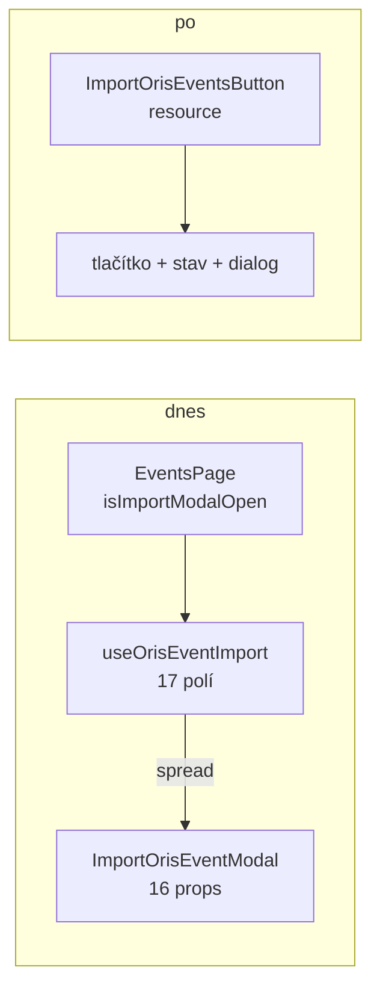

## Why

The ORIS import flow is one concept split across three places: a 17-field hook, a 16-prop modal that mirrors it field for field, and the open/close state in `EventsPage`. Every field the flow gains has to be added in all three, and the page also carries the rule that the batch template wins over the single-event one.

## What Changes

- **One module, `components/events/ImportOrisEventsButton.tsx`**, with the interface `{resource: HalResponse}`. It renders the trigger button, owns the open state, fetches the ORIS feed, enforces the selection limit and shows the per-event result — all of it implementation.
- **The module derives the import template itself** (`importEventsBatch` first, `importEvent` second, via `halResource`) and renders nothing when neither is present. `EventsPage` stops naming templates and drops `isImportModalOpen`.
- **The `onImported` callback is dropped.** Every successful mutation already invalidates the `['authorized']` prefix, so the events list refreshes on its own; a test pins that the list is refetched after a batch import without any callback.
- **`hooks/useOrisEventImport.ts` and its test are deleted.** The logic lives in the module's own file as a non-exported function, and the dialog markup becomes a non-exported collaborator of the same file, so no props are relayed between them.
- **Tests move to the module's interface**: the hook test and the modal test merge into one `ImportOrisEventsButton.test.tsx`; `EventsPage.test.tsx` stops mocking child components and checks the real module through the data boundary it already mocks.

No REST call, request body, template name, label, limit, or rendered state changes. The change is `spec-free`.

## No Behavior Change Justification

**Specs reviewed:**

- `openspec/specs/events/spec.md` — *ORIS Import Includes Registration Deadlines*, *ORIS Import Tolerates Missing Location* and *Multi-Event ORIS Import* describe what the import does (deadline mapping, tolerance of a missing location, batch selection with a fixed maximum, per-event result, already-imported events excluded). All of it is produced by the backend and rendered by the dialog unchanged; the batch template still wins, the limit still comes from the template's `orisIds.max`, and the result screen is the same.
- `openspec/specs/non-functional-requirements/spec.md` — unaffected: no response format, pagination or link changes.
- `openspec/specs/oris-club-key/spec.md` — unaffected; the ORIS feed endpoint stays as it is.

**Why no spec update is needed:** the change moves fetch-and-render logic for one dialog behind one module. No requirement names a hook or a component; the button appears exactly when the server sends an import template, and the dialog behaves identically. The one internal difference — a reopened dialog clears the previous result as before, now from the open handler instead of an effect — is not observable except that it is still cleared.

## Impact

**Affected code (frontend):**

- New `src/components/events/ImportOrisEventsButton.tsx` (button, state/logic, dialog).
- Deleted `src/hooks/useOrisEventImport.ts`, `src/hooks/useOrisEventImport.test.ts`, `src/components/events/ImportOrisEventModal.tsx`, `src/components/events/ImportOrisEventModal.test.tsx`.
- `src/pages/events/EventsPage.tsx` — drops `isImportModalOpen`, the three template variables and the button; renders the module once.
- `src/pages/events/EventsPage.test.tsx` — drops the child-component mocks, keeps the `useAuthorizedFetch` / `authorizedFetch` boundary mocks.

**Excluded:** the hardcoded `/api/oris/events` feed URL (not a HAL link today), and `BulkSyncOrisModal`, which is a different flow.

**APIs:** none. **Backend:** none. **Build/dev workflow:** unchanged.
