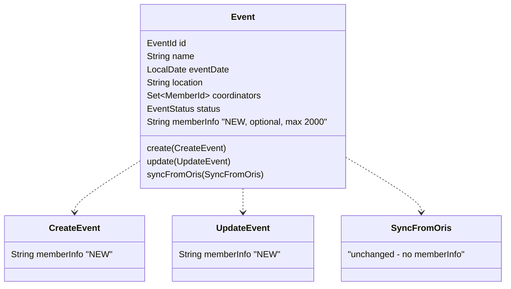
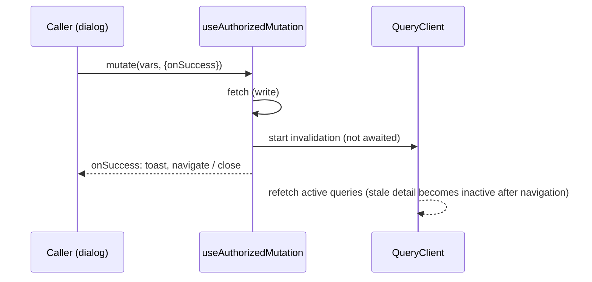

# Design

## Context

See proposal.md for the motivation. Current state that shapes the approach:

- **Event editing** goes through the existing `updateEvent` PATCH. Every property is a `JsonNullable`, and `UpdateEventRequestMapper` overlays it on a baseline built from the event (`PatchOverlay`). Coordinators already hold `EVENTS_EDIT` over their events (`EventCoordinatorRelationshipSource`), so a new editable field needs no authorization work.
- **ORIS synchronisation** only touches what it names. `Event.syncFromOris` assigns an explicit list of fields, and `OrisEventProjection` (the compared shape) lists only ORIS-owned fields. A new Klabis-only field is therefore invisible to synchronisation by construction.
- **Synchronisation page:** `SyncOverviewPage` is gated on `/sync/attempts`. The "Vyžaduje pozornost" tab exists only when the page resource carries `recordsNeedingAttention`. The tab is selected by `?tab=attention`, and no parameter means attempts.
- **Club key:** `/api/oris/club-key` (profile `oris`, `SYNC:MANAGE`) returns the key state with the `setClubKey` and `clearClubKey` templates. It is reachable only through the root rel `orisClubKey`, which `useRootNavigation` turns into a menu item like every other root link.
- **Mutations:** `useAuthorizedMutation` awaits `invalidateAuthorizedQueries` inside `mutationFn` (decision 1 of the archived `deepen-mutation-cache-invalidation`). The per-call callbacks therefore run only after the active queries are refetched. When the refetch shows the viewed resource is gone (404/403), `HalPageGate` renders `ErrorPage`, the dialog unmounts, and TanStack Query skips the per-call callbacks of an unmounted observer.
- **Registration dialog:** `EventRegistrationDialog` renders `categoryId` whenever the template has the property. `CategoryField` always shows the `*` marker. For an event without categories the inline options are an empty list.

## Goals / Non-Goals

**Goals:**
- One generic fix for lost success handling, not a per-page workaround.
- No new backend module dependency for the club key tab.

**Non-Goals:**
- Notifications when "Informace pro členy" changes, rich text or Markdown, showing the text in the events list.
- Making the club key or other settings available outside the synchronisation page.
- Reworking which page each "removed resource" action returns to beyond the free group actions named in the spec. Other pages keep their existing `onSubmitSuccess` navigation and only gain the reliability fix.

## Decisions

### D1: "Informace pro členy" is a plain optional text on the event (domain change)

The event gets an optional `memberInfo` text, limited to 2000 characters. It is set by `create` and by `update` (both commands carry it) and is never touched by `createFromOris` or `syncFromOris`. Like the other fields of `update`, it can only be changed while the event is DRAFT or ACTIVE. Blank input is stored as no information, so a cleared field and an empty one look the same on the detail page.

- *Alternative:* a value object with its own validation. Rejected: a length limit and blank-to-absent are all it needs, and the Bean Validation `@Size` on the command plus the spec's `maxLength` already express the limit (KISS).
- *Alternative:* store it on the calendar item or as a separate "announcement" aggregate. Rejected: it belongs to the event and shares the event's edit rights and lifecycle.

| Element | Change | Description |
|---|---|---|
| `Event.memberInfo` | added | Optional practical information for club members. Klabis-owned. Blank means absent. |
| `CreateEvent.memberInfo` | added | Optional on creation (EVENTS:MANAGE). |
| `UpdateEvent.memberInfo` | added | Part of the PATCH baseline (`UpdateEvent.from(event)`). Overlaid like `location`, so absent keeps it, null clears it and a value sets it. |
| `SyncFromOris`, `OrisEventProjection` | unchanged | Not listing the field is what keeps synchronisation away from it. A test pins this. |
| Persistence | changed | `events.events.member_info VARCHAR(2000) NULL` in V001, mapped by `EventMemento`. |

### D2: Synchronisation tabs are driven by available links; the club key stays a root link

Tabs and URL values: "Vyžaduje pozornost" uses no `tab` parameter and is the default, "Všechny pokusy" uses `tab=attempts`, and "Nastavení synchronizace" uses `tab=settings`. A tab is rendered only when its source exists:

- attention: `recordsNeedingAttention` on the page resource;
- attempts: always, since it is the page resource;
- settings: the root rel `orisClubKey`.

When only one tab is available the tab bar is hidden and that tab's content is shown, which keeps today's behaviour when `recordsNeedingAttention` is missing. The existing attempts filter parameters (`outcome`, …) stay as they are and live beside `tab=attempts`. The old `tab=attention` value is no longer needed: it is the default now. An unknown `tab` value falls back to the default.

The club key link stays on the API root. `useRootNavigation` gets a small set of root rels that are not menu destinations (`orisClubKey`) and skips them. The settings tab reads the link from the same root query, which is already cached by the menu. The "Klíč klubu ORIS" section fetches the club key resource and shows "nastaven" or "nenastaven". It opens `setClubKey` / `clearClubKey` through `halResource(...).template(...)` with `useTemplateDialog` and `navigateOnSuccess: false`, so the user stays on the tab.

- *Alternative:* move the link onto `/sync/attempts`. Rejected: `oris` would have to postprocess `sync`'s internal model types (`SyncAttemptResponse`, `SyncOverviewListing`), which is a new dependency on non-public types. A public extension point in `sync` would be more code for one link.
- *Alternative:* a dedicated settings page and route. Rejected: the user asked for a tab, and a route adds a page gate and a menu question for one section.

### D3: Success handling runs before the refreshed data lands (reverses decision 1 of `deepen-mutation-cache-invalidation`)

`useAuthorizedMutation` still starts the global invalidation exactly once per successful mutation, inside the hook, but **no longer awaits it** before resolving. The per-call `onSuccess` (toast, `onSubmitSuccess`, navigation, closing the dialog) therefore runs while the refetch is in flight. A network round trip cannot complete within the microtasks that separate `mutationFn` from the callbacks, so the screen still shows the old resource with the dialog mounted. Navigation away happens before the refetch can find the resource gone, and a detail query that becomes inactive by navigating away is only marked stale.

- *Alternative:* wrap `mutate` so the hook calls the caller's `onSuccess` first and then invalidates from inside the per-call callback. Rejected: TanStack skips per-call callbacks once the component unmounts, so a dialog closed during the request would silently skip the invalidation as well.
- *Alternative:* `mutateAsync` in `HalFormDisplay`. Rejected: the callback survives, but the error page renders first and navigation then runs from an unmounted component.
- *Alternative:* keep cached data in `HalPageGate` when a refetch fails. Rejected: it hides real errors, changes the page gate policy from #433, and does not help the registration dialog, which unmounts because its template disappears.

Consequences: `isPending` ends when the write succeeds, not after the refetch. After an edit the modal closes and the page updates one round trip later. The seam tests in `useAuthorizedFetch.test.ts` change from "refetch before onSuccess / pending during refetch" to "onSuccess before refetched data / refetch still triggered once / no refetch on failure / a failing refetch does not fail the mutation". `GroupDetailPage` already navigates in `onSubmitSuccess`. It only needs the leave and self-removal flows checked against the spec scenarios.

### D4: Registration dialog hides the category field when the event offers none

`EventRegistrationDialog` renders the category field only when the template has `categoryId` **and** its options are not empty. When the field is hidden, `categoryId` is dropped from the payload in the same place that already strips hidden SI and shared-service fields, so an empty string is never sent. `CategoryField` shows the `*` marker from `prop.required`, not unconditionally. The backend already accepts a registration without a category for such an event (`Event.resolveCategoryId`), so it does not change.

- *Alternative:* the backend omits `categoryId` from the template when the event has no categories. Rejected: the affordance is built from the generated API method and shared by several call sites, and the dialog already makes the same visibility decisions for SI and shared services.

## REST API changes

Only `docs/openapi/spec/events.yaml`. The frontend types are regenerated from it.

| Schema | Property | Definition |
|---|---|---|
| `EventDto` (event detail) | `memberInfo` | `type: [string, 'null']`. Readable by everyone who may see the event. Omitted or null when absent. |
| `CreateEventRequest` | `memberInfo` | `type: [string, 'null']`, `maxLength: 2000`, `x-hal-input-type: textarea` |
| `UpdateEventRequest` | `memberInfo` | `type: [string, 'null']`, `maxLength: 2000`, `x-hal-input-type: textarea`. PATCH: absent keeps it, null clears it. No `x-klabis-authority`, so everyone with `updateEvent` may change it. |

Endpoints, HAL links and HAL+FORMS affordance names are unchanged (`createEvent`, `updateEvent`). The new property simply appears in their templates. `orisClubKey`, `setClubKey` and `clearClubKey` are unchanged.

## Glossary

| Term | Meaning |
|---|---|
| Informace pro členy (member info) | Optional free text on an event, written by the event leader or an event manager, with practical details for club members (meeting time and place, what to bring). Klabis-owned and never synchronised with ORIS. |
| Nastavení synchronizace | Third tab of the synchronisation overview, holding synchronisation settings. Today it contains only the ORIS club key. |

## Risks / Trade-offs

- [Buttons re-enable one round trip before the page shows fresh data] → Intended trade-off of D3. After the dialog closes, the page refreshes on its own and the load is negligible.
- [Some caller relied on fresh data inside `onSuccess`] → The archived change removed every caller-side refetch, and no caller reads query data in `onSuccess`. The implementation task greps the 13 callers to confirm before changing the hook.
- [A form edit and the refetch could race on slow networks] → `invalidateQueries` cancels and restarts an in-flight refetch (`cancelRefetch`), so the last write wins on screen.
- [Bookmarks with `?tab=attention`] → They fall back to the default tab, which is attention now. Same result.
- [Two E2E unregister scenarios] → They are expected to pass after D3 and are part of verification. If they still fail, the cause is elsewhere and gets reported, not patched over.
- [The 2000 character limit is a guess] → It is generous for meeting details and easy to raise later. It is in the spec, so changing it later is a spec change.

## Migration Plan

No data migration: the column is added in V001 per the backend rule ("update the best fitting script"), there is no production data yet, and H2 resets on start. Rollback means reverting the commit.
