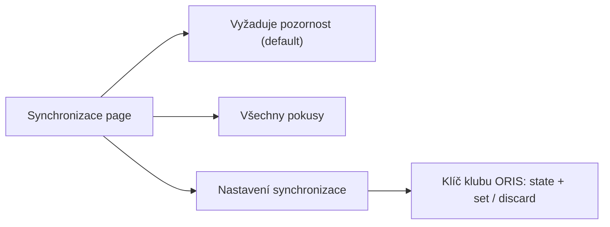

# Proposal

## Why

Four reported issues share one release:

- **#75** — the event leader has no place in Klabis to tell club members practical details (when and where to meet, what to bring). Today this goes through other channels.
- **#367** — the ORIS club key setting shows up in the main menu under the raw key `orisClubKey`. It is an administrative setting of the synchronisation, not a destination of its own.
- **#417** — after deleting a group or leaving it, the user stays on the detail URL and sees a 404/403 error instead of returning to the group list. The same root cause (the screen refreshes before the success handling runs, and the vanished resource tears the dialog down) silently drops the success handling of every action that removes what the user is looking at — including unregistering from an event, which breaks two E2E scenarios since #402.
- **#365** — registering for an event without categories shows a mandatory "Kategorie" field with no options, so the registration cannot be submitted. The spec already says the field must not be shown.

## What Changes

- **Event information for members (#75):** an event gets an optional free-text field "Informace pro členy" (plain multi-line text). The event leader (coordinator) or a user with EVENTS:MANAGE enters it when creating or editing a DRAFT/ACTIVE event; everyone who can see the event reads it on the event detail page. It is a Klabis-only field: ORIS synchronisation neither overwrites it nor reports it as a difference. No notification is sent when it changes.
- **Synchronisation page reorganised (#367):** the "Synchronizace" page gets three tabs in this order — "Vyžaduje pozornost" (default), "Všechny pokusy", "Nastavení synchronizace". The settings tab holds a single section "Klíč klubu ORIS" with the key state and the set/discard actions. The club key is no longer a main menu entry.
- **Removing the viewed resource returns to its list (#417):** when an action removes the resource the user is viewing, or the user's access to it (delete group, leave group, remove oneself as owner), the user is taken to the list the resource belongs to, with the success message. The success handling of every form action (toast, closing the dialog, navigation) runs before the screen is refreshed, so it is never lost when the refresh finds the resource gone.
- **Registration without categories (#365):** fix the registration dialog to match the existing spec — no category field for an event without categories, and no category sent.

## Capabilities

### New Capabilities

_None._

### Modified Capabilities

- `events`: new requirement for the "Informace pro členy" text — who edits it, where it is shown, ORIS synchronisation leaves it alone.
- `data-synchronization`: the overview is organised into three tabs with "Vyžaduje pozornost" first and shown by default; the attempts list moves to the second tab.
- `oris-club-key`: the club key is managed in the "Nastavení synchronizace" tab of the synchronisation overview and is not offered as a main menu entry.
- `application-navigation`: a submission that removes the viewed resource (or the user's access to it) navigates to the resource's list instead of refreshing the current page.

`event-registrations` needs no delta — #365 brings the implementation in line with the existing scenario "Member registers for an event without categories".

## Impact

- **Backend (events module):** event aggregate, persistence (V001 schema, memento), create/update commands and request mappers, event detail DTO, OpenAPI `events.yaml` (`EventDto`, `CreateEventRequest`, `UpdateEventRequest`). ORIS sync adapter must not touch the field.
- **Backend (other modules):** none — the `orisClubKey` root link stays as is.
- **Frontend:** `useAuthorizedMutation` ordering (`hooks/useAuthorizedFetch.ts`) and its seam test; `useRootNavigation` (exclude `orisClubKey` from the menu); `SyncOverviewPage` tabs and a new club key settings section; `EventRegistrationDialog` / `registrationFieldsFactory` category handling; event detail page and event form; `labels.ts`.
- **Reverses** decision 1 of the archived `deepen-mutation-cache-invalidation` change (refetch before per-call `onSuccess`).
- **Out of scope:** #418 (overlapping suspension dialogs) moves to the `resolve-group-ownership-on-suspension` proposal (#398).
