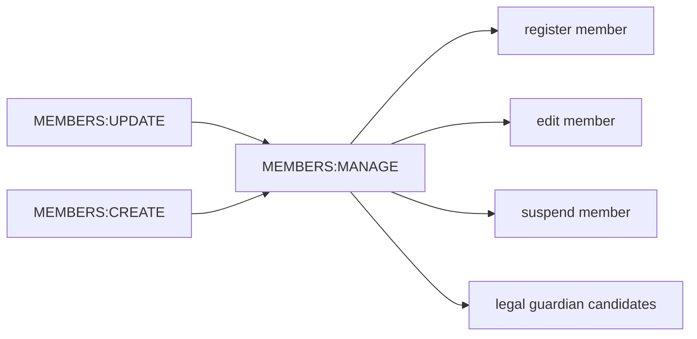

# Proposal

## Why

The members, legal-guardians and non-functional-requirements specs name two permissions that do not exist: `MEMBERS:UPDATE` and `MEMBERS:CREATE`. The operations they describe (registering, editing and suspending a member, listing legal guardian candidates) actually require `MEMBERS:MANAGE`. Readers of the specs get a wrong picture of who may do what, and every new proposal touching these requirements has to correct them again (found while preparing `resolve-group-ownership-on-suspension`, #398, which is implemented after this change).

## What Changes

- Every `MEMBERS:UPDATE` and `MEMBERS:CREATE` in the specs becomes `MEMBERS:MANAGE`; "MEMBERS:CREATE or MEMBERS:MANAGE" becomes "MEMBERS:MANAGE". No behavior changes - the specs are brought in line with what the application already does.
- Outside the specs: the `KLABIS_OAUTH2_CLIENT_SCOPES` example in `backend/.env.example` lists permission names instead of OAuth scopes and is replaced by the real default scopes; the test fixture `test-member-lifecycle-setup.sql` stores non-existent permissions and gets valid ones.

## Capabilities

### New Capabilities

None.

### Modified Capabilities

- `members`: Member Registration Flow, Authorization for Member Operations, Member Detail, Member Update, Membership Suspension - permission name corrected to MEMBERS:MANAGE.
- `legal-guardians`: Legal Guardian Candidates - permission name corrected to MEMBERS:MANAGE.
- `non-functional-requirements`: HATEOAS Link Structure - permission name corrected to MEMBERS:MANAGE.

## Impact

- Specs only for behavior; no API, backend or frontend code changes.
- `backend/.env.example` (comment only), `backend/src/test/resources/sql/test-member-lifecycle-setup.sql` (test data).
- Out of scope: `MEMBERS_SECTION_PRD.md` (historical PRD) and `openspec/openspec-critique.html` (historical review) keep the old names.
- `resolve-group-ownership-on-suspension` (#398) modifies Membership Suspension too; it is rebased onto this change and no longer carries the correction itself.

