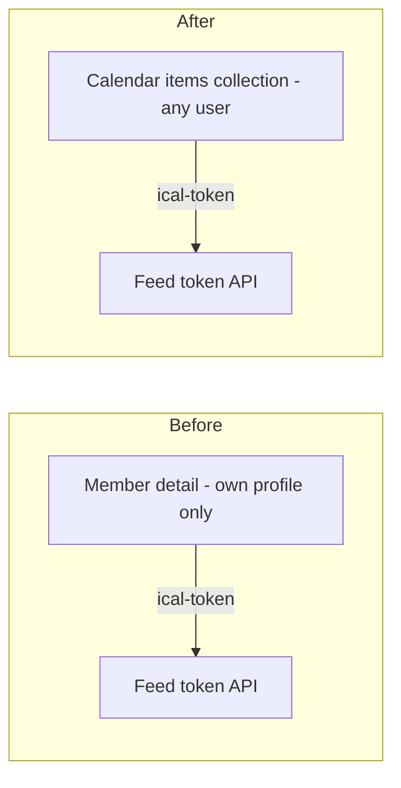

# Proposal

## Why

The calendar feed (iCalendar subscription URL) is managed in a "Kalendářový feed" section of the member's own profile, although it is a calendar concern and the token belongs to the user, not to the member profile. Users looking for the subscription look at the calendar, not at their profile, and users without a member profile cannot reach the feature at all.

## What Changes

- The calendar page header gets a "Kalendářový feed" button next to the "Můj rozvrh" filter, opening a modal with everything the profile section offers today: create the feed, masked URL and generation time, one-time reveal of the full URL with copy, regeneration with confirmation, and subscription help.
- The "Kalendářový feed" section is removed from the member detail page.
- The `ical-token` link (with its generate/regenerate affordance) moves from the member detail resource to the calendar items collection and is offered to every authenticated user; the button is shown only when the link is present.
- The regeneration confirmation is shown inline in the modal instead of a nested modal.

## Capabilities

### New Capabilities

### Modified Capabilities

- `calendar-items`: the "Personal Calendar Feed" requirement — feed management is reached from the calendar page instead of the user's profile (scenarios for first-time generation and for the "last set" label); the feed management entry point is part of the calendar header.

## Impact

- Backend: member detail gets a `changePassword` affordance on the caller's own profile (replaces the implicit own-profile signal). Calendar module: `IcalTokenMemberDetailLinkProcessor` removed; `ical-token` link added in the calendar items collection postprocessor.
- API spec: `docs/openapi/spec/members.yaml` (drop `ical-token` link), `docs/openapi/spec/calendar.yaml` (add `ical-token` to `listCalendarItems` links); regenerate bundle and frontend types.
- Frontend: `CalendarFeedSection` moves from `pages/members` to `pages/calendar` and becomes modal content; `MemberDetailPage` and `CalendarPage` (plus their tests) change.
- E2E scenarios touching the profile feed section (if any) need updating.
- No data or token-format change; existing feed URLs keep working.
