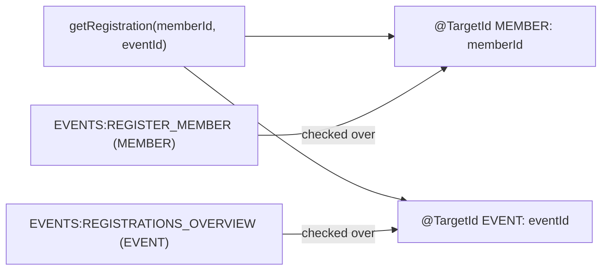
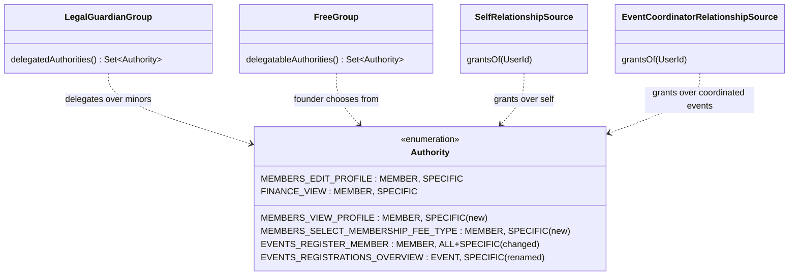

# Design

## Context

The motivation is in `proposal.md` (Why); the required behavior is in the delta specs.

Current state:

- **Rules.** `HasAuthority` lists the authorities, any one of which suffices. `OwnerVisible` adds "or the target is the caller".
  - `TargetId` marks **one** parameter or record component as the target.
  - `InvocationRules` (operations) and `FieldRules` (fields) read these annotations. `AuthorizationEvaluator.isAllowedOver` evaluates them against the request's `AuthorizationSnapshot`.
- **Spec-first.** The annotations are generated from spec extensions:
  - `api.mustache` turns `x-klabis-authority` and `x-klabis-owner-visible` into annotations on the operation.
  - `pathParams.mustache` turns `x-klabis-target-id` into `@TargetId` on a path parameter.
  - `pojo.mustache` turns `x-klabis-target-id`, `x-klabis-owner-visible` and `x-klabis-authority` into annotations on record components.
- **Grants.** Each `Authority` has one `TargetType` and a set of `GrantForm`s (`ALL`, `SPECIFIC`).
  - `RelationshipSource`s contribute grants over specific targets.
  - `AuthorizationSnapshot.fromSources` drops grants whose target type differs from the authority's.
  - No authority has both `ALL` and `SPECIFIC` yet, although the model allows it.
- **Self-grants already in place:**
  - `SelfProfileRelationshipSource` (members) gives `MEMBERS:EDIT_PROFILE` to adult members over themselves.
  - `AccountOwnerRelationshipSource` (finance) gives `FINANCE:VIEW`, introduced by #451.
- **Remaining owner-visible uses:** 9 operations (`events`, `members`, `membershipfees`) and 12 fields of `MemberDetailsResponse`.
  - `getRegistration` cannot be declared at all and is guarded by `RegistrationReadAccess` by hand.
  - `registerForEvent` always acts on the caller through `@ActingMember`.

## Goals / Non-Goals

**Goals:**
- One authorization model. A caller is allowed because they hold an authority, either over everything or over the target. "Being the target" is just one relationship that yields a grant.
- Every rule fits in the spec, `getRegistration` included. No hand-written access check remains for registrations.
- Removing owner-visible changes no behavior except the behavior the delta specs change.

**Non-Goals:**
- No UI for registering a legal guardian's minor. The API allows it; the frontend keeps registering the caller.
- No change to how grants are stored or to the permissions dialog.
- No change to `ActingUser` / `ActingMember` for operations that act on the caller's own data. Free group invitations, for example, stay as they are.

## Glossary

| Term | Meaning |
|---|---|
| **Self-grant** | A grant a user holds over themself because of who they are: an adult member, a member, any user. It is produced by a relationship source like any other relationship. It replaces the owner-visible rule. |
| **Zobrazení údajů člena** (`MEMBERS:VIEW_PROFILE`) | Permission to see a member's sensitive data (birth number, licences, dietary restrictions, ...). It is held only over specific members: every user over themself. |
| **Volba členského příspěvku** (`MEMBERS:SELECT_MEMBERSHIP_FEE_TYPE`) | Permission to choose, change or withdraw a member's membership fee type and to open their fee page. It is held only over specific members: an adult member over themself, and a legal guardian over their minors. |
| **Správa přihlášek člena** (`EVENTS:REGISTER_MEMBER`) | Permission to register a member for events and to view, edit and cancel their registrations. Held over everybody, it is the registrations manager. Held over specific members, it comes from the self-grant (every member) and from legal guardianship. |
| **Přehled přihlášek akce** (`EVENTS:REGISTRATIONS_OVERVIEW`) | Permission to see the full overview of one event's registrations: registration detail with SI card, registration time, ORIS-missing flag and accommodation list. It is held only over specific events, by the event coordinator. Formerly `EVENTS:REGISTRATIONS_READ`. |
| **Target kind** | The `TargetType` of an authority (MEMBER, EVENT, GROUP, NONE). It selects which identified target an authority is checked against. |

## Decisions

### D1: An operation may identify one target per kind; each authority uses the target of its own kind

`InvocationRules` keeps a map from target kind to the parameter that identifies it, instead of a single `TargetParameter`. `isAllowedOver` passes when the caller holds any listed authority either:
- over everything, or
- over the identified target whose kind equals the authority's `TargetType`.

An authority whose kind has no identified target can only pass over everything. Two `@TargetId` parameters of the same kind are a programming error and fail when the rules are built, which is cached per method.

- **Record fields:** a record has one target, as today. Every field case that remains needs only one target.
- **Collection targets:** a record component holding several ids was only meaningful for owner-visible ("any of the owners"). Without owner-visible this branch is removed, and such fields require a grant over everything.
- **Callers outside annotations:** `targetOf` / `targetParameterOf` are used by request-body field security and link building. They take the target kind they need. Request-body field security asks for the kind of the field's authorities.

*Alternative:* make `HasAuthority` repeatable, each occurrence with its own target. Rejected: it duplicates what `TargetType` already says, and the spec extension would need a nested structure.

*Alternative:* keep `getRegistration` hand-written. Rejected: it is the main case the owner rule could not express, and three link producers repeat the same check.

### D2: Owner-visible is replaced by self-grants from one members-module source

`SelfProfileRelationshipSource` is generalized and renamed to `SelfRelationshipSource`. It still costs one query per request: date of birth by member id.

| Caller | Self-grants over own id |
|---|---|
| any user (member or not) | `MEMBERS:VIEW_PROFILE` |
| any user except a minor member | `MEMBERS:EDIT_PROFILE` |
| adult member | `MEMBERS:SELECT_MEMBERSHIP_FEE_TYPE` |
| member (any age) | `EVENTS:REGISTER_MEMBER` |

- A non-member legal guardian's user id is the target of the legal guardian profile operations. With these grants the guardian reads and edits their own profile through the regular permissions.
- The bootstrap `admin` user also gets `VIEW_PROFILE` and `EDIT_PROFILE` over itself. This is harmless: there is no member or guardian record with that id.
- `AccountOwnerRelationshipSource` stays in finance, where it was introduced, because its rule is "has an account".

*Alternative:* a self-grant source per owning module, e.g. membershipfees for the fee choice. Rejected for now: each would query the member's date of birth across a module boundary, and the age rule would be duplicated.

*Alternative:* self-grant `MEMBERS:EDIT_PROFILE` to minors too, instead of a new view permission. Rejected: minors must not edit their profile (members spec, "Minor does not hold the permission over themself").

### D3: Domain changes — authorities and legal guardian delegation

| Element | Change | Description |
|---|---|---|
| `MEMBERS_VIEW_PROFILE` | added | Member-targeted, specific only. Self-granted to every user. Not delegated by any group: a legal guardian already sees everything through `EDIT_PROFILE`. |
| `MEMBERS_SELECT_MEMBERSHIP_FEE_TYPE` | added | Member-targeted, specific only. Self-granted to adult members and delegated by legal guardian groups. |
| `EVENTS_REGISTRATIONS` → `EVENTS_REGISTER_MEMBER` | renamed and changed | Value `EVENTS:REGISTRATIONS` → `EVENTS:REGISTER_MEMBER`. Target kind EVENT → MEMBER; grant forms ALL → ALL + SPECIFIC. A direct grant means "over all members". The name describes the permission on one member, which fits both grant forms. |
| `EVENTS_REGISTRATIONS_READ` → `EVENTS_REGISTRATIONS_OVERVIEW` | renamed | Value `EVENTS:REGISTRATIONS_OVERVIEW`. Specific only, so it is never stored. `EventCoordinatorRelationshipSource` grants it. |
| `LegalGuardianGroup.delegatedAuthorities()` | changed | `{MEMBERS_EDIT_PROFILE, FINANCE_VIEW, MEMBERS_SELECT_MEMBERSHIP_FEE_TYPE, EVENTS_REGISTER_MEMBER}`. |
| `FreeGroup.delegatableAuthorities()` | unchanged | `{MEMBERS_EDIT_PROFILE}`. A free group owner therefore loses fee access, which is intended (membership-fees delta). |
| `SelfProfileRelationshipSource` → `SelfRelationshipSource` | changed | Grants per the D2 table. |

- `EVENTS_REGISTER_MEMBER` becomes the first authority holdable in both forms:
  - `assignableAuthorities()` keeps offering it in the permissions dialog (ALL).
  - `holdableOverTargets()` now includes it, which lets relationship grants through the snapshot filter.
- `AuthorityToDtoConverter` throws for the two new authorities and for `EVENTS_REGISTRATIONS_OVERVIEW`. In `common.yaml`'s `Authority` enum, `EVENTS:REGISTRATIONS` becomes `EVENTS:REGISTER_MEMBER` and the comment is updated.

### D4: Authorization of the affected operations and fields

| Operation / field | Before | After |
|---|---|---|
| `MemberDetailsResponse`, 12 sensitive fields | `[MEMBERS_MANAGE, MEMBERS_EDIT_PROFILE]` + owner | `[MEMBERS_MANAGE, MEMBERS_EDIT_PROFILE, MEMBERS_VIEW_PROFILE]` |
| `getChoice`, `getFeeSummary`, `getFeeHistory` | `[MEMBERS_MANAGE, MEMBERS_EDIT_PROFILE]` + owner | `[MEMBERS_MANAGE, MEMBERS_SELECT_MEMBERSHIP_FEE_TYPE]` |
| `chooseFeeType`, `removeChoice` | `[MEMBERS_EDIT_PROFILE]` + owner | `[MEMBERS_SELECT_MEMBERSHIP_FEE_TYPE]` |
| `getLegalGuardian` | `MEMBERS_MANAGE` + owner | `[MEMBERS_MANAGE, MEMBERS_VIEW_PROFILE]` |
| `updateLegalGuardian` | `MEMBERS_MANAGE` + owner | `[MEMBERS_MANAGE, MEMBERS_EDIT_PROFILE]` |
| `registerForEvent` | caller only (`@ActingMember`) | `EVENTS_REGISTER_MEMBER`, target `memberId` |
| `editRegistration`, `unregisterFromEvent` | `EVENTS_REGISTER_MEMBER` + owner | `EVENTS_REGISTER_MEMBER` |
| `getRegistration` | hand-written `RegistrationReadAccess` | `[EVENTS_REGISTER_MEMBER, EVENTS_REGISTRATIONS_OVERVIEW]`, targets `memberId` (MEMBER) and `eventId` (EVENT) |
| `getRegistration?newRegistration=true` | caller must be the member | same rule as `getRegistration`, plus an inline controller check requiring `EVENTS_REGISTER_MEMBER` over `memberId` (the defaults expose the profile and SI card of a member who need not be registered, so the coordinator overview must not reach them); defaults are taken from the target member's profile |
| accommodation list, `registrationTime`, `missingInOris`, sort by registration time | `[EVENTS_REGISTER_MEMBER, EVENTS_REGISTRATIONS_READ]` over the event | `[EVENTS_REGISTER_MEMBER, EVENTS_REGISTRATIONS_OVERVIEW]` over the event |

- **Updating a legal guardian profile.** Only the administrator and the guardian themself can call `updateLegalGuardian`. Nobody else holds `EDIT_PROFILE` over a non-member guardian's id:
  - free groups contain only members,
  - legal guardian groups delegate over minors, not over guardians,
  - a member's self-grant is over an id that has no guardian record, so it yields not-found.
- **Event-targeted checks after re-targeting.** The last row keeps working: a holder of `EVENTS_REGISTER_MEMBER` over everything passes, and a holder over a member does not, because the target kinds differ. A guardian therefore never sees an event-wide overview, which is the intended behavior.
- **`GuardianListAccess`** (who sees a minor's guardians) has its own "is the caller a minor of the group" check. It becomes `MEMBERS_MANAGE` or `[MEMBERS_EDIT_PROFILE, MEMBERS_VIEW_PROFILE]` over any minor of the group. The minor passes through the self-grant, so the last hand-written self check outside presentation goes away. Behavior is unchanged.
- **Hand-written controller checks** that ask `has(EVENTS_REGISTER_MEMBER)` with no target stay valid, because that call asks about "over everything". The checks are:
  - `getEvent(..., has(EVENTS_REGISTER_MEMBER))` in `getRegistration`,
  - `listRegistrations` sort, which goes through the former `RegistrationReadAccess.canReadRegistrations` and becomes an inline `isAllowed` over the event.

### D5: Register endpoint names the member

`POST /api/events/{eventId}/registrations/{memberId}` replaces `POST /api/events/{eventId}/registrations`:
- the path parameter carries `x-klabis-target-id: MEMBER`, and `@ActingMember` is removed,
- the `Location` header and the affordance links use the path member,
- the event detail and summary affordance (`registerForEvent`) is built with the caller's member id, so a caller without a member profile is not offered it,
- the domain rules are unchanged: sanction blocking, open registration window, SI policy.

*Alternative:* keep the path and add `memberId` to the request body. Rejected: request-body targets are a special case in the evaluator, and the path form makes all four registration operations share one resource and one rule.

### D6: Removing owner-visible

The following go away:
- `OwnerVisible`,
- the `x-klabis-owner-visible` extension (template branches in `api.mustache` and `pojo.mustache`; the `pathParams.mustache` comment),
- `InvocationRules.ownerVisible` and `FieldRules.ownerVisible`,
- the `isAllowed(..., ownerVisible)` parameter, the owner branch of `isAllowedOver`, and `RecordTargets.discoverOwnerTarget` with the collection branch,
- `RegistrationReadAccess`.

`AuthorizationEvaluator.isSelf` stays, because it serves presentation decisions:
- the account link is hidden on your own profile,
- your own account is listed first,
- the change-password link uses `token.isSelf` directly.

Documentation to update:
- `docs/openapi/spec/README.md` (extension table and pairing rules),
- `docs/developerManual/06-security.html`,
- `backend/CLAUDE.md`,
- the field-security references of `backend-patterns` and `klabis-api-spec`,
- `docs/design-decisions.md` (ADR note that owner access is a self-grant).

## API

Only `registerForEvent` changes its shape. Every other affected operation keeps its path, parameters, bodies, link names and affordance names; only the security extensions change (D4).

| | Before | After |
|---|---|---|
| Method / path | `POST /api/events/{eventId}/registrations` | `POST /api/events/{eventId}/registrations/{memberId}` |
| Path parameters | `eventId` | `eventId`, `memberId` (`x-klabis-target-id: MEMBER`) |
| Security | none beyond authentication (acts on the caller) | `x-klabis-authority: EVENTS_REGISTER_MEMBER` |
| Request body | `RegisterEventRequest` | unchanged |
| Response | `201`, `Location` = registration of the caller | `201`, `Location` = registration of `memberId` |
| Affordance | `registerForEvent` on the event `self` link | unchanged name; target URL includes the caller's member id |

Other spec edits:
- `RegEventIdParam` gains `x-klabis-target-id: EVENT`. It is inert for operations whose authorities are not EVENT-kind.
- `getRegistration` gains `x-klabis-authority: [EVENTS_REGISTER_MEMBER, EVENTS_REGISTRATIONS_OVERVIEW]`.
- The comments that explain why no authority is declared are removed.

The frontend reads the template target from HAL, so `EventRegistrationDialog` and `EventsPage` need no change beyond regenerated types.

## Risks / Trade-offs

- **[Behavior change for minors and free group owners]** Both lose access to fee pages. → This is intended and covered by the membership-fees delta. The HAL-driven UI hides the button on its own.
- **[`EVENTS_REGISTER_MEMBER` changes its target kind]**
  - Direct holders, renamed together with the code, keep "over all".
  - Code that relied on its EVENT kind could silently stop matching. Only the event-targeted checks in D4 do, and they still pass for holders over everything.
  - → Tests cover the coordinator, the registrations manager, a guardian and a plain member for every row of D4.
- **[Self-grant source queries per request]** One date-of-birth lookup, as today. → No change in cost.
- **[Multi-target rules mis-declared]** E.g. an EVENT-kind authority on an operation without an EVENT target. → The authority can then pass only over everything, which fails safe. Rule building rejects duplicate kinds.
- **[Frontend calls the old register path]** → The frontend follows the HAL template target. E2E registration scenarios verify the flow.

## Migration Plan

- No data migration. The database is in-memory with no real migrations yet, so the stored value is renamed in `V001` and in the example data, together with the code (backend/CLAUDE.md: do not add new migration scripts).
- The API change to `registerForEvent` is breaking for third-party clients. Klabis has none besides its own frontend, which is deployed together with the backend.
- Rollback is a plain revert. No data written in the new form differs from the old one.
